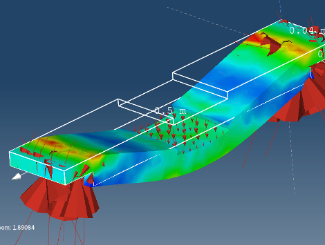

# Vektorfeld erstellen

**Vektorfeld**:

- Hilft, Felder wie Geschwindigkeit, elektrisches und magnetisches Feld, Wärmefluss und Kräfte zu visualisieren.
- Kann auf jeder Modellentität oder interpolierten Fläche wie **Schnitten** und **ISO-Flächen** erstellt werden.

