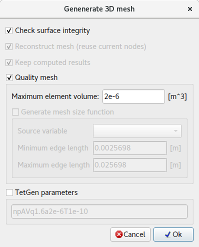

# Tetraedernetz erzeugen

Erzeugt ein Volumennetz (Tetraedernetz).

Ein **Volumennetz** wird für die meisten **Problemtypen** benötigt.

Der 3D-Netzgenerator kann ein Netz nur erzeugen, wenn:
1. das Modell eine geschlossene (wasserdichte) Fläche enthält,
2. sich die Flächenelemente nicht gegenseitig schneiden.

Um mehrere Volumennetze für ein Verbundwerkstoffmodell zu erzeugen, muss eine Trennfläche enthalten sein.

In manchen Fällen kann es notwendig sein, die Standardeinstellungen zu überschreiben und TetGen-Parameter direkt anzugeben.

## Benutzeroberfläche

- **Flächenintegrität prüfen** – nützlich beim Erzeugen eines 3D-Netzes aus einem Flächenmodell. Erkennt Fehler und mögliche Probleme des Flächennetzes.
- **Netz rekonstruieren (vorhandene Knoten wiederverwenden)** – behält die vorhandenen Knoten und fügt nur bei Bedarf neue hinzu.
- **Berechnete Ergebnisse beibehalten** – alle berechneten Ergebnisse werden auf die neuen Knoten und Elemente abgebildet/interpoliert.
- **Qualitätsnetz** – erzeugt ein 3D-Netz, das Qualitätskriterien erfüllt.
    - **Maximales Elementvolumen** – maximales Volumen jedes erzeugten Elements. Kein Element sollte ein größeres Volumen als angegeben haben.
    - **Netzgrößenfunktion erzeugen** – dient zum Verfeinern des Netzes an Stellen, an denen sich die Ergebnisse stark ändern.
- **TetGen-Parameter** – Parameter, die an den Netzgenerator TetGen übergeben werden.

Das folgende Bild zeigt den Unterschied in der Netzauflösung bei adaptiver Vernetzung.

## Syntax der Parameter

`pYrq_Aa_miO_S_T_XMwcdzfenvgkJBNEFICQVh`

Unterstriche zeigen an, dass auf bestimmte Schalter optional Zahlen folgen können. Zwischen einem Schalter und seinem numerischen Parameter darf kein Leerzeichen stehen.

Es folgt eine Übersicht aller Befehlszeilenschalter mit einer kurzen Beschreibung.

- **p** - Tetraedrisiert einen stückweise linearen Komplex (PLC).
- **r** - Rekonstruiert ein zuvor erzeugtes Netz.
- **q** - Verfeinert das Netz (zur Verbesserung der Netzqualität).
- **R** - Vergröberung des Netzes (zur Verringerung der Elementanzahl).
- **a** - Wendet eine Beschränkung des maximalen Tetraedervolumens an.
- **O** - Legt die Stufe der Netzoptimierung fest.
- **S** - Legt die maximale Anzahl hinzugefügter Punkte fest.
- **T** - Setzt eine Toleranz für den Koplanaritätstest (Standard 10−8).
- **X** - Unterdrückt die Verwendung exakter Arithmetik.
- **M** - Keine Zusammenführung koplanarer Facetten oder sehr naher Eckpunkte.
- **w** - Erzeugt eine gewichtete Delaunay-Triangulierung (reguläre Triangulierung).
- **c** - Behält die konvexe Hülle des PLC bei.
- **d** - Erkennt Selbstüberschneidungen von Facetten des PLC.
- **n** - Gibt die Nachbarn der Tetraeder aus.
- **C** - Prüft die Konsistenz des endgültigen Netzes.
- **Q** - Still: keine Terminalausgabe außer Fehlern.
- **V** - Ausführlich: detaillierte Informationen, mehr Terminalausgabe.
