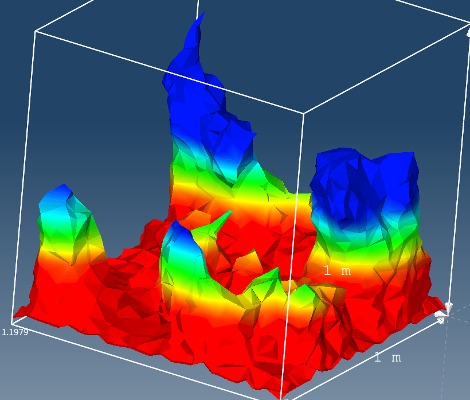

# Crear ISO

La **entidad ISO** es una forma de entidad interpolada similar al **corte**. La **entidad ISO** es una «superficie de nivel» basada en un valor escalar o en la magnitud de un vector.

La **entidad ISO** se puede crear sobre cualquier entidad de volumen o de superficie a partir de cualquier variable de resultado aplicable a los nodos. Las **variables de resultado** que por defecto se aplican a los elementos, como **Von Mises Stress** (tensión de von Mises), deben convertirse primero en variables de nodo.

