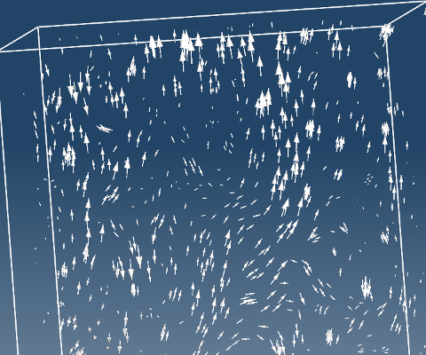

# Crear campo vectorial

**Campo vectorial**:

- Ayuda a visualizar campos como la velocidad, el campo eléctrico y magnético, el flujo de calor y las fuerzas.
- Se puede crear sobre cualquier entidad del modelo o sobre una superficie interpolada, como **cortes** y **superficies ISO**.

