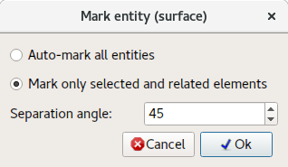

# Marquer la surface

Les conditions aux limites, initiales et d'environnement ne peuvent être appliquées qu'aux entités (points, lignes, surfaces et volumes) ; il est donc nécessaire de diviser une surface en plusieurs surfaces logiques. Ce processus s'appelle le **marquage**.

## Marquer automatiquement toutes les entités

Tous les éléments de surface sont examinés et regroupés en entités surface en fonction de l'**angle de séparation**.

## Marquer uniquement les éléments sélectionnés et associés

Tous les éléments de surface voisins des éléments sélectionnés (pointés), ceux-ci compris, sont examinés et regroupés en une entité surface en fonction de l'**angle de séparation**.
