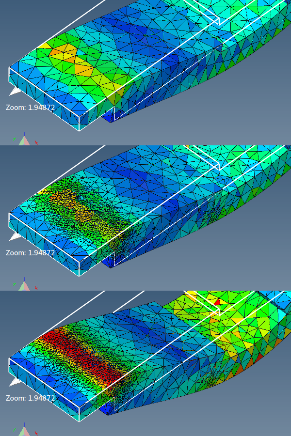

# Generuj siatkę czworościenną

Generuje siatkę objętościową (czworościenną).

**Siatka objętościowa** jest wymagana dla większości **typów problemów**.

Generator siatek 3D może wygenerować siatkę tylko wtedy, gdy:
1. Model zawiera zamkniętą (szczelną) powierzchnię.
2. Elementy powierzchni nie przecinają się wzajemnie.

Aby wygenerować kilka siatek objętościowych reprezentujących model materiału kompozytowego, należy uwzględnić powierzchnię rozdzielającą.

W niektórych przypadkach może być konieczne zastąpienie ustawień domyślnych i bezpośrednie podanie parametrów TetGen.

## Interfejs graficzny

- **Sprawdź integralność powierzchni** - przydatne przy generowaniu siatki 3D z modelu powierzchniowego. Pozwala wykryć błędy i potencjalne problemy siatki powierzchni.
- **Odbuduj siatkę (użyj ponownie bieżących węzłów)** - zachowuje bieżące węzły i dodaje nowe tylko w razie potrzeby.
- **Zachowaj obliczone wyniki** - wszystkie obliczone wyniki zostaną przeniesione/interpolowane na nowe węzły i elementy.
- **Siatka wysokiej jakości** - generuje siatkę 3D spełniającą kryteria jakości.
    - **Maksymalna objętość elementu** - maksymalna objętość każdego generowanego elementu. Żaden element nie powinien mieć objętości większej od podanej.
    - **Generuj funkcję rozmiaru siatki** - należy jej używać do zagęszczania siatki w miejscach, w których występują różnice w wynikach.
- **Parametry TetGen** - parametry przekazywane do generatora siatek TetGen.

Poniższy rysunek pokazuje różnicę w rozdzielczości siatki przy użyciu siatkowania adaptacyjnego.

## Składnia parametrów

`pYrq_Aa_miO_S_T_XMwcdzfenvgkJBNEFICQVh`

Podkreślenia oznaczają, że po niektórych przełącznikach mogą opcjonalnie występować liczby. Nie należy zostawiać spacji między przełącznikiem a jego parametrem liczbowym.

Poniżej przedstawiono przegląd wszystkich przełączników wiersza poleceń wraz z krótkim opisem.

- **p** - Dzieli na czworościany kompleks liniowy odcinkowo (PLC).
- **r** - Odbudowuje wcześniej wygenerowaną siatkę.
- **q** - Zagęszcza siatkę (w celu poprawy jej jakości).
- **R** - Upraszczanie siatki (w celu zmniejszenia liczby elementów).
- **a** - Stosuje ograniczenie maksymalnej objętości czworościanu.
- **O** - Określa poziom optymalizacji siatki.
- **S** - Określa maksymalną liczbę dodanych punktów.
- **T** - Ustawia tolerancję testu współpłaszczyznowości (domyślnie 10−8).
- **X** - Wyłącza użycie arytmetyki dokładnej.
- **M** - Nie scala współpłaszczyznowych ścian ani bardzo bliskich wierzchołków.
- **w** - Generuje ważoną (regularną) triangulację Delaunaya.
- **c** - Zachowuje otoczkę wypukłą PLC.
- **d** - Wykrywa samoprzecięcia ścian PLC.
- **n** - Zapisuje sąsiadów czworościanów.
- **C** - Sprawdza spójność końcowej siatki.
- **Q** - Tryb cichy: brak wyjścia w terminalu poza błędami.
- **V** - Tryb szczegółowy: szczegółowe informacje, więcej wyjścia w terminalu.
