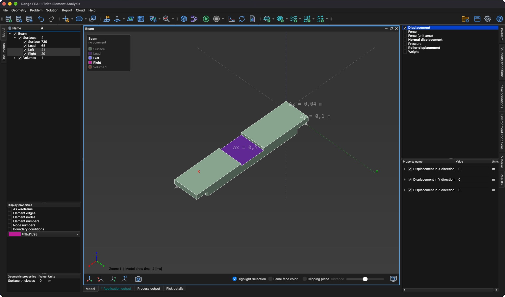

# Okrajová podmínka

**Okrajová podmínka** je podmínka zadaná na hranici, přičemž hranicí může být jakákoli entita modelu (Bod, Čára, Povrch, Objem).

Okrajové podmínky jsou:
- **Specifické pro úlohu** – Každý **typ úlohy** definuje vlastní sadu **okrajových podmínek**.
- **Specifické pro entitu** – Ne každou okrajovou podmínku lze použít na každý typ entity (např. **Pressure** lze použít pouze na **Povrch**).
- **Explicitní** – Na hranici je předepsáno přesné řešení (např. **Temperature** pro **Heat transfer**). V seznamu **Okrajové podmínky** jsou zobrazeny tučným písmem.
- **Implicitní** – Řešení na hranici z nich vyplývá (např. **Heat** pro **Heat transfer**).

## Přiřazení okrajové podmínky

1. Vyberte jednu nebo více entit ve **stromu modelu**.
2. Otevřete záložku **Okrajové podmínky** na pravé straně hlavního okna. Seznam obsahuje pouze okrajové podmínky, které jsou platné pro vybrané **typy úloh** a vybrané entity.
3. Zaškrtnutím políčka před názvem okrajové podmínky ji přiřadíte. Zrušením zaškrtnutí okrajovou podmínku z vybraných entit odeberete.
4. Vyberte okrajovou podmínku a v seznamu níže upravte hodnoty jejích vlastností.

Některé vlastnosti mají vlastní zaškrtávací políčko. Například u každé složky okrajové podmínky **Displacement** lze zaškrtnutí zrušit a ponechat tak posuv v daném směru volný.

Okrajové podmínky, které působí ve směru daném geometrií (**Normal displacement**, **Roller displacement**), odvozují svůj lokální směr z entity. Zaškrtnutím **Použít zadaný lokální směr** lze směr zadat ručně.

Chcete-li přiřazené okrajové podmínky zobrazit ve 3D oblasti, zaškrtněte **Okrajové podmínky** v **Možnostech zobrazení**.

## Časově závislé hodnoty

Hodnota každé vlastnosti může být časově závislá. Rozbalte vlastnost a kliknutím na **Upravit časově závislé hodnoty** zadejte tabulku hodnot pro dané časy. Časově závislé hodnoty se použijí, je-li úloha **přechodová** (časově závislá), tedy je-li v záložce **Úloha** zapnut **Řešič v čase**.
