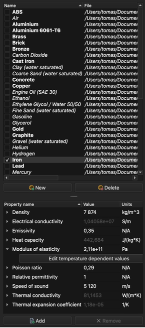

# Materiál

**Materiál** je kolekce materiálových vlastností relevantních pro daný **typ úlohy**. Hodnoty každé materiálové vlastnosti mohou být teplotně závislé.

## Přiřazení materiálu

1. Vyberte jednu nebo více entit ve **stromu modelu**.
2. Otevřete záložku **Materiál** na pravé straně hlavního okna.
3. Zaškrtnutím políčka před názvem materiálu jej přiřadíte vybraným entitám.

Materiály, které obsahují všechny vlastnosti vyžadované vybranými **typy úloh**, jsou uvedeny **tučným** písmem, všechny ostatní materiály _kurzívou_.

_Poznámka: Všechny entity modelu musí mít přiřazen materiál._

## Materiálové vlastnosti

Vlastnosti vybraného materiálu jsou uvedeny ve spodní části záložky **Materiál**. Hodnotu lze upravit přímo ve sloupci **Hodnota**. Tlačítky **Přidat** a **Odstranit** vlastnost přidáte nebo odstraníte.

Chcete-li, aby vlastnost byla teplotně závislá, rozbalte ji a kliknutím na **Upravit teplotně závislé hodnoty** zadejte tabulku hodnot pro dané teploty. Vlastnost s teplotně závislými hodnotami je ve sloupci **Hodnota** zašedlá a lze ji měnit pouze v této tabulce.

## Databáze materiálů

Seznam materiálů je databáze sdílená všemi modely. Každý materiál je uložen ve vlastním souboru, který je uveden ve sloupci **Soubor**. Tlačítkem **Nový** vytvoříte nový materiál, tlačítkem **Smazat** smažete vybraný. Změny materiálových vlastností se ukládají do databáze.
