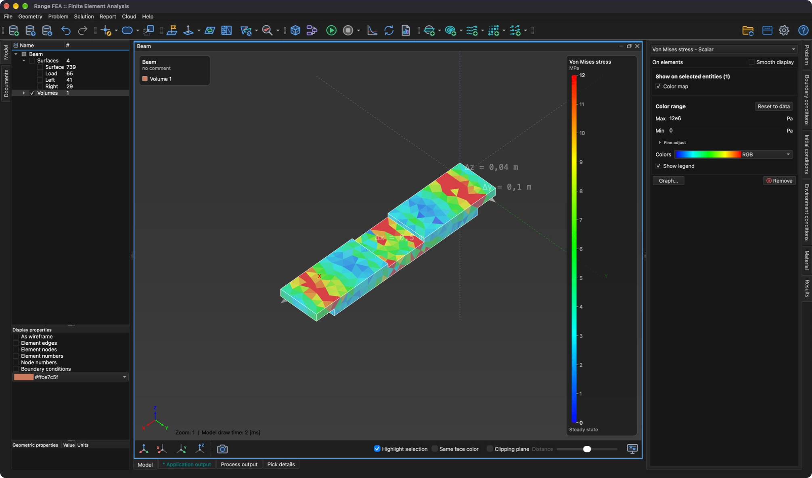

# Výsledky

**Výsledky** vytváří **řešič** a skládají se z **výsledkových proměnných**.

## Výsledková proměnná

**Výsledková proměnná** je sada hodnot vypočtených **řešičem**. **Výsledková proměnná** je definována svým **typem** (např. **Temperature** nebo **Displacement**) a vektorem hodnot. Podle **typu** může **výsledková proměnná** obsahovat vektor skalárních nebo vektorových hodnot.

Například výsledková proměnná **Temperature** obsahuje vektor teplot pro každý uzel, kdežto **Displacement** obsahuje vektor vektorů posuvu pro každý uzel.

Všechny výsledkové proměnné vybraného modelu jsou uvedeny v rozbalovací nabídce v horní části záložky **Výsledky** spolu se svým druhem (**Scalar** nebo **Vector**).

**Výsledková proměnná** může být vypočtena buď na úrovni uzlů, nebo na úrovni prvků. Například **Displacement** se počítá na úrovni uzlů, kdežto **Von Mises stress** na úrovni prvků. Kde je vybraná proměnná uložena (**Na uzlech** nebo **Na prvcích**), je uvedeno pod rozbalovací nabídkou.

Proměnné na úrovni prvků se zobrazují s jednou hodnotou na prvek. Pro spojité zobrazení:

- Proměnné napětí nabízejí zaškrtávací políčko **Vyhlazené zobrazení**. To průměruje výsledky prvků v uzlech pouze pro zobrazení, samotné výsledky zůstávají beze změny. Průměrování snižuje špičkové hodnoty.
- Ostatní proměnné na úrovni prvků nabízejí tlačítko **Zobrazit na uzlech**, které proměnnou převede z prvků na uzly.

## Zobrazení výsledků

Výsledky se zobrazují na entitách, které jsou vybrány ve **stromu modelu**. Výsledky úlohy řešené na **Objemech** jsou nejlépe vidět, když jsou povrchové entity skryté.

- **Zobrazit na vybraných entitách** – zaškrtnutím **Barevná mapa** se vybrané entity obarví podle hodnoty proměnné. Vektorové proměnné lze zobrazit také jako **Deformovaný tvar**.
- **Barevný rozsah** – hodnoty **Max** a **Min** barevné mapy. Lze je zadat ručně nebo změnit v **Jemném nastavení**. **Obnovit podle dat** nastaví rozsah zpět na rozsah vypočtený z výsledků.
- **Barvy** – barevné schéma barevné mapy.
- **Zobrazit legendu** – zobrazí rozsah hodnot ve 3D oblasti.
- **Měřítko deformace a šipek** – násobí deformaci deformovaných tvarů a délku šipek vektorových polí (pouze vektorové proměnné).
- **Graf…** – zobrazí rozložení hodnot a umožní nastavit barevný rozsah na grafu.
- **Odstranit** – odstraní proměnnou z modelu.

Výsledky lze zobrazit také na entitách vytvořených k tomuto účelu: **Řezy**, **ISO**, **Proudnice**, **Skalární pole** a **Vektorová pole**.
