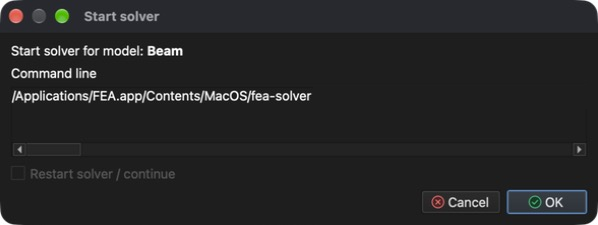

# Řešič

**Řešič** je nástroj, který zpracuje nastavení **úlohy** a vypočte **výsledky** na daném **modelu**.

V závislosti na velikosti **modelu**, **typu úlohy**, nastavení konvergence a přechodovém nastavení se doba řešení **úlohy** může pohybovat od sekund až po hodiny i déle.

## Spuštění řešiče

**Menu:** _Řešení -> Spustit řešič_

Před spuštěním řešiče musí být model uložen. Pokud ještě uložen nebyl, zobrazí se nejprve dialog **Uložit model**. Poté se zobrazí dialog **Spustit řešič**.

Před spuštěním řešiče se zkontroluje nastavení úlohy. Nalezené **Chyby** (např. entita bez materiálu) a **Upozornění** jsou vypsány v dialogu **Spustit řešič**. Obsahuje-li model již výsledky, lze zaškrtnout **Restartovat řešič / pokračovat** a pokračovat z těchto výsledků místo výpočtu od začátku.

Řešič běží jako samostatný proces na pozadí, takže během výpočtu lze pokračovat v práci. Veškerý jeho výstup se zobrazuje v záložce **Výstup procesu** pod 3D oblastí. Po dokončení řešiče se vypočtené **výsledky** automaticky načtou do modelu.

## Zastavení řešiče

- _Řešení -> Zastavit řešič_ – požádá všechny běžící řešiče o zastavení.
- _Řešení -> Ukončit řešič násilím_ – okamžitě ukončí proces řešiče.

## Sledování řešiče

- _Zprávy -> Konvergence řešiče_ – zobrazí graf konvergence řešiče.
- _Zprávy -> Monitorovací body_ – zobrazí hodnoty vypočtené v monitorovacích bodech definovaných pomocí _Úloha -> Definovat monitorovací body_.
- _Zprávy -> Log soubor řešiče_ – zobrazí log soubor řešiče.
