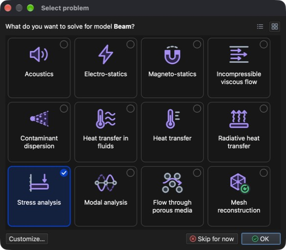

# Problemtyp

Der **Problemtyp** ist ein eindeutiger Bezeichner des zu lösenden physikalischen Phänomens.

Problemtypen werden im Dialog **Problem auswählen** ausgewählt (**Menü:** _Problem -> Problem auswählen_). Klicken Sie auf eine Kachel, um einen Problemtyp aus- oder abzuwählen, und bestätigen Sie mit **OK**. Die Schaltflächen oben rechts schalten zwischen der **Kachelansicht** und der **Listenansicht** um, die zusätzlich eine kurze Beschreibung jedes Problemtyps zeigt.

Liste der unterstützten Problemtypen:

- **Acoustics** (Akustik) – transienter und harmonischer (Frequenzbereich) Schalldruck, Schallschnelle, Intensität und Schalldruckpegel.
- **Electro-statics** (Elektrostatik) – elektrisches Feld, Stromdichte und erzeugte Joulesche Wärme.
- **Magneto-statics** (Magnetostatik) – Magnetfeld.
- **Incompressible viscous flow** (inkompressible viskose Strömung) – stationäre und transiente Strömung newtonscher Fluide.
- **Contaminant dispersion** (Schadstoffausbreitung) – Verteilung eines „Schadstoffs“ im Strömungsfeld.
- **Heat transfer in fluids** (Wärmeübertragung in Fluiden) – Temperaturverteilung im strömenden Fluid.
- **Heat transfer** (Wärmeübertragung) – stationäre und transiente Temperaturverteilung und Wärmestrom, mit einfacher, erzwungener und natürlicher Konvektion.
- **Radiative heat transfer** (Wärmeübertragung durch Strahlung) – Wärmeübertragung zwischen mehreren Flächen, die Wärme abstrahlen und/oder aufnehmen können.
- **Stress analysis** (Spannungsanalyse) – statische Spannungsanalyse und lineare Elastodynamik, einschließlich Wärmeausdehnung und Lasten aus Fluiddruck.
- **Modal analysis** (Modalanalyse) – Eigenfrequenzen der Struktur und ihre Eigenformen.
- **Flow through porous media** (Strömung durch poröse Medien) – Druck und Geschwindigkeit eines Fluids, das durch durchlässiges Material strömt.
- **Mesh reconstruction** (Netzrekonstruktion) – Rekonstruktion des Netzes anhand vorgegebener Kriterien.

## Problemtypen kombinieren

Es ist möglich, mehrere verschiedene **Problemtypen** zu kombinieren (z. B. **Heat transfer** und **Stress analysis** oder **Incompressible viscous flow** und **Contaminant dispersion**).

- Manche Problemtypen setzen einen anderen voraus. Die Auswahl eines solchen Problemtyps wählt auch den erforderlichen aus: **Magneto-statics** erfordert **Electro-statics**, **Contaminant dispersion** und **Heat transfer in fluids** erfordern **Incompressible viscous flow** und **Radiative heat transfer** erfordert **Heat transfer**.
- Problemtypen, die sich nicht mit der aktuellen Auswahl kombinieren lassen, sind ausgegraut und als **Inkompatibel** gekennzeichnet (z. B. lässt sich **Modal analysis** mit keinem anderen Problemtyp kombinieren).

## Aufgabenablauf

Die ausgewählten Problemtypen werden nacheinander als Aufgaben gelöst. Ihre Reihenfolge wird automatisch so festgelegt, dass die Ergebnisse einer Aufgabe von der nächsten verwendet werden können (z. B. wird **Heat transfer** vor **Stress analysis** gelöst, um die Wärmeausdehnung zu berücksichtigen).

Klicken Sie auf **Anpassen…**, um den Aufgabenablauf anzusehen oder zu ändern. Die Aufgaben werden von oben nach unten ausgeführt. Mit den Schaltflächen **Nach oben** und **Nach unten** ändern Sie die Reihenfolge, mit **>** verschieben Sie eine Aufgabe in eine Gruppe, die wiederholt wird (mit eigener Anzahl von Iterationen und eigenem Konvergenzwert), und mit **<** nehmen Sie sie wieder heraus. Ein Doppelklick auf einen Wert ermöglicht dessen Bearbeitung. **Automatische Reihenfolge verwenden** verwirft den benutzerdefinierten Aufgabenablauf.

Wird ein Problemtyp aus einem Modell entfernt, das bereits dessen Ergebnisse enthält, bietet die Anwendung an, diese Ergebnisse aus dem Modell zu löschen.
