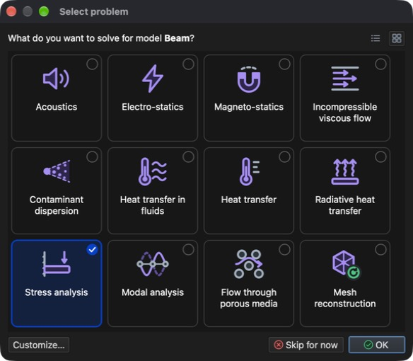
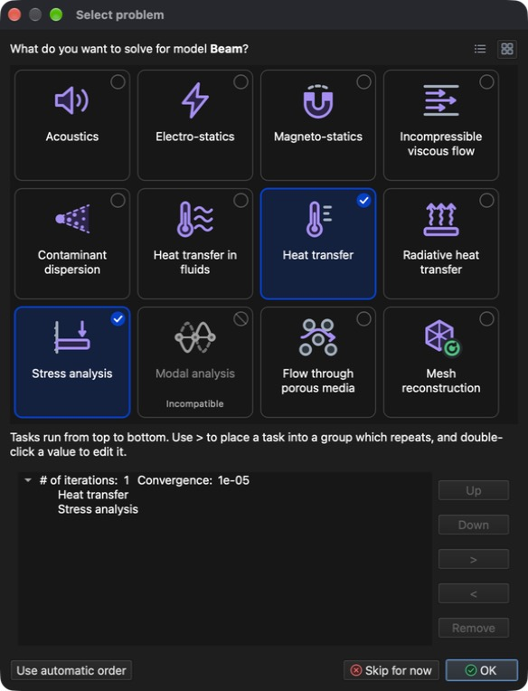

# Problem type

**Problem type** is a unique identifier of the physical phenomena to be solved.

Problem types are selected in the **Select problem** dialog (**Menu:** _Problem -> Select problem_). Click a tile to select or deselect a problem type and click **OK** to accept. The buttons in the top right corner switch between the **Tile view** and the **List view**, which also shows a short description of each problem type.

List of supported problem types:

- **Acoustics** - transient and harmonic (frequency domain) acoustic pressure, particle velocity, intensity and sound pressure level.
- **Electro-statics** - electric field, current density and generated Joule's heat.
- **Magneto-statics** - magnetic field.
- **Incompressible viscous flow** - steady-state and transient flow of newtonian fluids.
- **Contaminant dispersion** - distribution of "contaminant" in the flow field.
- **Heat transfer in fluids** - temperature distribution in flowing fluid.
- **Heat transfer** - steady-state and transient temperature distribution and heat flow, with simple, forced and natural convection.
- **Radiative heat transfer** - heat transfer between several surfaces capable of emitting and/or receiving heat.
- **Stress analysis** - static stress and linear elasto-dynamics analysis, including thermal expansion and loads from fluid pressure.
- **Modal analysis** - structure's natural frequencies and their mode shapes.
- **Flow through porous media** - pressure and velocity of fluid flowing through permeable material.
- **Mesh reconstruction** - reconstruct mesh based on provided criteria.

## Combining problem types

It is possible to combine multiple different **problem types** (e.g., **Heat transfer** and **Stress analysis** or **Incompressible viscous flow** and **Contaminant dispersion**).

- Some problem types require another one. Selecting such a problem type selects the required one as well: **Magneto-statics** requires **Electro-statics**, **Contaminant dispersion** and **Heat transfer in fluids** require **Incompressible viscous flow** and **Radiative heat transfer** requires **Heat transfer**.
- Problem types which cannot be combined with the current selection are grayed out and marked as **Incompatible** (e.g., **Modal analysis** cannot be combined with any other problem type).

## Task flow

Selected problem types are solved one after another as tasks. Their order is set automatically, so that results of one task can be used by the next one (e.g., **Heat transfer** is solved before **Stress analysis** to account for thermal expansion).

Click **Customize...** to see or change the task flow. Tasks run from top to bottom. Use the **Up** and **Down** buttons to change their order, **>** to place a task into a group which repeats (with its own number of iterations and convergence value) and **<** to take it out of the group. Double-click a value to edit it. **Use automatic order** discards the custom task flow.

If a problem type is removed from a model which already contains its results, the application offers to clear these results from the model.
