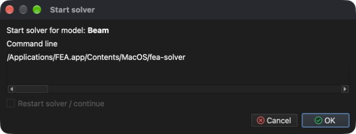

# Solver

**Solver** is a tool that processes **Problem** settings and computes **Results** on a given **Model**.

Based on **Model** size, **Problem type**, convergence settings and transient setup, time to solve the **Problem** may vary from seconds up to hours and longer.

## Starting the solver

**Menu:** _Solution -> Start solver_

The model must be saved before the solver can start. If it has not been saved yet, a **Save model** dialog is shown first. Then the **Start solver** dialog is shown.

Before the solver starts, the problem setup is checked. Found **Errors** (e.g., an entity without a material) and **Warnings** are listed in the **Start solver** dialog. If the model already contains results, **Restart solver / continue** can be checked to continue from these results instead of starting from the beginning.

Solver runs as a separate process in the background, so it is possible to continue working while it is running. All its output is displayed in the **Process output** tab below the 3D area. Once the solver has finished, computed **Results** are loaded into the model automatically.

## Stopping the solver

- _Solution -> Stop solver_ - asks all running solvers to stop.
- _Solution -> Kill solver_ - terminates the solver process immediately.

## Monitoring the solver

- _Report -> Solver convergence_ - shows a graph of solver convergence.
- _Report -> Monitoring points_ - shows values computed at monitoring points defined by _Problem -> Define monitoring points_.
- _Report -> Solver log file_ - shows the log file of the solver.
