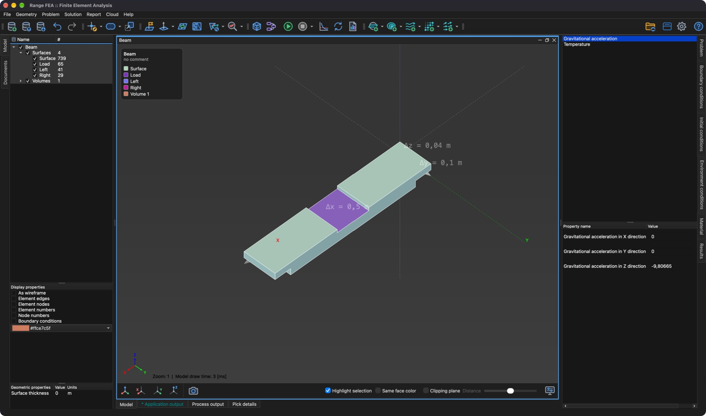

# Condición de entorno

Una **condición de entorno** es una condición que se puede especificar en cualquier entidad del modelo, como Punto, Línea, Superficie o Volumen. La **condición de entorno** especifica valores propios del **problema** para el entorno dado (p. ej., **Temperature** – temperatura del entorno o **Gravitational acceleration** – aceleración de la gravedad).

Las condiciones de entorno disponibles dependen de los **tipos de problema** seleccionados:

- **Gravitational acceleration** – componentes en las direcciones X, Y y Z, por defecto 0, 0 y -9.80665 `[m/s^2]`.
- **Temperature** – por defecto 293.15 `[K]`.

## Edición de una condición de entorno

A diferencia de las **condiciones de contorno**, las condiciones de entorno no se marcan. Están siempre presentes y tienen valores por defecto.

1. Seleccione una o varias entidades en el **árbol del modelo**.
2. Abra la pestaña **Condiciones de entorno** en el lado derecho de la ventana principal.
3. Seleccione la condición de entorno y edite los valores de sus propiedades en la lista inferior.

Si no se especifica ninguna **condición inicial** para una entidad del modelo, se utiliza la **condición de entorno**.
