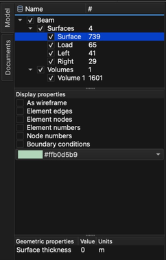

# Modelo

Un **modelo** es una representación geométrica virtual de un objeto tridimensional. Un modelo está formado por **entidades** geométricas.

## Entidades

Una **entidad** es una colección de elementos (símplices geométricos) del mismo tipo. Se distinguen los siguientes tipos:

- **Punto** – colección de elementos 0D (nodo).
- **Línea** – colección de elementos 1D (segmento).
- **Superficie** – colección de elementos 2D (triángulo, cuadrilátero).
- **Volumen** – colección de elementos 3D (tetraedro).

Independientemente de si los elementos son 0D, 1D, 2D o 3D, todos se representan en el espacio 3D. Por ejemplo, un punto (nodo) no tiene dimensiones, solo tiene una posición, mientras que una línea tiene una dimensión (longitud).

Además de estas entidades geométricas, un modelo puede contener entidades creadas a partir de los **resultados** calculados: **Cortes**, **ISO**, **Líneas de corriente**, **Campos escalares** y **Campos vectoriales**.

## Árbol del modelo

Todas las entidades de un modelo aparecen en el **árbol del modelo** (pestaña **Modelo** en el lado izquierdo de la ventana principal), agrupadas por tipo. La columna **#** muestra el número de entidades de un grupo o el número de elementos de una entidad.

- La casilla situada delante del nombre muestra u oculta el modelo, el grupo o la entidad en el área 3D.
- Al hacer clic en una fila, esta se selecciona. Para seleccionar varias entidades, mantenga pulsada la tecla _Ctrl_ (_⌘ Cmd_ en macOS) mientras selecciona, o la tecla _Mayús_ para seleccionar un rango. Al seleccionar un modelo o un grupo se seleccionan todas las entidades que contiene.
- Las **Condiciones de contorno**, las **Condiciones iniciales**, las **Condiciones de entorno**, el **Material** y los **Resultados** se asignan siempre a las entidades seleccionadas en el **árbol del modelo**.

Las **Propiedades de visualización**, debajo del árbol, controlan cómo se dibujan las entidades seleccionadas (p. ej., **En alambre**, **Aristas de los elementos**, **Nodos de los elementos**, **Condiciones de contorno**) y su color.

## Propiedades geométricas

A cada **entidad**, excepto al **Volumen**, se le puede asignar una propiedad **geométrica** que completa su representación 3D. Se muestra para las entidades seleccionadas en la lista **Propiedades geométricas**, debajo del **árbol del modelo**:

- **Volumen del punto** – volumen de un **Punto** en metros cúbicos.
- **Sección de la línea** – área de la sección transversal de una **Línea** en metros cuadrados.
- **Espesor de la superficie** – espesor de una **Superficie** en metros.
