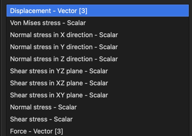

# Resultados

Los **resultados** los produce el **solver** y están formados por **variables de resultado**.

## Variable de resultado

Una **variable de resultado** es un conjunto de valores calculados por el **solver**. Una **variable de resultado** está definida por su **tipo** (p. ej., **Temperature** o **Displacement**) y un vector de valores. Según el **tipo**, una **variable de resultado** puede contener un vector de valores escalares o vectoriales.

Por ejemplo, la variable de resultado **Temperature** contiene un vector de temperaturas para cada nodo, mientras que **Displacement** contiene un vector de vectores de desplazamiento para cada nodo.

Todas las variables de resultado del modelo seleccionado aparecen en el menú desplegable de la parte superior de la pestaña **Resultados**, junto con su clase (**Scalar** o **Vector**).

Una **variable de resultado** se puede calcular a nivel de nodo o a nivel de elemento. Por ejemplo, **Displacement** se calcula a nivel de nodo, mientras que **Von Mises stress** se calcula a nivel de elemento. Dónde se almacena la variable seleccionada (**En nodos** o **En elementos**) se indica debajo del menú desplegable.

Las variables a nivel de elemento se muestran con un valor por elemento. Para obtener una visualización continua:

- Las variables de tensión ofrecen la casilla **Visualización suavizada**. Promedia los resultados de los elementos en los nodos solo para la visualización; los resultados en sí no cambian. El promediado reduce los valores máximos.
- Las demás variables a nivel de elemento ofrecen el botón **Mostrar en los nodos**, que cambia la variable de elementos a nodos.

## Visualización de resultados

Los resultados se muestran en las entidades seleccionadas en el **árbol del modelo**. Los resultados de un problema resuelto en **Volúmenes** se ven mejor cuando las entidades de superficie están ocultas.

- **Mostrar en las entidades seleccionadas** – marque **Mapa de colores** para colorear las entidades seleccionadas según el valor de la variable. Las variables vectoriales también se pueden mostrar como **Forma deformada**.
- **Rango de colores** – valores **Máx** y **Mín** del mapa de colores. Se pueden escribir o cambiar en el **Ajuste fino**. **Restablecer según datos** devuelve el rango al calculado a partir de los resultados.
- **Colores** – esquema de colores del mapa de colores.
- **Mostrar leyenda** – muestra el rango de valores en el área 3D.
- **Escala de deformación y flechas** – multiplica la deformación de las formas deformadas y la longitud de las flechas de los campos vectoriales (solo variables vectoriales).
- **Gráfico…** – muestra la distribución de valores y permite ajustar el rango de colores sobre un gráfico.
- **Eliminar** – elimina la variable del modelo.

Los resultados también se pueden mostrar en entidades creadas para ese fin: **Cortes**, **ISO**, **Líneas de corriente**, **Campos escalares** y **Campos vectoriales**.
