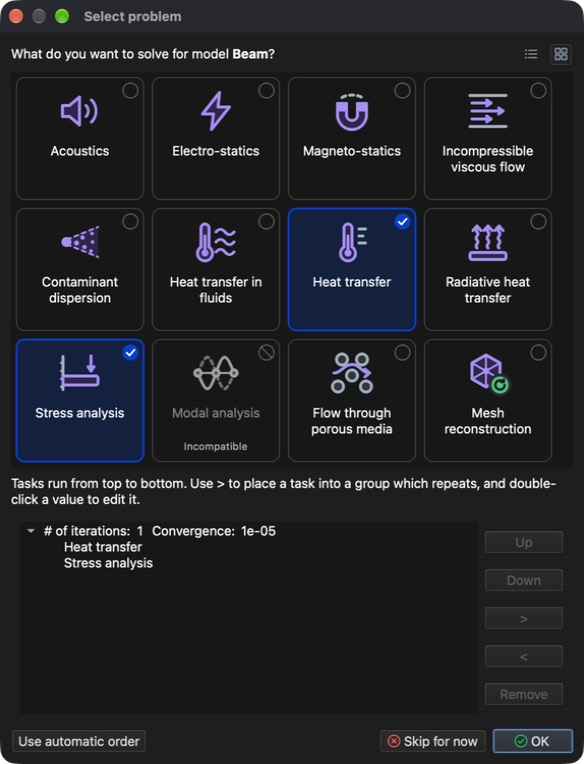

# Type de problème

Le **type de problème** est un identifiant unique du phénomène physique à résoudre.

Les types de problème se sélectionnent dans la boîte de dialogue **Sélectionner le problème** (**Menu :** _Problème -> Sélectionner le problème_). Cliquez sur une tuile pour sélectionner ou désélectionner un type de problème, puis sur **OK** pour valider. Les boutons en haut à droite basculent entre la **Vue en tuiles** et la **Vue en liste**, qui affiche aussi une courte description de chaque type de problème.

Liste des types de problème pris en charge :

- **Acoustics** (acoustique) – pression acoustique, vitesse particulaire, intensité et niveau de pression acoustique, en régime transitoire et harmonique (domaine fréquentiel).
- **Electro-statics** (électrostatique) – champ électrique, densité de courant et chaleur dégagée par effet Joule.
- **Magneto-statics** (magnétostatique) – champ magnétique.
- **Incompressible viscous flow** (écoulement visqueux incompressible) – écoulement permanent et transitoire de fluides newtoniens.
- **Contaminant dispersion** (dispersion de contaminant) – répartition d'un « contaminant » dans le champ d'écoulement.
- **Heat transfer in fluids** (transfert de chaleur dans les fluides) – répartition de la température dans un fluide en écoulement.
- **Heat transfer** (transfert de chaleur) – répartition de la température et flux de chaleur en régime permanent et transitoire, avec convection simple, forcée et naturelle.
- **Radiative heat transfer** (transfert de chaleur par rayonnement) – transfert de chaleur entre plusieurs surfaces capables d'émettre et/ou de recevoir de la chaleur.
- **Stress analysis** (analyse des contraintes) – analyse statique des contraintes et élastodynamique linéaire, y compris la dilatation thermique et les charges dues à la pression d'un fluide.
- **Modal analysis** (analyse modale) – fréquences propres de la structure et leurs modes propres.
- **Flow through porous media** (écoulement en milieu poreux) – pression et vitesse d'un fluide traversant un matériau perméable.
- **Mesh reconstruction** (reconstruction du maillage) – reconstruction du maillage selon les critères fournis.

## Combinaison de types de problème

Il est possible de combiner plusieurs **types de problème** différents (p. ex. **Heat transfer** et **Stress analysis**, ou **Incompressible viscous flow** et **Contaminant dispersion**).

- Certains types de problème en requièrent un autre. La sélection d'un tel type sélectionne aussi celui qui est requis : **Magneto-statics** requiert **Electro-statics**, **Contaminant dispersion** et **Heat transfer in fluids** requièrent **Incompressible viscous flow**, et **Radiative heat transfer** requiert **Heat transfer**.
- Les types de problème qui ne peuvent pas être combinés avec la sélection actuelle sont grisés et marqués **Incompatible** (p. ex. **Modal analysis** ne peut être combiné avec aucun autre type de problème).

## Flux de tâches

Les types de problème sélectionnés sont résolus l'un après l'autre sous forme de tâches. Leur ordre est défini automatiquement, de sorte que les résultats d'une tâche puissent être utilisés par la suivante (p. ex. **Heat transfer** est résolu avant **Stress analysis** afin de tenir compte de la dilatation thermique).

Cliquez sur **Personnaliser…** pour afficher ou modifier le flux de tâches. Les tâches s'exécutent de haut en bas. Les boutons **Monter** et **Descendre** modifient leur ordre, **>** place une tâche dans un groupe qui se répète (avec son propre nombre d'itérations et sa propre valeur de convergence) et **<** l'en retire. Double-cliquez sur une valeur pour la modifier. **Utiliser l'ordre automatique** abandonne le flux de tâches personnalisé.

Si un type de problème est retiré d'un modèle qui contient déjà ses résultats, l'application propose de supprimer ces résultats du modèle.
