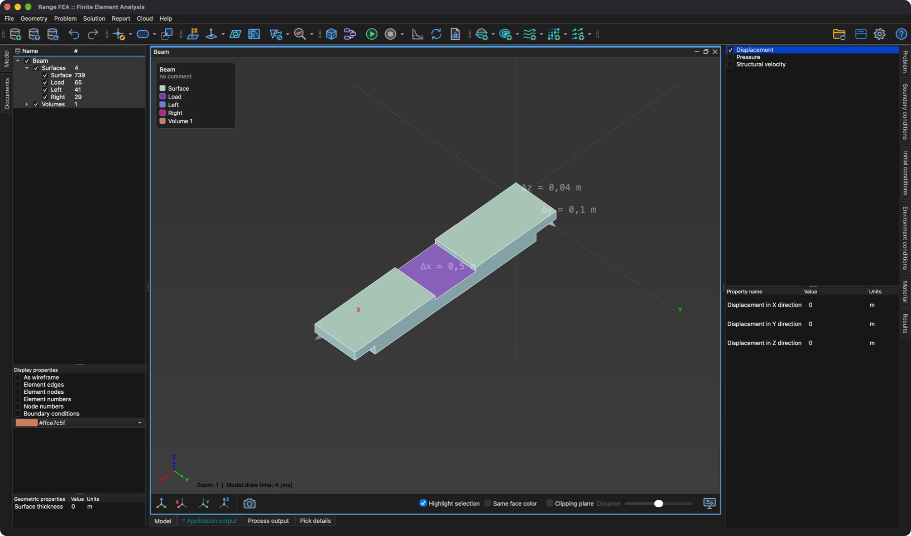

# Condizione iniziale

Una **condizione iniziale** è una condizione che può essere specificata su qualsiasi entità del modello (Punto, Linea, Superficie, Volume) e può essere vista come punto di partenza per il solutore. Nei **problemi stazionari** una **condizione iniziale** ben scelta migliora la convergenza del solutore. Nei problemi **transitori** (dipendenti dal tempo) definisce lo stato al tempo iniziale.

Le condizioni iniziali sono specifiche del **problema**: ogni **tipo di problema** definisce il proprio insieme di **condizioni iniziali** (ad es. **Temperature** per **Heat transfer**, **Velocity** e **Pressure** per **Incompressible viscous flow** oppure **Displacement** per **Stress analysis**).

## Assegnazione di una condizione iniziale

1. Selezionare una o più entità nell'**albero del modello**.
2. Aprire la scheda **Condizioni iniziali** sul lato destro della finestra principale.
3. Selezionare la casella davanti al nome della condizione iniziale per assegnarla. Deselezionarla per rimuovere la condizione iniziale dalle entità selezionate.
4. Selezionare la condizione iniziale per modificare i valori delle sue proprietà nell'elenco sottostante.

Le condizioni iniziali sono facoltative. Se per una data entità del modello non è specificata alcuna **condizione iniziale**, viene usata la **condizione ambientale**. Sulle entità con una **condizione al contorno esplicita** viene usato il valore prescritto dalla condizione al contorno.
