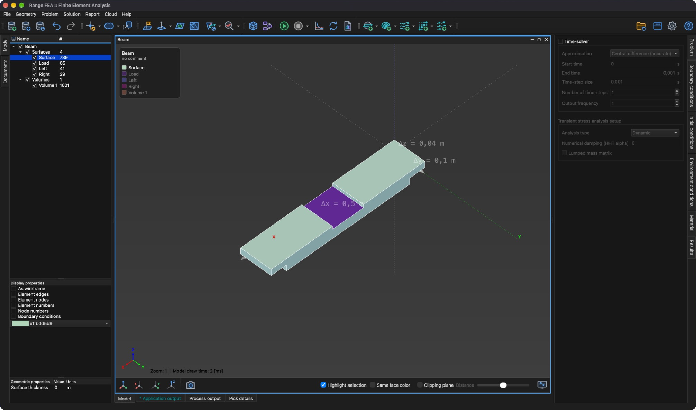

# Model

**Model** je virtuálna geometrická reprezentácia trojrozmerného objektu. Model sa skladá z geometrických **entít**.

## Entity

**Entita** je kolekcia prvkov (geometrických simplexov) rovnakého typu a delí sa na tieto typy:

- **Bod** – kolekcia 0D prvkov (uzol).
- **Čiara** – kolekcia 1D prvkov (úsečka).
- **Povrch** – kolekcia 2D prvkov (trojuholník, štvoruholník).
- **Objem** – kolekcia 3D prvkov (štvorsten).

Bez ohľadu na to, či sú prvky 0D, 1D, 2D alebo 3D, všetky sú reprezentované v 3D priestore. Napríklad bod (uzol) nemá žiadne rozmery, má iba polohu, zatiaľ čo čiara má jeden rozmer (dĺžku).

Okrem týchto geometrických entít môže model obsahovať entity vytvorené z vypočítaných **výsledkov**: **Rezy**, **ISO**, **Prúdnicové čiary**, **Skalárové polia** a **Vektorové polia**.

## Strom modelu

Všetky entity modelu sú uvedené v **strome modelu** (záložka **Model** na ľavej strane hlavného okna) a sú zoskupené podľa typu. Stĺpec **#** zobrazuje počet entít v skupine alebo počet prvkov v entite.

- Zaškrtávacie políčko pred názvom zobrazí alebo skryje model, skupinu alebo entitu v 3D oblasti.
- Kliknutím sa riadok vyberie. Ak chcete vybrať viac entít, držte počas výberu kláves _Ctrl_ (na macOS _⌘ Cmd_), prípadne kláves _Shift_ na výber rozsahu. Výberom modelu alebo skupiny sa vyberú všetky entity, ktoré obsahuje.
- **Okrajové podmienky**, **Počiatočné podmienky**, **Environmentálne podmienky**, **Materiál** a **Výsledky** sa vždy priraďujú entitám, ktoré sú vybrané v **strome modelu**.

**Možnosti zobrazenia** pod stromom určujú, ako sa vybrané entity vykresľujú (napr. **Ako drôtený model**, **Hrany prvkov**, **Uzly prvkov**, **Okrajové podmienky**), a ich farbu.

## Geometrické vlastnosti

Každej **entite** okrem **Objemu** možno priradiť **geometrickú** vlastnosť, ktorá dopĺňa jej 3D reprezentáciu. Pre vybrané entity je zobrazená v zozname **Geometrické vlastnosti** pod **stromom modelu**:

- **Objem bodu** – objem **Bodu** v kubických metroch.
- **Plocha prierezu čiary** – plocha prierezu **Čiary** v štvorcových metroch.
- **Hrúbka povrchu** – hrúbka **Povrchu** v metroch.
