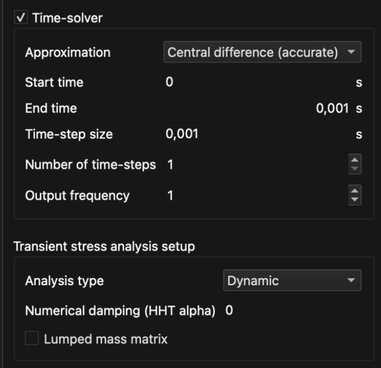

# Úloha

**Úloha** je všeobecný pojem pre jeden alebo viac fyzikálnych javov aplikovaných na geometriu a je definovaná **typom úlohy**, **špecifickým nastavením úlohy**, **okrajovými podmienkami**, **počiatočnými podmienkami**, **environmentálnymi podmienkami** a **nastavením materiálu**.

Úloha sa definuje pre každý model zvlášť. Jej časti sa nastavujú v záložkách na pravej strane hlavného okna: **Úloha**, **Okrajové podmienky**, **Počiatočné podmienky**, **Environmentálne podmienky** a **Materiál**.

## Výber úlohy

**Menu:** _Úloha -> Vybrať úlohu_

Dialóg **Vybrať úlohu** slúži na výber toho, čo sa má riešiť (pozri [Typ úlohy](general_Problem_type.md)). Zobrazí sa aj automaticky po načítaní modelu, ktorý nemá žiadnu úlohu. Kým nie je úloha vybraná, obsahuje záložka **Úloha** iba tlačidlo **Vybrať úlohu**.

## Špecifické nastavenie úlohy

Po výbere úlohy obsahuje záložka **Úloha** nastavenie, ktoré je špecifické pre vybrané **typy úloh**.

- **Riešič v čase** – zaškrtnite, ak sa má úloha riešiť ako **prechodová** (časovo závislá). Po zaškrtnutí možno nastaviť metódu aproximácie, počiatočný čas, veľkosť časového kroku, počet časových krokov a frekvenciu výstupu; koncový čas sa z nich vypočíta (_koncový čas = počiatočný čas + veľkosť časového kroku * počet časových krokov_). Ak nie je zaškrtnuté, úloha sa rieši ako **ustálená**. Riešič v čase je dostupný iba pre typy úloh, ktoré ho podporujú.
- Ďalšie sekcie závisia od vybraných **typov úloh** (napr. **Nastavenie prechodovej analýzy napätia**, nastavenie radiácie, akustiky alebo modálnej analýzy).

Ďalšie akcie súvisiace s úlohou nájdete v menu **Úloha**: _Nastaviť maticový riešič úloh_, _Definovať monitorovacie body_ a _Vyčistiť nastavenia_.
