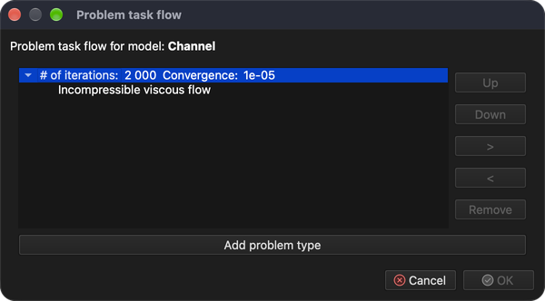
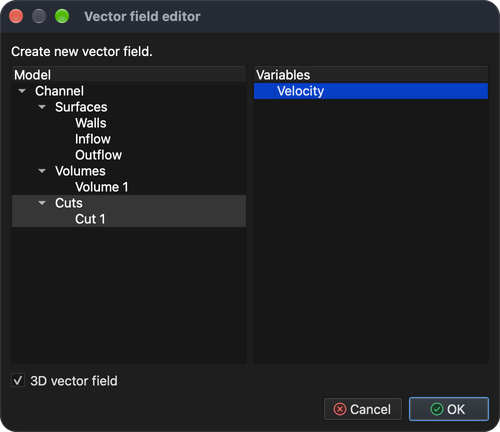

# Rozptyl kontaminantu v tekutinách

Tento návod ukáže, jak nastavit a vyřešit multifyzikální simulaci, která spojuje nelineární iterační úlohu – **CFD (výpočetní dynamiku tekutin)** – s přenosem kontaminantu unášeného prouděním.

Potřebné jsou dva typy úloh:

1. **Incompressible viscous flow** (nestlačitelné viskózní proudění) – počítá rychlost a tlak tekutiny (ustálené nebo přechodové proudění newtonovských tekutin).
2. **Contaminant dispersion** (rozptyl kontaminantu) – počítá, jak se kontaminant v tomto proudovém poli šíří.

Protože úloha proudění je nelineární, řeší se iteračně. Simulace proto probíhá ve dvou etapách:

1. **Ustálené proudění** – nejprve se vypočte zkonvergované „počáteční“ proudové pole a rozložení tlaku, zatím bez kontaminantu.
2. **Přechodová simulace** – poté se z tohoto proudového pole pomocí **časového krokování** sleduje, jak je impulz kontaminantu vstupující do kanálu unášen prouděním.

## 1. Načíst model

**Nabídka:** _Soubor -> Otevřít model_

V dialogu **Otevřít model** vyberte **Channel.tmsh** a klikněte na **Otevřít**.

Model se skládá ze tří povrchových entit – **Walls** (stěny), **Inflow** (přítok) a **Outflow** (odtok). Protože modelu zatím není přiřazen žádný typ úlohy, po dokončení načítání se automaticky otevře dialog **Pořadí kroků úlohy**.

## 2. Pořadí kroků úlohy (etapa 1 – ustálené proudění)

V první etapě se řeší pouze proudění, a to s velkým počtem nelineárních iterací, aby řešení mohlo zkonvergovat.

1. V dialogu **Pořadí kroků úlohy** klikněte na **Přidat typ úlohy**.
2. V dialogu **Výběr typu úlohy** zaškrtněte **Incompressible viscous flow** a klikněte na **OK**.
3. Dvakrát klikněte na hodnotu **1** vedle **počet iterací:**, napište **2000** a stiskněte _Enter_.
4. Kliknutím na **OK** dialog zavřete.

Dialog lze kdykoli znovu otevřít tlačítkem **Pořadí kroků úloh** na panelu nástrojů. Nyní by měl vypadat takto:

## 3. Vygenerovat objemovou síť

Model je definován pouze svými povrchy. Aby bylo možné řešit proudění v jeho vnitřku, je nutné nejprve vygenerovat objemovou (čtyřstěnnou) síť.

**Nabídka:** _Geometrie -> Objem -> Generovat čtyřstěnnou síť_

Předvyplněné hodnoty v dialogu **Generovat 3D síť** postačují. Klikněte na **OK**. Po dokončení generování se ve stromu **Model** ve skupině **Objemy** objeví nová entita **Volume 1**.

## 4. Přiřadit materiál

Všechny entity modelu musí mít přiřazený materiál.

1. Ve stromu **Model** klikněte na **Walls** a poté se stisknutou klávesou _Shift_ klikněte na **Volume 1**, čímž vyberete všechny entity.
2. Otevřete záložku **Materiál** na pravé straně hlavního okna.
3. Zaškrtněte **Water** (voda).

## 5. Okrajové podmínky (etapa 1)

Okrajové podmínky se přiřazují v záložce **Okrajové podmínky** entitě vybrané ve stromu **Model**. **Povrchovým entitám** přiřaďte tyto podmínky:

1. **Walls**
    - _Wall_ (stěna; hodnota není potřeba)
2. **Inflow**
    - _Volumetric flow rate (inflow)_ (objemový průtok – přítok)
        - Volumetric flow rate = 50 `[m^3/s]`
3. **Outflow**
    - _Pressure (implicit)_ (tlak – implicitní)
        - Pressure = 0 `[Pa]` (výchozí hodnota je 1000 `[Pa]`)

Pro každou entitu: vyberte ji ve stromu **Model**, v záložce **Okrajové podmínky** zaškrtněte podmínku, vyberte ji, aby se pod seznamem zobrazily její vlastnosti, poté dvakrát klikněte na hodnotu, napište novou a stiskněte _Enter_.

## 6. Vyřešit ustálené proudění

**Nabídka:** _Řešení -> Spustit řešič_

Pokud model ještě nebyl uložen, nejprve se zobrazí dialog **Uložit model**. Kliknutím na **Uložit** přijměte navržený název souboru (**Channel.rbm**) a poté v dialogu **Spustit řešič pro model** klikněte na **OK**.

Řešič běží na pozadí a jeho výstup se zobrazuje v záložce **Výstup procesu**. Výpočet všech 2000 iterací trvá několik minut; výpočet je dokončen, když výstup skončí řádkem **SOLVER - END**. Konvergenci řešení lze kdykoli zkontrolovat pomocí:

**Nabídka:** _Zprávy -> Konvergence řešiče_

## 7. Vytvořit řez

Proudění lze dobře prozkoumat zobrazením rychlosti jako **vektorového pole**, ve kterém každá šipka ukazuje směr a velikost proudění v jednom bodě. Vektorové pole vykreslené v celém objemu se však rychle změní v hustý mrak překrývajících se šipek, který se špatně čte. Obvykle je přehlednější model nejprve rozříznout **řezem** – rovinou procházející objemem – a vektorové pole pak zobrazit pouze na této rovině.

_Tip: před začátkem zaškrtněte ve stromu **Model** skupinu **Objemy**, aby byl objem při umísťování řezu viditelný._

**Nabídka:** _Geometrie -> Řez -> Vytvořit řez_

V dialogu **Editor řezu**:

1. V seznamu **Model** vyberte **Volume 1**. Řez se vytvoří přes tento objem.
2. **Poloha roviny** určuje bod, kterým rovina řezu prochází. Výchozí hodnoty ji umísťují do středu modelu (**X** = 7.5, **Y** = 2.5, **Z** = 1.5 `[m]`); ponechte je.
3. **Normála roviny** určuje orientaci roviny. Výchozí normála (**X** = 1) dává svislou rovinu; změňte ji na **X** = 0, **Y** = 0, **Z** = 1, čímž získáte vodorovnou rovinu procházející kanálem v polovině jeho výšky.

Během změny hodnot se rovina řezu průběžně zobrazuje ve **3D oblasti modelu**. Kliknutím na **OK** řez vytvoříte. Ve stromu **Model** se ve skupině **Řezy** objeví nová entita **Cut 1**.

## 8. Vytvořit vektorové pole

Nyní zobrazte vypočtenou rychlost jako šipky na rovině řezu.

**Nabídka:** _Geometrie -> Vektorové pole -> Vytvořit vektorové pole_

V dialogu **Editor vektorového pole**:

1. V seznamu **Model** vyberte **Cut 1**. Šipky se vykreslí na rovině řezu vytvořené v předchozím kroku.
2. V seznamu **Proměnné** vyberte **Velocity** (rychlost).
3. Ponechte zaškrtnuté **3D vektorové pole**. Šipky pak ukazují celý vektor rychlosti. Není-li políčko zaškrtnuté, každá šipka se promítne do roviny řezu a zobrazí se pouze složka proudění ležící v rovině.

Kliknutím na **OK** vektorové pole vytvoříte. Objeví se ve stromu **Model** ve skupině **Vektorová pole**. Zrušte zaškrtnutí skupiny **Objemy**, aby plný objem nezakrýval šipky.

Šipky mohou být příliš krátké na to, aby byly dobře vidět, protože jejich délka je úměrná rychlosti proudění. Chcete-li je prodloužit, vyberte vektorové pole ve stromu **Model**, otevřete záložku **Výsledky** a zvyšte hodnotu v části **Měřítko**. Měřítko je součinem hodnoty **Měřítko** a mocniny deseti nastavené v poli **Faktor**; v příkladu níže dávají **Měřítko** 1 a **Faktor** 2 měřítko `1 × 10^2 = 100`.

## 9. Pořadí kroků úlohy (etapa 2 – přechodová simulace)

Jakmile je k dispozici zkonvergované proudové pole, lze nastavit **přechodovou** simulaci včetně úlohy **Contaminant dispersion**.

V přechodové simulaci se úlohy řeší jednou v každém časovém kroku. **Incompressible viscous flow** je stále nelineární úloha, proto v každém časovém kroku potřebuje vlastní nelineární iterace, zatímco **Contaminant dispersion** se řeší jednou za časový krok po vyřešení proudění. Znovu otevřete dialog **Pořadí kroků úlohy** (tlačítko **Pořadí kroků úloh** na panelu nástrojů) a nastavte ho takto:

1. Vyberte **Incompressible viscous flow** a klikněte na tlačítko **>**. Úloha se tím přesune do nové, vnořené skupiny iterací.
2. Dvakrát klikněte na hodnotu vnějšího **počet iterací:** a změňte ji z **2000** na **1**. Poté změňte vnitřní (vnořený) **počet iterací:** z **1** na **10**.
3. Klikněte na **Přidat typ úlohy**, zaškrtněte **Contaminant dispersion** a klikněte na **OK**. Automaticky se zaškrtne i **Incompressible viscous flow**, protože rozptyl kontaminantu potřebuje proudové pole. Pokud se na vnější úrovni přidá druhá položka **Incompressible viscous flow**, vyberte ji a klikněte na **Odstranit**.

Pořadí kroků by mělo vypadat jako na snímku obrazovky níže. Potvrďte kliknutím na **OK**.

## 10. Nastavení řešiče v čase

Otevřete záložku **Úloha** na pravé straně hlavního okna a nastavte:

1. Zaškrtněte **Řešič v čase**.
2. **Aproximace**: **Backward difference (stable)** (zpětná diference – stabilní).
3. **Velikost časového kroku**: **0.01** `[s]`.
4. **Počet časových kroků**: **2000**.
5. **Frekvence výstupu**: **10** – záznam s výsledky se zapíše každý 10. časový krok.

**Koncový čas** se vypočte automaticky (2000 × 0.01 s = 20 s).

V části **Nastavení rozptylu kontaminantu** nastavte **Maximální nasycení** na **2.4** `[kg/m^3]` a **Koeficient difúze** na **0.01** `[m^2/s]`. Více informací najdete v teoretické příručce.

## 11. Okrajové podmínky (etapa 2)

Kontaminant vstupuje do kanálu přítokem. Ve stromu **Model** vyberte **Inflow** a v záložce **Okrajové podmínky** zaškrtněte **Particle concentration** (koncentrace částic); **Volumetric flow rate (inflow)** ponechte zaškrtnuté.

Místo konstantní hodnoty se použije hodnota závislá na čase. Rozbalte vlastnost **Particle concentration** (šipka před jejím názvem) a klikněte na **Upravit časově závislé hodnoty**.

V dialogu **Editor složek** nastavte **Počet hodnot** na **3**, zadejte níže uvedené hodnoty (buňku upravíte dvojitým kliknutím) a klikněte na **Ok**.

| Čas `[s]` | Koncentrace částic `[kg/m^3]` |
| --------- | ----------------------------- |
| 0         | 0                             |
| 5         | 1                             |
| 10        | 0                             |

Mezi dvěma zadanými časy se hodnota lineárně interpoluje a po posledním zadaném čase zůstává poslední hodnota. Při těchto hodnotách koncentrace na přítoku během prvních 5 sekund stoupne z 0 na 1 `[kg/m^3]` a mezi 5. a 10. sekundou klesne zpět na 0.

## 12. Vyřešit přechodovou úlohu (restart)

**Nabídka:** _Řešení -> Spustit řešič_

V dialogu **Spustit řešič pro model** zaškrtněte **Restartovat řešič / pokračovat** a klikněte na **OK**. Řešič pak jako výchozí bod použije již vypočtené ustálené proudění a pokračuje simulací s časovým krokováním.

Upozornění **Contaminant dispersion: No implicit boundary condition assigned.** (není přiřazena žádná implicitní okrajová podmínka) je očekávané a lze ho ignorovat.

## 13. Zobrazit výsledky během běhu řešiče

Přechodový řešič běží na pozadí, takže výsledky lze prohlížet ještě během výpočtu. Další zobrazovací entity, například řezy, izoplochy, proudnice, vektorová nebo skalární pole, lze vytvořit kdykoli a zobrazit na nich vypočtené výsledky. Zde se znovu použijí řez a vektorové pole z kroků 7 a 8.

### 13.1 Koncentrace kontaminantu na řezu

1. Ve stromu **Model** rozbalte skupinu **Řezy**, zaškrtněte **Cut 1**, aby byl viditelný, a vyberte ho.
2. Otevřete záložku **Výsledky** a v rozbalovacím seznamu nahoře vyberte **Particle concentration - Scalar**.
3. V části **Použít jako ...** zaškrtněte **Scalar**. Řez je nyní obarven podle koncentrace kontaminantu.
4. V části **Rozsah hodnot a barevná škála** nastavte **Maximum** na **1** a **Minimum** na **0** (napište hodnotu a stiskněte _Enter_). Odpovídá to rozsahu koncentrace na přítoku, takže stejná barva znamená stejnou koncentraci v každém časovém kroku.
5. Zaškrtněte **Zobrazit rozsah hodnot**, aby se ve **3D oblasti modelu** zobrazila barevná škála.

### 13.2 Šipky vektorového pole

Aby byl směr proudění nad obarveným řezem lépe čitelný, vykreslete šipky s hroty a bílou barvou:

1. Ve stromu **Model** vyberte vektorové pole (**Velocity** ve skupině **Vektorová pole**).
2. V části **Možnosti zobrazení** pod stromem zaškrtněte **Vykreslit hroty šipek**.
3. Klikněte na výběr barvy pod zaškrtávacími políčky a zvolte bílou (**#ffffffff**).

Další možnosti zobrazení určují, zda mají všechny šipky stejnou délku (**Vykreslit šipky stejně dlouhé**) a zda šipky začínají v bodě, ve kterém se rychlost vyhodnocuje (**Vykreslit šipky vycházející z bodu**).

## 14. Záznamy modelu (výsledky v čase)

Každý 10. časový krok (podle **Frekvence výstupu**) zapíše řešič záznam modelu s řešením pro daný čas. Záznamy jsou uvedeny v záložce **Záznamy** na levé straně hlavního okna; sloupec **Záznam** udává číslo časového kroku (záznam **500** obsahuje řešení v čase 500 × 0.01 s = 5 s). Dvojitým kliknutím na záznam se načtou výsledky pro jeho časový krok; výsledky použité v záložce **Výsledky** zůstanou zachovány a vykreslí se pro načtený záznam.

Výpočet všech 2000 časových kroků chvíli trvá (na současném počítači asi 20 minut). Řešič lze kdykoli zastavit a dosud zapsané záznamy zůstanou zachovány:

**Nabídka:** _Řešení -> Zastavit řešič_ (potvrďte kliknutím na **Yes**)

## 15. Nahrát video

Video se vytváří z toho, co je právě zobrazeno ve **3D oblasti modelu**, proto nejprve nastavte pohled a zobrazené výsledky (viz krok 13). Nastavení zobrazení se s modelem neukládají, takže po jeho opětovném otevření je nutné je nastavit znovu. Poté otevřete záložku **Záznamy**, poli **Od** a **Do** v dolní části zvolte rozsah záznamů a klikněte na červené tlačítko **Záznam**.

Zobrazí se dialog **Nastavení videa**, ve kterém lze nastavit kodek videa, formát souboru, počet snímků za sekundu a počet snímků na záznam; pod nimi se zobrazuje odhadovaná délka videa. Při 202 záznamech, 24 snímcích za sekundu a 1 snímku na záznam má video přibližně 8,4 sekundy. Kliknutím na **OK** spustíte nahrávání.

Nahrávání může chvíli trvat, protože se postupně načte každý záznam modelu a jako snímek videa se pořídí snímek obrazovky **3D oblasti modelu**.

Video a všechny snímky (jeden obrázek PNG na záznam) najdete v záložce **Dokumenty** ve skupině **Channel**; video **Channel.mp4** je na konci seznamu. Dvojitým kliknutím ho přehrajete.

