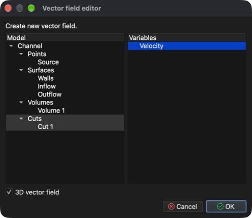
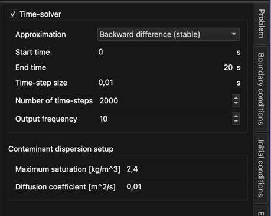
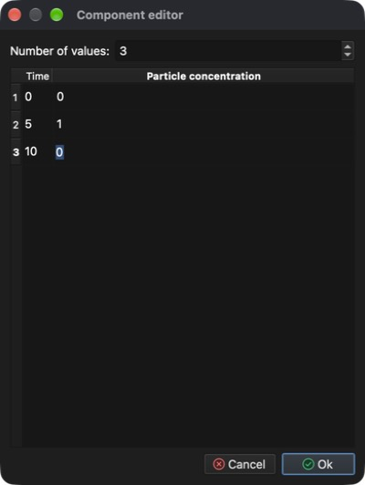
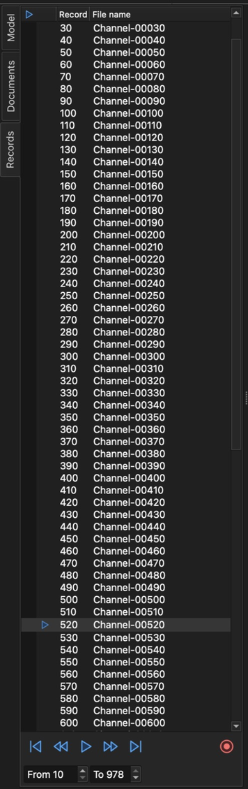

# Rozptyl kontaminantu v tekutinách

Tento návod ukáže, jak nastavit a vyřešit multifyzikální simulaci, která kombinuje nelineární, iterační úlohu – **CFD (Computational Fluid Dynamics, výpočetní dynamika tekutin)** – s transportem kontaminantu unášeného prouděním.

Potřebné jsou dva typy úloh:

1. **Incompressible viscous flow** (nestlačitelné viskózní proudění) – počítá rychlost a tlak tekutiny (ustálené nebo přechodové proudění newtonských tekutin).
2. **Contaminant dispersion** (rozptyl kontaminantu) – počítá, jak se kontaminant v tomto proudovém poli šíří.

Protože je úloha proudění nelineární, řeší se iteračně. Simulace proto probíhá ve dvou etapách:

1. **Ustálené proudění** – nejprve se bez kontaminantu vypočte zkonvergované „počáteční“ proudové pole a rozložení tlaku.
2. **Přechodová simulace** – potom se z tohoto proudového pole pomocí **časového kroku** sleduje, jak je pulz kontaminantu vstupující do kanálu unášen skrz něj.

## 1. Načíst model

**Menu:** _Soubor -> Otevřít model_

V dialogu **Otevřít model** vyberte **Channel.rbm** a klikněte na **Open** (Otevřít).

Model se skládá z jedné bodové entity – **Source** – a tří povrchových entit – **Walls**, **Inflow** a **Outflow**. Protože modelu zatím není přiřazen žádný typ úlohy, po dokončení načítání se automaticky otevře dialog **Vybrat úlohu**.

## 2. Vybrat úlohu (etapa 1 – ustálené proudění)

V první etapě se řeší pouze proudění, a to s mnoha nelineárními iteracemi, aby mohlo zkonvergovat.

1. V dialogu **Vybrat úlohu** klikněte na dlaždici **Incompressible viscous flow**.
2. Ponechte **Maximum iterací** na **2000** a **Konvergence** na **1e-05**, což jsou výchozí hodnoty pro ustálené proudění.
3. Dialog zavřete kliknutím na **OK**.

Dialog lze kdykoli znovu otevřít tlačítkem **Vybrat úlohu** na panelu nástrojů.

## 3. Vygenerovat objemovou síť

Model je definován pouze svými povrchy. Aby bylo možné vyřešit proudění uvnitř, je nejprve nutné vygenerovat objemovou (čtyřstěnnou) síť.

**Menu:** _Geometrie -> Objem -> Generovat čtyřstěnnou síť_

Předvyplněné hodnoty v dialogu **Generovat 3D síť** postačí. Klikněte na **OK**. Po dokončení generování se ve **stromu modelu** pod **Objemy** objeví nová entita **Volume 1**.

## 4. Přiřadit materiál

Všechny entity modelu musí mít přiřazen materiál.

1. Ve **stromu modelu** rozbalte **Objemy**, klikněte na **Source** a potom se stisknutou klávesou _Shift_ klikněte na **Volume 1**, čímž vyberete všechny entity.
2. Otevřete záložku **Materiál** na pravé straně hlavního okna.
3. Zaškrtněte **Water** (voda; je na konci seznamu).

## 5. Okrajové podmínky (etapa 1)

Okrajové podmínky se přiřazují v záložce **Okrajové podmínky** entitě vybrané ve **stromu modelu**. **Povrchovým** entitám přiřaďte tyto podmínky:

1. **Walls**
    - _Wall_ (stěna; hodnota není potřeba)
2. **Inflow**
    - _Volumetric flow rate (inflow)_ (objemový průtok, vtok)
        - Volumetric flow rate = 50 `[m^3/s]`
3. **Outflow**
    - _Pressure (implicit)_ (tlak, implicitní)
        - Pressure = 0 `[Pa]` (výchozí hodnota je 1000 `[Pa]`)

Pro každou entitu: vyberte ji ve **stromu modelu**, v záložce **Okrajové podmínky** zaškrtněte podmínku, vyberte ji, aby se pod seznamem zobrazily její vlastnosti, potom dvakrát klikněte na hodnotu, zadejte novou a stiskněte _Enter_.

## 6. Vyřešit ustálené proudění

**Menu:** _Řešení -> Spustit řešič_

Model **Channel** byl otevřen ze souboru, takže se do něj uloží automaticky. V dialogu **Spustit řešič** klikněte na **OK**. Pokud dialog vypíše chybu, například **Entity Source has no material assigned.**, je tlačítko **OK** neaktivní; nejprve přiřaďte této entitě materiál.

Řešič běží na pozadí a jeho výstup se zobrazuje v záložce **Výstup procesu**. Výpočet všech 2000 iterací trvá několik minut; je dokončen, když výstup končí řádkem **SOLVER - END**. Konvergenci řešení lze kdykoli zkontrolovat pomocí:

**Menu:** _Zprávy -> Konvergence řešiče_

## 7. Vytvořit řez

Dobrým způsobem, jak prozkoumat proudění, je zobrazit rychlost jako **vektorové pole**, kde každá šipka ukazuje směr a velikost proudění v jednom bodě. Vektorové pole vykreslené v celém objemu se však rychle změní v hustý mrak překrývajících se šipek, který se špatně čte. Obvykle je přehlednější model nejprve rozříznout **řezem** – rovinou procházející objemem – a vektorové pole zobrazit jen na této rovině.

_Tip: Před začátkem zaškrtněte ve **stromu modelu** **Objemy**, aby byl objem při umísťování řezu vidět._

**Menu:** _Geometrie -> Řez -> Vytvořit řez_

V dialogu **Editor řezu**:

1. V seznamu **Model** vyberte **Volume 1**. Řez se vytvoří skrz tento objem.
2. **Poloha roviny** určuje bod, kterým rovina řezu prochází. Výchozí hodnoty ji umísťují do středu modelu (**X** = 7,5, **Y** = 2,5, **Z** = 1,5 `[m]`); ponechte je.
3. **Normála roviny** určuje orientaci roviny. Výchozí normála (**X** = 1) dává svislou rovinu; změňte ji na **X** = 0, **Y** = 0, **Z** = 1, abyste získali vodorovnou rovinu procházející polovinou výšky kanálu. Mezi poli se přesouvejte klávesou _Tab_: stisknutím _Enter_ se potvrdí celý dialog.

Rovina řezu se během změny hodnot zobrazuje v náhledu ve **3D oblasti modelu**. Kliknutím na **OK** řez vytvoříte. Ve **stromu modelu** se pod **Řezy** objeví nová entita **Cut 1**.

## 8. Vytvořit vektorové pole

Nyní zobrazte vypočtenou rychlost jako šipky na rovině řezu.

**Menu:** _Geometrie -> Vektorové pole -> Vytvořit vektorové pole_

V dialogu **Editor vektorového pole**:

1. V seznamu **Model** vyberte **Cut 1**. Šipky se vykreslí na rovině řezu vytvořené v předchozím kroku.
2. V seznamu **Proměnné** vyberte **Velocity** (rychlost).
3. Ponechte zaškrtnuté **3D vektorové pole**. Šipky pak ukazují celý vektor rychlosti. Bez zaškrtnutí se každá šipka promítne do roviny řezu a zobrazí se jen složka proudění v rovině.

Kliknutím na **OK** vektorové pole vytvoříte. Objeví se ve **stromu modelu** pod **Vektorová pole** s názvem **Velocity**. Zrušte zaškrtnutí **Objemy**, aby plný objem nezakrýval šipky, a zaškrtněte **Vektorová pole**.

Šipky mohou být příliš krátké, aby byly dobře vidět, protože jejich délka je úměrná rychlosti proudění. Chcete-li je prodloužit, vyberte vektorové pole ve **stromu modelu**, otevřete záložku **Výsledky** a zvětšete hodnotu v sekci **Měřítko deformace a šipek**, například na **100**. Hodnotu zadejte nebo posuňte posuvník vedle ní.

## 9. Vybrat úlohu (etapa 2 – přechodová simulace)

Se zkonvergovaným proudovým polem lze nastavit **přechodovou** simulaci včetně **Contaminant dispersion**.

V přechodové simulaci se úlohy řeší jednou v každém časovém kroku. **Incompressible viscous flow** je stále nelineární, a proto potřebuje v každém časovém kroku vlastní nelineární iterace, zatímco **Contaminant dispersion** se řeší jednou v každém časovém kroku po proudění. Znovu otevřete dialog **Vybrat úlohu** (tlačítko **Vybrat úlohu** na panelu nástrojů) a nastavte jej takto:

1. Klikněte na dlaždici **Contaminant dispersion** (**Incompressible viscous flow** zůstane vybrána a je označena jako **Vyžadována**) a potom kliknutím na **Přizpůsobit…** zobrazte pořadí kroků úlohy.
2. Vyberte **Incompressible viscous flow** a klikněte na tlačítko **>**. Tím ji přesunete do nové, vnořené skupiny iterací.
3. Dvakrát klikněte na hodnotu vnějšího **# of iterations:** a změňte ji z **2000** na **1**. Potom změňte vnitřní (vnořené) **# of iterations:** z **1** na **10**.

Potvrďte kliknutím na **OK**.

## 10. Nastavení řešiče v čase

Otevřete záložku **Úloha** na pravé straně hlavního okna a nastavte (mezi poli se přesouvejte klávesou _Tab_):

1. Zaškrtněte **Řešič v čase**.
2. **Aproximace**: **Backward difference (stable)** (zpětná diference, stabilní).
3. **Velikost časového kroku**: **0,01** `[s]`.
4. **Počet časových kroků**: **2000**.
5. **Frekvence výstupu**: **10** – záznam výsledků se zapíše každý 10. časový krok.

**Koncový čas** se vypočte automaticky (2000 × 0,01 s = 20 s).

V sekci **Nastavení rozptylu kontaminantu** nastavte **Maximum saturation** na **2,4** `[kg/m^3]` a **Diffusion coefficient** na **0,01** `[m^2/s]`. Více informací najdete v teoretické příručce.

## 11. Okrajové podmínky (etapa 2)

Kontaminant vstupuje do kanálu vtokem. Ve **stromu modelu** vyberte **Inflow** a v záložce **Okrajové podmínky** zaškrtněte **Particle concentration** (koncentrace částic; **Volumetric flow rate (inflow)** ponechte zaškrtnuté).

Místo konstantní hodnoty se použije časově závislá hodnota. Rozbalte vlastnost **Particle concentration** (šipka před názvem) a klikněte na **Upravit časově závislé hodnoty**.

V dialogu **Editor složek** nastavte **Počet hodnot** na **3** a zadejte níže uvedené hodnoty (buňku upravíte dvojklikem), potom klikněte na **Ok**.

| Čas `[s]` | Particle concentration `[kg/m^3]` |
| --------- | --------------------------------- |
| 0         | 0                                 |
| 5         | 1                                 |
| 10        | 0                                 |

Mezi dvěma zadanými časy se hodnota lineárně interpoluje a po posledním zadaném čase zůstává poslední hodnota. S těmito hodnotami koncentrace na vtoku během prvních 5 sekund stoupá z 0 na 1 `[kg/m^3]` a mezi 5 a 10 sekundami klesá zpět na 0.

## 12. Vyřešit přechodovou úlohu (restart)

**Menu:** _Řešení -> Spustit řešič_

V dialogu **Spustit řešič** zaškrtněte **Restartovat řešič / pokračovat** a klikněte na **OK**. Řešič pak použije již vypočtené ustálené proudění jako výchozí bod a pokračuje simulací s časovým krokem.

Upozornění **Contaminant dispersion: No implicit boundary condition assigned.** je očekávané a lze ho ignorovat.

## 13. Zobrazit výsledky během běhu řešiče

Přechodový řešič běží na pozadí, takže výsledky lze prohlížet, i když ještě počítá. Jakmile se zapíší první záznamy, objeví se na levé straně hlavního okna záložka **Záznamy**. Výsledky přechodového výpočtu se zobrazí až po načtení záznamu: otevřete záložku **Záznamy**, dvakrát klikněte na nejnovější záznam a vraťte se na záložku **Model** (více o záznamech viz krok 14). Další zobrazovací entity, jako jsou řezy, izoplochy, proudnice, vektorová nebo skalární pole, lze vytvořit kdykoli a zobrazit na nich vypočtené výsledky. Zde se znovu použije řez a vektorové pole z kroků 7 a 8.

### 13.1 Koncentrace kontaminantu na řezu

1. Ve **stromu modelu** rozbalte **Řezy**, zaškrtněte **Cut 1**, aby byl vidět, a vyberte jej.
2. Otevřete záložku **Výsledky** a v rozbalovací nabídce nahoře vyberte **Particle concentration - Scalar**. Pokud nabídka obsahuje jen **Velocity** a **Pressure**, ještě nebyl načten žádný záznam přechodového výpočtu.
3. V sekci **Zobrazit na vybraných entitách** zaškrtněte **Barevná mapa**. Řez je nyní obarven podle koncentrace kontaminantu.
4. V sekci **Barevný rozsah** nastavte **Max** na **1** a **Min** na **0** (zadejte hodnotu a stiskněte _Enter_). To odpovídá rozsahu koncentrace na vtoku, takže stejné barvy znamenají stejnou koncentraci v každém časovém kroku.
5. Zaškrtněte **Zobrazit legendu**, aby se ve **3D oblasti modelu** zobrazila barevná stupnice.

### 13.2 Šipky vektorového pole

Aby byl směr proudění nad obarveným řezem lépe čitelný, vykreslete šipky s hroty a bílou barvou:

1. Zaškrtněte **Vektorová pole** a ve **stromu modelu** vyberte vektorové pole (**Velocity** pod **Vektorová pole**).
2. V **Možnostech zobrazení** pod stromem zaškrtněte **Hroty šipek**.
3. Klikněte na výběr barvy pod zaškrtávacími políčky a zvolte bílou (**#ffffffff**).

Ostatní možnosti zobrazení určují, zda mají všechny šipky stejnou délku (**Šipky stejně dlouhé**) a zda šipky začínají v bodě, ve kterém se rychlost vyhodnocuje (**Šipky vycházející z bodu**).

## 14. Záznamy modelu (výsledky v čase)

Každý 10. časový krok (**Frekvence výstupu**) řešič zapíše záznam modelu s řešením pro daný čas. Záznamy jsou uvedeny v záložce **Záznamy** na levé straně hlavního okna; sloupec **Záznam** ukazuje číslo časového kroku (záznam **500** obsahuje řešení v čase 500 × 0,01 s = 5 s). Dvojklikem na záznam načtete výsledky jeho časového kroku; načtený záznam je označen šipkou a výsledky zobrazené v záložce **Výsledky** zůstanou zachovány a překreslí se pro něj. Legenda ve **3D oblasti modelu** zobrazuje časový krok a čas načteného záznamu (např. **Time-step 520 · 5,19 s**). Tlačítka ve spodní části záložky přehrávají záznamy jeden po druhém.

Výpočet všech 2000 časových kroků chvíli trvá (asi 20 minut na současném počítači). Řešič lze kdykoli zastavit a dosud zapsané záznamy zůstanou zachovány:

**Menu:** _Řešení -> Zastavit řešič_ (potvrďte tlačítkem **Yes** (Ano))

Po zastavení řešiče se načte poslední zapsaný záznam.

## 15. Nahrát video

Video se vytváří z toho, co je právě zobrazeno ve **3D oblasti modelu**, proto nejprve nastavte pohled a zobrazené výsledky (viz krok 13). Nastavení zobrazení se s modelem neukládají, takže po jeho opětovném otevření je třeba je nastavit znovu. Potom otevřete záložku **Záznamy**, pomocí polí **Od** a **Do** ve spodní části zvolte rozsah záznamů a klikněte na červené tlačítko záznamu.

Zobrazí se dialog **Nastavení videa**, ve kterém lze nastavit kodek videa, formát souboru, počet snímků za sekundu a počet snímků na záznam; pod nimi se zobrazí odhadovaná délka videa a počet záznamů. S 98 záznamy (řešič byl zastaven přibližně v čase 9,8 s), 24 snímky za sekundu a 1 snímkem na záznam je video dlouhé asi 4,1 sekundy; všech 200 záznamů úplného výpočtu dá asi 8,3 sekundy. Kliknutím na **OK** spustíte nahrávání.

Nahrávání může chvíli trvat, protože se postupně načte každý záznam modelu a snímek obrazovky **3D oblasti modelu** se použije jako snímek videa.

Video a všechny snímky (jeden obrázek PNG na záznam) najdete v záložce **Dokumenty** pod **Channel**: video **Channel.mp4** pod **Videa** a snímky pod **Obrázky**. Dvojklikem video přehrajete.

