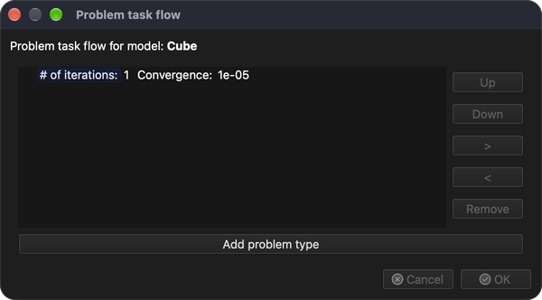

# Nakreslit krychli

Tento návod ukáže, jak nakreslit/vygenerovat jednoduchou geometrii, například krychli.

## 1. Vytvořit nový model

**Nabídka:** _Soubor -> Nový model_

Jako název modelu zadejte **Cube** a klikněte na **OK**. Vytvoří se nový prázdný model s názvem **Cube**. Protože nově vytvořený model nemá přiřazenou žádnou úlohu, zobrazí se dialog **Pořadí kroků úlohy**.

### 1.1 Přiřadit typ úlohy

Typ úlohy přiřadíte kliknutím na tlačítko **Přidat typ úlohy**. V dialogu **Výběr typu úlohy** vyberte **Heat transfer** (přenos tepla).

Kliknutím na **OK** zavřete dialog **Výběr typu úlohy** a poté opět kliknutím na **OK** zavřete dialog **Pořadí kroků úlohy**.

## 2. Nakreslit krychli

**Nabídka:** _Geometrie -> Kreslit -> Nakreslit kvádr_

Po aktivaci položky nabídky se na pravé straně hlavního okna zobrazí panel **Kreslit objekt**, ve kterém lze změnit polohu, velikost a dělení objektu v jednotlivých osách.

Zobrazený objekt se mění současně se změnou hodnot v panelu **Kreslit objekt**. Kliknutím na tlačítko **OK** se objekt přidá do modelu. Zobrazí se potvrzovací dialog se seznamem vybraných modelů, do kterých bude objekt přidán.

Potvrďte kliknutím na **OK** a krychle se přidá do modelu **Cube**.

## 3. Uložit model

Model uložíte následující akcí.

**Nabídka:** _Soubor -> Uložit model_

Pokud model ještě nebyl uložen, program zobrazí dialog **Uložit model** s navrženým názvem souboru a cestou, kam ho uložit. Potvrďte kliknutím na **Uložit**.
