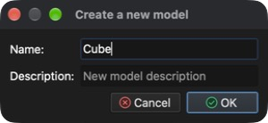
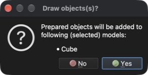

# Nakreslit krychli

Tento návod ukáže, jak nakreslit (vygenerovat) jednoduchou geometrii, například krychli.

## 1. Vytvořit nový model

**Menu:** _Soubor -> Nový model_

Zadejte **Cube** jako název modelu (popis je nepovinný) a klikněte na **OK**. Vytvoří se nový prázdný model s názvem **Cube**. Protože nově vytvořený model nemá přiřazenou žádnou úlohu, zobrazí se dialog **Vybrat úlohu**.

### 1.1 Přiřadit typ úlohy

Pro přiřazení typu úlohy klikněte na dlaždici **Heat transfer** a potom na tlačítko **OK**.

## 2. Nakreslit krychli

**Menu:** _Geometrie -> Kreslit -> Nakreslit kvádr_

Po spuštění akce se na pravé straně hlavního okna zobrazí panel **Kreslit objekt**, ve kterém lze změnit polohu a velikost objektu a počet dělení ve směru X, Y a Z. Výchozím objektem je krychle o hraně 1 `[m]` umístěná v počátku.

Zobrazený objekt se mění současně se změnou hodnot v panelu **Kreslit objekt**. Ponechte zaškrtnuté **Sloučit blízké uzly** a kliknutím na tlačítko **OK** objekt přidejte do modelu. Zobrazí se potvrzovací dialog **Draw objects(s)?** se seznamem vybraných modelů, do kterých bude objekt přidán.

Potvrďte kliknutím na **Yes** (Ano) a krychle se přidá do modelu **Cube** jako jedna entita **Povrch**.

## 3. Uložit model

Model uložíte touto akcí.

**Menu:** _Soubor -> Uložit model_

Pokud model ještě nebyl uložen, program zobrazí dialog **Uložit model** s navrženým názvem souboru (**Cube.rbm**) a složkou, kam se uloží. Potvrďte kliknutím na **Save** (Uložit).
