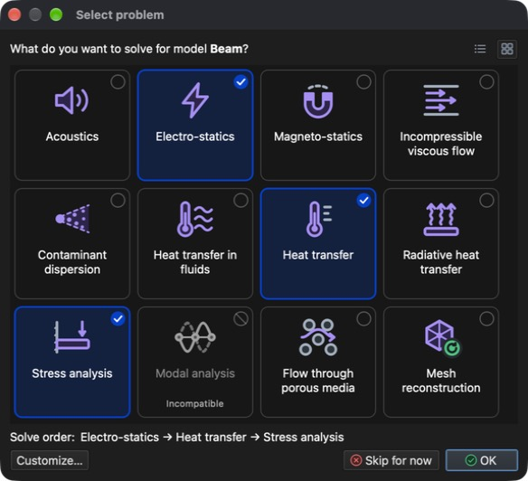
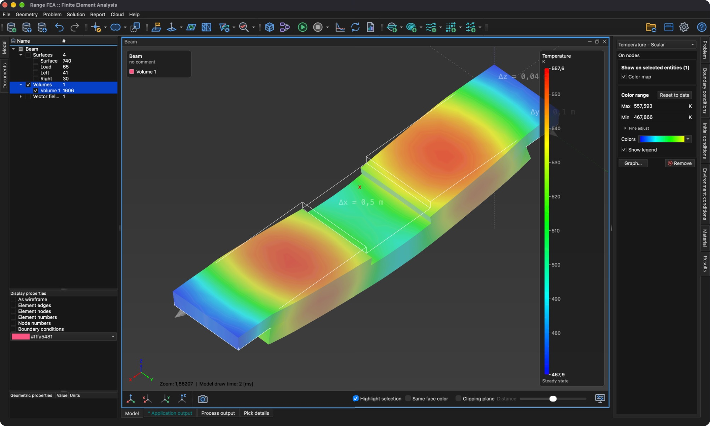

# Multifyzika

Tento návod ukáže, jak na jednom modelu vyřešit několik provázaných úloh. Znovu se použije model **Beam** (nosník) z návodu **Analýza napětí a deformace**. Tentokrát nosníkem protéká elektrický proud, který ho zahřívá (Jouleovo teplo), a teplo způsobí, že se nosník roztáhne a zdeformuje.

Potřebné jsou tři typy úloh, které se řeší v tomto pořadí:

1. **Electro-statics** (elektrostatika) – počítá elektrický potenciál, elektrické pole, proudovou hustotu a Jouleovo teplo vytvořené proudem.
2. **Heat transfer** (přenos tepla) – počítá rozložení teploty způsobené Jouleovým teplem.
3. **Stress analysis** (analýza napětí) – počítá tepelnou roztažnost (posunutí) a výsledné napětí.

Každá úloha využívá výsledky předchozí, proto na pořadí úloh záleží.

## 1. Načíst model

**Menu:** _Soubor -> Otevřít model_

V dialogu **Otevřít model** vyberte **Beam.rbm** a klikněte na **Open** (Otevřít).

Protože modelu zatím není přiřazen žádný typ úlohy, po dokončení načítání se automaticky otevře dialog **Vybrat úlohu**.

## 2. Vybrat úlohy

V dialogu **Vybrat úlohu** klikněte na dlaždice **Electro-statics**, **Heat transfer** a **Stress analysis**. Pod dlaždicemi dialog zobrazí **Pořadí řešení**: Electro-statics → Heat transfer → Stress analysis. **Modal analysis** je označena jako **Nekompatibilní**, protože ji nelze kombinovat s jinými typy úloh. Potvrďte kliknutím na **OK**.

Dialog lze kdykoli znovu otevřít tlačítkem **Vybrat úlohu** na panelu nástrojů.

## 3. Vygenerovat 3D síť

Všechny tři úlohy se řeší na objemové síti.

**Menu:** _Geometrie -> Objem -> Generovat čtyřstěnnou síť_

Předvyplněné hodnoty v dialogu **Generovat 3D síť** postačí. Klikněte na **OK**. Po dokončení generování se ve **stromu modelu** pod **Objemy** objeví nová entita **Volume 1**.

## 4. Přiřadit materiál

Všechny entity modelu musí mít přiřazen materiál. Materiál musí obsahovat vlastnosti potřebné pro všechny tři úlohy; **Iron** (železo) je obsahuje.

1. Ve **stromu modelu** rozbalte **Objemy**, klikněte na **Surface** a potom se stisknutou klávesou _Shift_ klikněte na **Volume 1**, čímž vyberete všechny entity.
2. Otevřete záložku **Materiál** na pravé straně hlavního okna.
3. Zaškrtněte **Iron**.

## 5. Přiřadit okrajové podmínky

Protože je vybráno více typů úloh, nabízí záložka **Okrajové podmínky** podmínky všech těchto úloh a jedna entita může mít přiřazeno více podmínek – jednu pro každou úlohu. **Povrchovým** entitám přiřaďte tyto podmínky:

1. **Surface** (vnější povrch nosníku)
    - _Simple convection_ (jednoduchá konvekce)
        - Convection coefficient = 100 `[W/(m^2*K)]`
        - Fluid temperature = 293,15 `[K]`
2. **Load** (plocha uprostřed nosníku)
    - _Electric potential_ (elektrický potenciál)
        - Electric potential = 0,04 `[V]`
    - _Simple convection_ (hodnoty jako u **Surface**)
3. **Left** a **Right** (plochy na obou koncích nosníku)
    - _Displacement_ (posunutí)
        - Displacement in X, Y and Z direction = 0 `[m]`
    - _Electric potential_
        - Electric potential = -0,04 `[V]`
    - _Simple convection_ (hodnoty jako u **Surface**)

Proud tedy teče ze středu nosníku k oběma koncům a všechny plochy odevzdávají teplo do okolního vzduchu konvekcí.

Pro každou entitu: vyberte ji ve **stromu modelu** (pro výběr **Left** i **Right** držte _Ctrl_ / _⌘ Cmd_), v záložce **Okrajové podmínky** zaškrtněte podmínku, vyberte ji, aby se pod seznamem zobrazily její vlastnosti, potom dvakrát klikněte na hodnotu, zadejte novou a stiskněte _Enter_. Výchozí hodnoty **Simple convection** (100 `[W/(m^2*K)]` a 293,15 `[K]`) a **Displacement** (0 `[m]`) již odpovídají, takže je třeba změnit pouze **Electric potential**.

## 6. Zkontrolovat environmentální podmínky

Environmentální podmínky platí pro celý model a nezaškrtávají se jako okrajové podmínky. Otevřete záložku **Environmentální podmínky** a vyberte každou podmínku, abyste ověřili její hodnoty:

- _Gravitational acceleration_ (gravitační zrychlení)
    - 0, 0 a -9,80665 `[m/s^2]` ve směru X, Y a Z
- _Temperature_ (teplota)
    - Temperature = 293,15 `[K]`

## 7. Vyřešit úlohu

**Menu:** _Řešení -> Spustit řešič_

Před spuštěním řešiče musí být model uložen. Model **Beam** byl otevřen ze souboru, takže se do něj uloží automaticky; model, který ještě nikdy nebyl uložen, nejprve zobrazí dialog **Uložit model**. Poté se zobrazí dialog **Spustit řešič**.

Dialog vypíše tři upozornění: **Electro-statics: No implicit boundary condition assigned.**, **Heat transfer: No explicit boundary condition assigned.** a **Stress analysis: No implicit boundary condition assigned.** Pro toto nastavení jsou očekávaná a lze je ignorovat. Kliknutím na **OK** spustíte řešič.

Řešič běží na pozadí a jeho výstup se zobrazuje v záložce **Výstup procesu**. Úlohy se řeší jedna po druhé v pořadí kroků úlohy; výpočet je dokončen, když výstup končí řádkem **SOLVER - END**.

## 8. Vytvořit vektorové pole

**Vektorové pole** je zobrazovací entita, která vykresluje vektorovou proměnnou jako šipky. Zde se použije k zobrazení elektrického pole uvnitř nosníku.

**Menu:** _Geometrie -> Vektorové pole -> Vytvořit vektorové pole_

V dialogu **Editor vektorového pole** vyberte v seznamu **Model** položku **Volume 1** a v seznamu **Proměnné** položku **Electric field** a ponechte zaškrtnuté **3D vektorové pole**. Seznam **Proměnné** obsahuje vektorové proměnné vypočtené pro vybranou entitu (**Electric field**, **Current density**, **Heat flux**, **Displacement** a **Force**).

Kliknutím na **OK** vektorové pole vytvoříte. Přidá se do **stromu modelu** pod **Vektorová pole** s názvem **Electric field** a vypočtené výsledky lze na něj použít jako na jakoukoli jinou entitu modelu.

## 9. Zobrazit výsledky

Výsledky se zobrazují v záložce **Výsledky** na entitě vybrané ve **stromu modelu**, stejně jako v návodu **Analýza napětí a deformace**.

### 9.1. Teplota a deformace objemu

1. Ve **stromu modelu** zaškrtněte **Objemy** (povrchy ponechte nezaškrtnuté) a potom vyberte **Volume 1**.
2. V záložce **Výsledky** vyberte v rozbalovací nabídce **Temperature - Scalar**, zaškrtněte **Barevná mapa** a **Zobrazit legendu**. Pokud zobrazený rozsah neodpovídá výsledkům, klikněte na **Obnovit podle dat**.
3. V rozbalovací nabídce vyberte **Displacement - Vector [3]**, zaškrtněte **Deformovaný tvar** a nastavte **Měřítko deformace a šipek** na **20**, aby byla deformace vidět (vypočtená posunutí jsou jen asi 1,2 mm).
4. Znovu vyberte **Temperature - Scalar**, aby legenda zobrazovala teplotu.

Teplota se pohybuje přibližně od 468 K do 558 K; nosník je nejteplejší uprostřed obou vnějších částí a prohýbá se nahoru, protože upevněné konce mu nedovolí se volně roztáhnout.

### 9.2. Teplota na vektorovém poli

1. Ve **stromu modelu** zrušte zaškrtnutí **Objemy**, zaškrtněte **Vektorová pole** a vyberte **Electric field**.
2. V záložce **Výsledky** vyberte **Temperature - Scalar**, zaškrtněte **Barevná mapa** a **Zobrazit legendu** (pokud ještě nejsou zaškrtnuté). Šipky jsou nyní obarveny podle teploty v místě, kde se nacházejí.
3. V **Možnostech zobrazení** pod stromem zaškrtněte **Hroty šipek**, aby byl vidět směr elektrického pole. Elektrické pole směřuje ze středu nosníku (vyšší potenciál) k oběma koncům.

