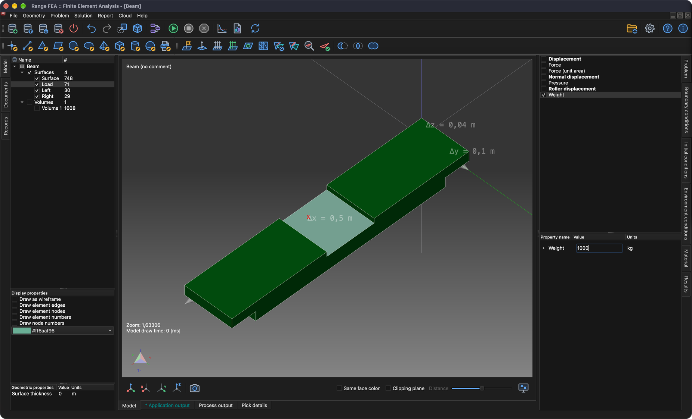

# Analýza napětí a deformace

Tento návod ukáže, jak nastavit a vyřešit úlohu **Stress analysis** (analýza napětí). Použije se jednoduchý nosník podepřený na obou koncích se zatížením uprostřed.

## 1. Načíst model

**Nabídka:** _Soubor -> Otevřít model_

Zobrazí se dialog **Otevřít model**. Vyberte soubor **Beam.tmsh** a kliknutím na **Otevřít** model načtěte.

Protože tomuto modelu není přiřazena žádná fyzikální úloha, zobrazí se brzy po dokončení načítání dialog **Pořadí kroků úlohy**.

Klikněte na tlačítko **Přidat typ úlohy** a zobrazí se dialog **Výběr typu úlohy**. Najděte a zaškrtněte **Stress analysis** a potvrďte kliknutím na **OK**.

Dialog **Pořadí kroků úlohy** by nyní měl zobrazovat 1 iteraci úlohy **Stress analysis**. Potvrďte kliknutím na **OK**.

## 2. Vygenerovat 3D síť

K vyřešení této úlohy je nutné vygenerovat objemovou síť.

**Nabídka:** _Geometrie -> Objem -> Generovat čtyřstěnnou síť_

Tato akce zobrazí dialog **Generovat 3D síť**.

Předvyplněné hodnoty zatím postačují. Potvrďte kliknutím na **OK**.

Po vygenerování sítě se ve stromu **Model** objeví nová entita ve skupině **Objemy**. Chcete-li vygenerovanou síť vidět, skryjte povrchové entity, zobrazte pouze **Objemy** a v **Možnosti zobrazení** zaškrtněte **Vykreslit jako drátový model**.

## 3. Přiřadit materiál

Materiál lze přiřadit pouze vybraným entitám modelu. Entity se vybírají ve stromu **Model**. Chcete-li vybrat více entit, podržte při výběru klávesu _Ctrl_ (na macOS _⌘ Cmd_), případně klávesu _Shift_ pro výběr rozsahu. Po výběru všech entit lze materiál přiřadit v záložce **Materiál** na pravé straně hlavního okna.

Strom **Model** a seznam materiálů jsou zobrazeny na následujícím snímku obrazovky.

Materiál je přiřazen, když je zaškrtnuto políčko před jeho názvem. V tomto návodu se použije **Iron** (železo).

_Poznámka: Všechny entity modelu musí mít přiřazený materiál._

## 4. Přiřadit okrajové podmínky

Okrajové podmínky jsou zadané hodnoty proměnných pole (nebo souvisejících veličin, například derivací) na hranicích pole. Okrajové podmínky se dělí na **explicitní** a **implicitní**. **Explicitní** podmínky jsou zvýrazněny **tučným** písmem.

V tomto návodu se okrajové podmínky přiřadí **povrchovým entitám** takto:

1. **Load**
    - _Weight_ (hmotnost)
        - Weight = 1000 `[kg]`
2. **Left** a **Right**
    - _Displacement_ (posunutí)
        - posunutí ve směru X = 0 `[m]`
        - posunutí ve směru Y = 0 `[m]`
        - posunutí ve směru Z = 0 `[m]`

Okrajovou podmínku **Weight** přiřadíte takto:

1. Ve stromu **Model** vyberte entitu **Load**.
2. Otevřete záložku **Okrajové podmínky**, vyberte a zaškrtněte okrajovou podmínku **Weight**.
3. V poli hodnoty vlastnosti **Weight** nahraďte **1** hodnotou **1000** `[kg]`.

Okrajovou podmínku **Displacement** přiřadíte takto:

1. Ve stromu **Model** vyberte entity **Left** a **Right** (k výběru obou podržte _Ctrl_ / _⌘ Cmd_).
2. V záložce **Okrajové podmínky** vyberte a zaškrtněte okrajovou podmínku **Displacement**.
3. Zkontrolujte, že všechny hodnoty vlastností jsou nastaveny na **0** `[m]`.

## 5. Přiřadit environmentální podmínky

Aby okrajová podmínka **Weight** fungovala správně, musí být nastavena správná environmentální podmínka **Gravitational acceleration** (gravitační zrychlení).

Environmentální podmínky se nezaškrtávají jako okrajové podmínky. Otevřete záložku **Environmentální podmínky** a vyberte **Gravitational acceleration**, abyste zkontrolovali její hodnoty: 0, 0 a -9.80665 `[m/s^2]` ve směru X, Y a Z.

## 6. Vyřešit úlohu

Je-li úloha správně nastavena, lze ji vyřešit.

**Nabídka:** _Řešení -> Spustit řešič_

Před spuštěním řešiče musí být model uložen. Pokud ještě nebyl uložen, nejprve se zobrazí dialog **Uložit model**; potvrďte ho kliknutím na **Uložit** (pokud soubor se stejným názvem již existuje, potvrďte jeho nahrazení). Poté se zobrazí dialog **Spustit řešič pro model**.

Kliknutím na **OK** spustíte proces řešiče.

Proces řešiče běží na pozadí a celý jeho výstup se zobrazuje v záložce **Výstup procesu**, jak je vidět na následujícím snímku obrazovky.

## 7. Použít vypočtené výsledky

Po úspěšném dokončení procesu řešiče by se vypočtené výsledky měly načíst automaticky. Aby se výsledky zobrazily, je nutné je použít na entity modelu. Provádí se to v záložce **Výsledky**. Výsledky se použijí na vybrané entity modelu. K tomuto účelu skryjte všechny povrchové entity a zobrazte pouze **Objemy**.

### 7.1. Posunutí

V rozbalovacím seznamu vyberte **Displacement** (pokud ještě není vybráno). **Displacement** je vektorová proměnná; lze ji použít jako **Scalar** (entita se obarví podle velikosti posunutí) a/nebo jako **Displacement** (entita se prohne). Tentokrát zaškrtněte políčko **Displacement** a **Měřítko** nastavte na **500**, aby byla deformace viditelná.

### 7.2. Von Misesovo napětí

Podobně jako **Displacement** použijte na vybranou entitu ve skupině **Objemy** i **Von Mises Stress** (Von Misesovo napětí). Navíc zaškrtněte políčko **Zobrazit rozsah hodnot**, aby se rozsah hodnot zobrazil ve 3D oblasti.

## 8. Vytvořit zprávu

Někdy je potřeba vytvořit zprávu, ve které se zveřejní vypočtené výsledky.

**Nabídka:** _Zprávy -> Vytvořit zprávu_

Program umí vytvářet zprávy ve více formátech (HTML, Markdown, ODF a PDF), přičemž všechny jsou ve výchozím stavu zaškrtnuté. Tentokrát stačí vytvořit pouze dokument **PDF**, proto zrušte zaškrtnutí všech formátů kromě **Portable Document Format(PDF)** a klikněte na **Ok**.

Po vytvoření zprávy se zobrazí hlášení **Documents have been generated.** (dokumenty byly vytvořeny). Zavřete ho kliknutím na **OK**.

Vytvořené dokumenty se nezobrazují automaticky. Chcete-li je zobrazit, přejděte do stromu **Dokumenty** a dvakrát klikněte na dokument, který chcete otevřít.

