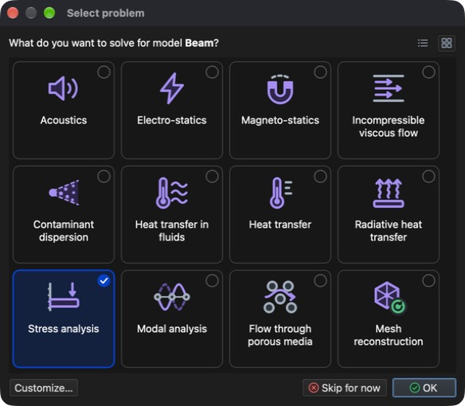
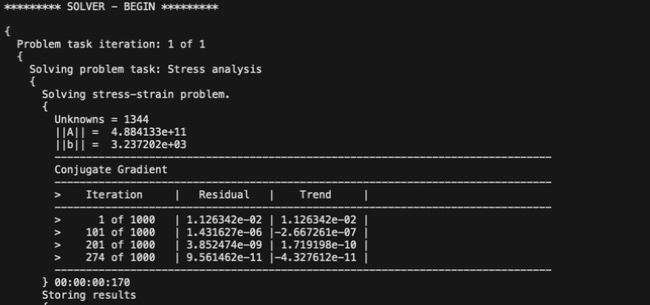
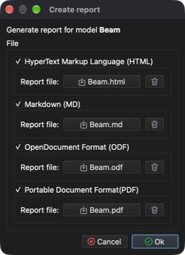

# Analýza napětí a deformace

Tento návod ukáže, jak nastavit a vyřešit úlohu **Stress analysis** (analýza napětí). Použije se jednoduchý nosník podepřený na obou koncích se zatížením uprostřed.

## 1. Načíst model

**Menu:** _Soubor -> Otevřít model_

Zobrazí se dialog **Otevřít model**. Vyberte soubor **Beam.rbm** a kliknutím na **Open** (Otevřít) model načtěte.

Protože tento model nemá přiřazenou žádnou fyzikální úlohu, krátce po dokončení načítání se zobrazí dialog **Vybrat úlohu**.

Klikněte na dlaždici **Stress analysis** a potvrďte kliknutím na **OK**.

## 2. Vygenerovat 3D síť

Pro vyřešení této úlohy je nutné vygenerovat objemovou síť.

**Menu:** _Geometrie -> Objem -> Generovat čtyřstěnnou síť_

Tato akce zobrazí dialog **Generovat 3D síť**.

Prozatím postačí předvyplněné hodnoty. Potvrďte kliknutím na tlačítko **OK**.

Po vygenerování sítě se ve **stromu modelu** objeví nová entita **Objem**. Chcete-li vygenerovanou síť zobrazit, skryjte povrchové entity, zobrazte pouze **Objemy** a v **Možnostech zobrazení** zaškrtněte **Jako drátový model**.

## 3. Přiřadit materiál

Materiál lze přiřadit pouze vybrané entitě modelu. Entity se vybírají ve **stromu modelu**. Chcete-li vybrat více entit, držte při výběru klávesu _Ctrl_ (na macOS _⌘ Cmd_), případně klávesu _Shift_ pro výběr rozsahu. Po výběru všech entit lze materiál přiřadit v záložce **Materiál** na pravé straně hlavního okna.

**Strom modelu** a **seznam materiálů** jsou zobrazeny na následující snímce obrazovky.

Materiál je přiřazen, když je zaškrtnuto políčko před jeho názvem. V tomto návodu se použije **Iron** (železo).

_Poznámka: Všechny entity modelu musí mít přiřazen materiál._

## 4. Přiřadit okrajové podmínky

Okrajové podmínky jsou zadané hodnoty proměnných pole (nebo souvisejících veličin, například derivací) na hranicích pole. Okrajové podmínky se dělí na **explicitní** a **implicitní**. **Explicitní** podmínky jsou zvýrazněny **tučným** písmem.

V tomto návodu se okrajové podmínky přiřadí **povrchovým** entitám takto:

1. **Load**
    - _Weight_ (hmotnost)
        - Weight = 1000 `[kg]`
2. **Left** a **Right**
    - _Displacement_ (posunutí)
        - Displacement in X direction = 0 `[m]`
        - Displacement in Y direction = 0 `[m]`
        - Displacement in Z direction = 0 `[m]`

Okrajovou podmínku **Weight** přiřadíte takto:

1. Vyberte entitu **Load** ve **stromu modelu**.
2. Otevřete záložku **Okrajové podmínky**, vyberte a zaškrtněte okrajovou podmínku **Weight**.
3. Ve vlastnosti **Weight** nahraďte hodnotu **1** hodnotou **1000** `[kg]`.

Okrajovou podmínku **Displacement** přiřadíte takto:

1. Vyberte entity **Left** a **Right** ve **stromu modelu** (pro výběr obou držte _Ctrl_ / _⌘ Cmd_).
2. V záložce **Okrajové podmínky** vyberte a zaškrtněte okrajovou podmínku **Displacement**.
3. Ověřte, že všechny hodnoty vlastností jsou nastaveny na **0** `[m]`.

## 5. Přiřadit environmentální podmínky

Aby okrajová podmínka **Weight** fungovala správně, musí být přiřazena správná environmentální podmínka **Gravitational acceleration** (gravitační zrychlení).

Environmentální podmínky se nezaškrtávají jako okrajové podmínky. Otevřete záložku **Environmentální podmínky** a vyberte **Gravitational acceleration**, abyste ověřili její hodnoty: 0, 0 a -9,80665 `[m/s^2]` ve směru X, Y a Z.

## 6. Vyřešit úlohu

Jakmile je úloha správně nastavena, lze ji vyřešit.

**Menu:** _Řešení -> Spustit řešič_

Před spuštěním řešiče musí být model uložen. Model **Beam** byl otevřen ze souboru, takže se do něj uloží automaticky; model, který ještě nikdy nebyl uložen, nejprve zobrazí dialog **Uložit model** (potvrďte kliknutím na **Save** (Uložit), a pokud již soubor se stejným názvem existuje, potvrďte jeho nahrazení). Poté se zobrazí dialog **Spustit řešič**.

Kliknutím na tlačítko **OK** spustíte proces řešiče.

Proces řešiče běží na pozadí a veškerý jeho výstup se zobrazuje v záložce **Výstup procesu** pod 3D oblastí, jak je vidět na snímce obrazovky níže. Výpočet je dokončen, když výstup končí řádkem **SOLVER - END**.

## 7. Zobrazit vypočtené výsledky

Po úspěšném dokončení procesu řešiče by se vypočtené výsledky měly načíst automaticky. Aby se zobrazily, je třeba je použít na entity modelu. To se provádí v záložce **Výsledky**. Výsledky se zobrazují na vybraných entitách modelu. Za tímto účelem se vraťte na záložku **Model** pod 3D oblastí, skryjte všechny povrchové entity, zobrazte pouze **Objemy** a ve **stromu modelu** vyberte **Volume 1**.

### 7.1. Posunutí

V rozbalovací nabídce vyberte **Displacement** (pokud ještě není vybráno). **Displacement** je vektorová proměnná; lze ji zobrazit jako **Barevnou mapu** (entita se obarví podle velikosti posunutí) a/nebo jako **Deformovaný tvar** (entita se ohne). Tentokrát zaškrtněte políčko **Deformovaný tvar** a nastavte **Měřítko deformace a šipek** na **500**, aby byla deformace vidět.

### 7.2. Napětí podle von Misese

Podobně jako **Displacement** zobrazte **Von Mises stress** na vybrané entitě **Objem**: v rozbalovací nabídce vyberte **Von Mises stress - Scalar** a zaškrtněte **Barevná mapa**. Deformovaný tvar nastavený pro **Displacement** zůstane zobrazen. Navíc zaškrtněte políčko **Zobrazit legendu**, aby se ve 3D oblasti zobrazil rozsah hodnot.

**Von Mises stress** se počítá na prvcích, proto je každý prvek vykreslen jednou barvou. Zaškrtnutím **Vyhlazené zobrazení** se hodnoty prvků zprůměrují v uzlech a obraz bude spojitý; mění se tím pouze zobrazení, ne výsledky.

## 8. Vytvořit zprávu

Někdy je potřeba vytvořit zprávu, ve které budou vypočtené výsledky publikovány.

**Menu:** _Zprávy -> Vytvořit zprávu_

Software umí vytvářet zprávy ve více formátech (HTML, Markdown, ODT a PDF), všechny jsou ve výchozím stavu zaškrtnuté. Tentokrát stačí vytvořit pouze dokument **PDF**, proto zrušte zaškrtnutí všech formátů kromě **Portable Document Format(PDF)** a klikněte na tlačítko **Ok**.

Po vytvoření zprávy se zobrazí zpráva **Documents have been generated.** (Dokumenty byly vytvořeny). Zavřete ji kliknutím na **OK**.

Vytvořené dokumenty se automaticky nezobrazí. Chcete-li je zobrazit, otevřete záložku **Dokumenty** na levé straně hlavního okna, kde jsou uvedeny pod názvem modelu (**Beam**): zpráva pod **Dokumenty** a obrázek 3D oblasti použitý ve zprávě pod **Obrázky**. Dvojklikem otevřete dokument, který chcete zobrazit.

