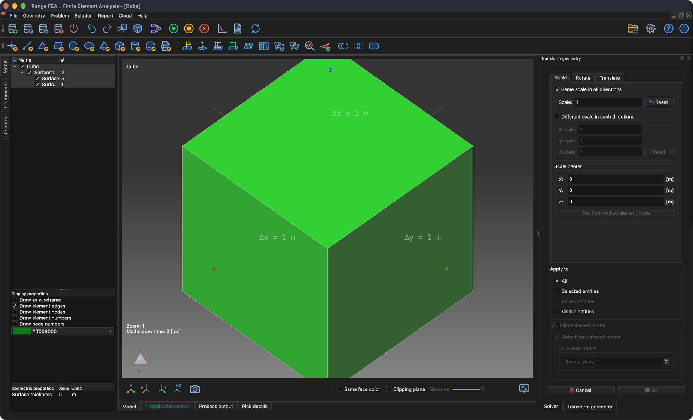

# Transformovat geometrii

Tento návod navazuje na návod **Nakreslit krychli** a ukáže, jak škálovat, otáčet a posouvat celou geometrii nebo jen její části.

## 1. Načíst model

Pokud model **Cube** ještě není načten, otevřete ho akcí nabídky **_Otevřít model_**.

**Nabídka:** _Soubor -> Otevřít model_

Zobrazí se dialog **Otevřít model**. Vyberte soubor **Cube.rbm** a klikněte na **Otevřít**.

Jakmile je model načten, lze jeho geometrii (celou nebo její část) upravovat (transformovat).

## 2. Příprava

**Nabídka:** _Geometrie -> Škálovat, posunout, otočit_

Po aktivaci položky nabídky se na pravé straně hlavního okna zobrazí panel **Transformovat geometrii** se třemi záložkami: **Měřítko**, **Otočit** a **Posunout**.

V tomto návodu se všechny transformace postupně použijí na jednu stěnu krychle.

V tuto chvíli jsou všechny stěny modelu **Cube** seskupeny v jedné **povrchové entitě**. Proto je potřeba jednu stěnu **označit** jako samostatnou **povrchovou entitu**, aby se transformace použily jen na tuto stěnu a ne na ostatní. Slouží k tomu akce nabídky **_Označit povrch_**. Nejprve je však nutné stěnu krychle vybrat.

## 3. Vybrat stěnu

Stiskněte a podržte klávesu **_Ctrl_** (na macOS **_⌘ Cmd_**) a klikněte **_levým tlačítkem myši_** na jednu stěnu krychle. Vybraný prvek se zvýrazní. Protože model **Cube** se skládá ze 6 obdélníkových (čtyřúhelníkových) prvků, odpovídá jeden prvek jedné stěně krychle.

## 4. Označit povrch

**Nabídka:** _Geometrie -> Povrch -> Označit povrch_

Tato akce zobrazí dialog **Označit entitu**. Protože byl v předchozím kroku vybrán jeden prvek, je předvolena možnost **_Označit pouze vybrané a související prvky_**. Kliknutím na tlačítko **Ok** se jedna stěna modelu **Cube** označí jako samostatná **povrchová entita**.

_**Poznámka:** Libovolnou entitu lze přejmenovat **dvojitým kliknutím** **levým tlačítkem myši** na její název ve stromu **Model** na levé straně hlavního okna._

## 5. Škálovat vybranou entitu (stěnu krychle)

Vyberte označený povrch (**_Ctrl_** / **_⌘ Cmd_** + **_levé tlačítko myši_**) a otevřete panel **Transformovat geometrii**.

**Nabídka:** _Geometrie -> Škálovat, posunout, otočit_

1. Zaškrtněte **Stejné měřítko ve všech směrech**.
2. Hodnotu **Měřítko** nastavte na 0,5 (použijte desetinný oddělovač svého systému, např. 0,5 nebo 0.5).
3. Klikněte na tlačítko **Nastavit z označeného prvku/uzlu**.
4. Ve skupině **Použít na** vyberte **Označené entity**.
5. Zkontrolujte, že je zaškrtnuta možnost **Zahrnout sdílené uzly** a **všechna** její podřízená zaškrtávací políčka.

Správné nastavení je zobrazeno na následujícím snímku obrazovky.

Klikněte na **Ok**. Výsledek je zobrazen na následujícím snímku obrazovky.

## 6. Otočit vybranou entitu (škálovanou stěnu krychle)

Otočením vybraného povrchu lze vytvořit vytažený povrch. Otevřete panel **Transformovat geometrii**.

**Nabídka:** _Geometrie -> Škálovat, posunout, otočit_

Přepněte na záložku **Otočit** a zadejte hodnoty podle následujícího snímku obrazovky:

1. V **Úhly rotace** nastavte **X** na -90.
2. Klikněte na tlačítko **Nastavit z označeného prvku/uzlu** a poté ve **Střed rotace** změňte **Z** na 0.
3. Ve skupině **Použít na** vyberte **Označené entity**.
4. Zkontrolujte, že jsou zaškrtnuty možnosti **Zahrnout sdílené uzly**, **Odpojit/rozdělit sdílené uzly** a **Vytáhnout uzly**, a **Počet kroků vytažení** nastavte na 6.

_Poznámka: **Počet kroků vytažení: 6** vytvoří šest nových segmentů._

Klikněte na **Ok**. Výsledek je zobrazen na následujícím snímku obrazovky.

