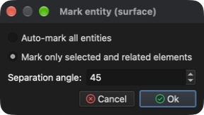
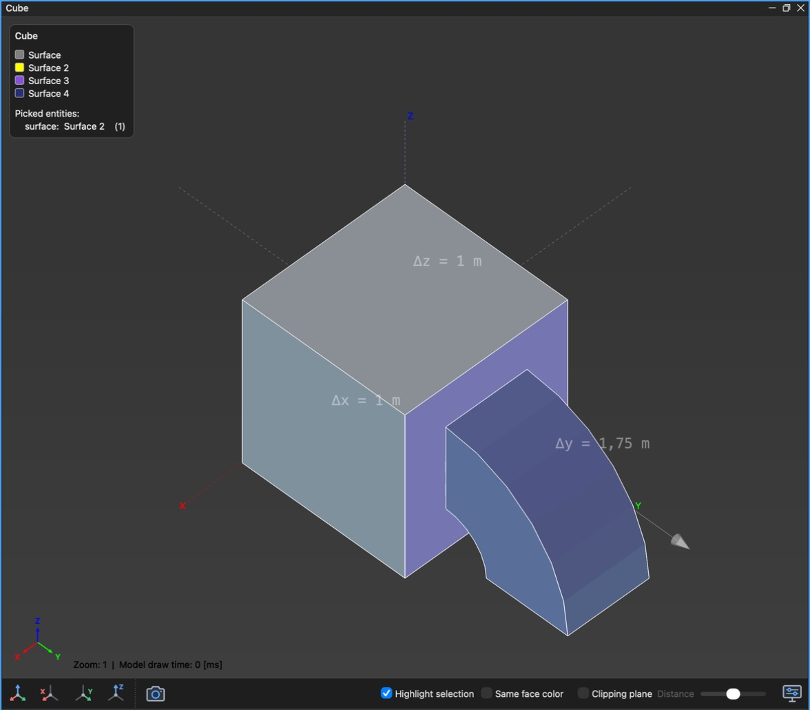

# Transformovat geometrii

Tento návod navazuje na návod **Nakreslit krychli** a ukáže, jak škálovat, otáčet a posouvat celou geometrii nebo jen její části.

## 1. Načíst model

Pokud model **Cube** ještě není načten, lze to provést akcí **_Otevřít model_**.

**Menu:** _Soubor -> Otevřít model_

Zobrazí se dialog **Otevřít model**. Vyberte soubor **Cube.rbm** a klikněte na **Open** (Otevřít).

Jakmile je model připraven, lze jeho geometrii (celou nebo část) upravit (transformovat).

## 2. Příprava

**Menu:** _Geometrie -> Škálovat, posunout, otočit_

Po spuštění akce se na pravé straně hlavního okna zobrazí panel **Transformovat geometrii** se třemi záložkami: **Měřítko**, **Otočit** a **Posunout**. Skupina **Použít na** pod záložkami určuje, která část modelu se transformuje.

V tomto návodu se všechny transformace postupně použijí na jednu stěnu krychle. Panel prozatím zavřete kliknutím na **Zrušit**.

V tuto chvíli jsou všechny stěny modelu **Cube** seskupeny v jedné **entitě povrchu**. Proto je třeba jednu stěnu **označit** jako samostatnou **entitu povrchu**, aby se transformace použily pouze na tuto stěnu a ne na ostatní. K tomu slouží akce **_Označit povrch_**. Nejprve je však třeba stěnu krychle vybrat.

## 3. Vybrat stěnu

Stiskněte a držte klávesu **_Ctrl_** (na macOS **_⌘ Cmd_**) a klikněte **_levým tlačítkem myši_** na stěnu krychle, která směřuje k ose **Y**. Vybraný prvek se zvýrazní a zobrazí se v sekci **Picked entities** v přehledu v levém horním rohu 3D oblasti. Protože se model **Cube** skládá ze 6 obdélníkových (čtyřúhelníkových) prvků, odpovídá jeden prvek jedné stěně krychle.

## 4. Označit povrch

**Menu:** _Geometrie -> Povrch -> Označit povrch_

Tato akce zobrazí dialog **Mark entity (surface)**. Protože byl v předchozím kroku jeden prvek **vybrán**, je předvolena možnost **_Označit pouze vybrané a související prvky_**. Kliknutím na tlačítko **Ok** se jedna stěna modelu **Cube** označí jako samostatná **entita povrchu** s názvem **Surface 2**.

_**Poznámka:** Každou entitu lze přejmenovat **dvojklikem** **levým tlačítkem myši** na název entity ve **stromu modelu** na levé straně hlavního okna._

## 5. Škálovat vybranou entitu (stěnu krychle)

Vyberte označený povrch (**_Ctrl_** / **_⌘ Cmd_** + **_levé tlačítko myši_**) a otevřete panel **Transformovat geometrii**.

**Menu:** _Geometrie -> Škálovat, posunout, otočit_

1. Na záložce **Měřítko** ponechte zaškrtnuté **Stejné měřítko ve všech směrech**.
2. Nastavte hodnotu **Měřítko** na 0,5 (použijte desetinný oddělovač vašeho systému, např. 0,5 nebo 0.5).
3. Klikněte na tlačítko **Nastavit z označeného prvku/uzlu**. **Střed škálování** se nastaví do středu vybrané stěny (0,5; 1; 0,5).
4. Ve skupině **Použít na** vyberte **Označené entity**.
5. Ujistěte se, že je zaškrtnuto **Zahrnout sdílené uzly** i všechna jeho podřízená zaškrtávací políčka.

Správné nastavení je vidět na následující snímce obrazovky.

Klikněte na **Ok**. Vybraná stěna se zmenší na polovinu a mezera mezi zmenšenou stěnou a zbytkem krychle se vyplní novou entitou povrchu (**Surface 3**). Výsledek je vidět na následující snímce obrazovky.

## 6. Otočit vybranou entitu (zmenšenou stěnu krychle)

Otočením vybraného povrchu lze vytvořit vytažený povrch. Otevřete panel **Transformovat geometrii**.

**Menu:** _Geometrie -> Škálovat, posunout, otočit_

Přepněte na záložku **Otočit** a zadejte hodnoty podle následující snímky obrazovky:

1. Nastavte **Úhly rotace** **X** na -90.
2. Klikněte na tlačítko **Nastavit z označeného prvku/uzlu** a potom změňte **Střed rotace** **Z** na 0.
3. Ve skupině **Použít na** vyberte **Označené entity**.
4. Ujistěte se, že jsou zaškrtnuta **Zahrnout sdílené uzly**, **Odpojit/rozdělit sdílené uzly** a **Vytáhnout uzly**, a nastavte **Počet kroků vytažení** na 6.

_Poznámka: **Počet kroků vytažení: 6** vytvoří šest nových segmentů._

Klikněte na **Ok**. Vytažené segmenty se přidají jako nová entita povrchu (**Surface 4**). Výsledek je vidět na následující snímce obrazovky.

