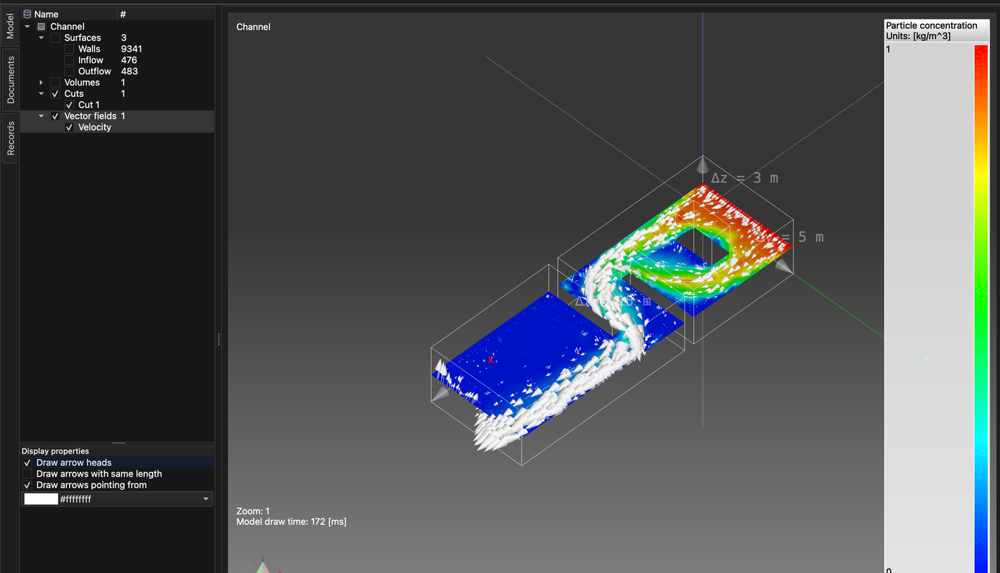

# Schadstoffausbreitung in Fluiden

Dieses Tutorial zeigt, wie eine Multiphysik-Simulation eingerichtet und gelöst wird, die ein nichtlineares, iteratives Problem – **CFD (numerische Strömungsmechanik)** – mit dem Transport eines von der Strömung mitgeführten Schadstoffs kombiniert.

Es werden zwei Problemtypen benötigt:

1. **Incompressible viscous flow** (inkompressible viskose Strömung) – berechnet Geschwindigkeit und Druck des Fluids (stationäre oder transiente Strömung newtonscher Fluide).
2. **Contaminant dispersion** (Schadstoffausbreitung) – berechnet, wie sich ein Schadstoff in diesem Strömungsfeld ausbreitet.

Da das Strömungsproblem nichtlinear ist, wird es iterativ gelöst. Die Simulation wird daher in zwei Phasen durchgeführt:

1. **Stationäre Strömung** – zuerst werden ohne Schadstoff ein konvergiertes „Anfangs“-Strömungsfeld und die Druckverteilung berechnet.
2. **Transiente Simulation** – anschließend wird ausgehend von diesem Strömungsfeld mit **Zeitschrittverfahren** verfolgt, wie ein in den Kanal eintretender Schadstoffpuls durch ihn transportiert wird.

## 1. Modell laden

**Menü:** _Datei -> Modell öffnen_

Wählen Sie im Dialog **Modell öffnen** die Datei **Channel.tmsh** und klicken Sie auf **Öffnen**.

Das Modell besteht aus drei Flächenentitäten – **Walls**, **Inflow** und **Outflow**. Da dem Modell noch kein Problemtyp zugewiesen ist, öffnet sich nach dem Laden automatisch der Dialog **Aufgabenablauf des Problems**.

## 2. Aufgabenablauf des Problems (Phase 1 – stationäre Strömung)

In der ersten Phase wird nur die Strömung gelöst, und zwar mit vielen nichtlinearen Iterationen, damit die Lösung konvergieren kann.

1. Klicken Sie im Dialog **Aufgabenablauf des Problems** auf **Problemtyp hinzufügen**.
2. Aktivieren Sie in der **Problemtyp-Auswahl** den Eintrag **Incompressible viscous flow** und klicken Sie auf **OK**.
3. Doppelklicken Sie auf den Wert **1** neben **Anzahl Iterationen:**, geben Sie **2000** ein und drücken Sie _Enter_.
4. Klicken Sie auf **OK**, um den Dialog zu schließen.

Der Dialog kann jederzeit über die Schaltfläche **Aufgabenablauf der Probleme** in der Werkzeugleiste erneut geöffnet werden. Er sollte nun so aussehen:

## 3. Volumennetz erzeugen

Das Modell ist nur durch seine Flächen definiert. Um eine Strömung in seinem Inneren zu lösen, muss zuerst ein Volumennetz (Tetraedernetz) erzeugt werden.

**Menü:** _Geometrie -> Volumen -> Tetraedernetz erzeugen_

Die vorausgefüllten Werte im Dialog **3D-Netz erzeugen** reichen aus. Klicken Sie auf **OK**. Nach Abschluss der Vernetzung erscheint im Baum **Modell** unter **Volumen** eine neue Entität **Volume 1**.

## 4. Material zuweisen

Allen Modellentitäten muss ein Material zugewiesen sein.

1. Klicken Sie im Baum **Modell** auf **Walls** und dann mit gedrückter _Umschalt_-Taste auf **Volume 1**, um alle Entitäten auszuwählen.
2. Öffnen Sie die Registerkarte **Material** auf der rechten Seite des Hauptfensters.
3. Aktivieren Sie **Water** (Wasser).

## 5. Randbedingungen (Phase 1)

Randbedingungen werden auf der Registerkarte **Randbedingungen** der im Baum **Modell** ausgewählten Entität zugewiesen. Weisen Sie den **Flächen**-Entitäten die folgenden Bedingungen zu:

1. **Walls**
    - _Wall_ (Wand; kein Wert erforderlich)
2. **Inflow**
    - _Volumetric flow rate (inflow)_ (Volumenstrom, Zufluss)
        - Volumetric flow rate = 50 `[m^3/s]`
3. **Outflow**
    - _Pressure (implicit)_ (Druck, implizit)
        - Pressure = 0 `[Pa]` (der Standardwert ist 1000 `[Pa]`)

Für jede Entität: Wählen Sie sie im Baum **Modell** aus, aktivieren Sie die Bedingung auf der Registerkarte **Randbedingungen**, wählen Sie die Bedingung aus, damit ihre Eigenschaften unter der Liste angezeigt werden, doppelklicken Sie dann auf den Wert, geben Sie den neuen ein und drücken Sie _Enter_.

## 6. Stationäre Strömung lösen

**Menü:** _Lösung -> Löser starten_

Wurde das Modell noch nicht gespeichert, wird zuerst der Dialog **Modell speichern** angezeigt. Klicken Sie auf **Speichern**, um den vorgeschlagenen Dateinamen (**Channel.rbm**) zu übernehmen, und klicken Sie dann im Dialog **Löser für Modell starten** auf **OK**.

Der Löser läuft im Hintergrund, und seine Ausgabe wird auf der Registerkarte **Prozessausgabe** angezeigt. Die Berechnung aller 2000 Iterationen dauert einige Minuten; der Lauf ist abgeschlossen, wenn die Ausgabe mit **SOLVER - END** endet. Die Konvergenz der Lösung kann jederzeit überprüft werden mit:

**Menü:** _Bericht -> Konvergenz des Lösers_

## 7. Schnitt erstellen

Eine gute Möglichkeit, eine Strömung zu untersuchen, ist die Darstellung der Geschwindigkeit als **Vektorfeld**, wobei jeder Pfeil Richtung und Betrag der Strömung an einem Punkt zeigt. Ein durch das gesamte Volumen gezeichnetes Vektorfeld wird jedoch schnell zu einer dichten Wolke sich überlagernder Pfeile, die schwer zu lesen ist. Meist ist es übersichtlicher, das Modell zuerst mit einem **Schnitt** – einer Ebene durch das Volumen – zu zerlegen und das Vektorfeld dann nur auf dieser Ebene anzuzeigen.

_Tipp: Aktivieren Sie vor dem Start **Volumen** im Baum **Modell**, damit das Volumen beim Positionieren des Schnitts sichtbar ist._

**Menü:** _Geometrie -> Schnitt -> Schnitt erstellen_

Im Dialog **Schnitteditor**:

1. Wählen Sie in der Liste **Modell** den Eintrag **Volume 1** aus. Der Schnitt wird durch dieses Volumen erstellt.
2. **Ebenenposition** legt einen Punkt fest, durch den die Schnittebene verläuft. Die Standardwerte setzen ihn in die Mitte des Modells (**X** = 7.5, **Y** = 2.5, **Z** = 1.5 `[m]`); behalten Sie sie bei.
3. **Ebenennormale** legt die Ausrichtung der Ebene fest. Die Standardnormale (**X** = 1) ergibt eine senkrechte Ebene; ändern Sie sie auf **X** = 0, **Y** = 0, **Z** = 1, um eine waagerechte Ebene zu erhalten, die den Kanal auf halber Höhe schneidet.

Während die Werte geändert werden, wird die Schnittebene im **3D-Modellbereich** in einer Vorschau angezeigt. Klicken Sie auf **OK**, um den Schnitt zu erstellen. Im Baum **Modell** erscheint unter **Schnitte** eine neue Entität **Cut 1**.

## 8. Vektorfeld erstellen

Stellen Sie nun die berechnete Geschwindigkeit als Pfeile auf der Schnittebene dar.

**Menü:** _Geometrie -> Vektorfeld -> Vektorfeld erstellen_

Im Dialog **Vektorfeld-Editor**:

1. Wählen Sie in der Liste **Modell** den Eintrag **Cut 1** aus. Die Pfeile werden auf der im vorherigen Schritt erstellten Schnittebene gezeichnet.
2. Wählen Sie in der Liste **Variablen** den Eintrag **Velocity** (Geschwindigkeit) aus.
3. Lassen Sie **3D-Vektorfeld** aktiviert. Die Pfeile zeigen dann den vollständigen Geschwindigkeitsvektor. Ist die Option deaktiviert, wird jeder Pfeil auf die Schnittebene projiziert, und es wird nur der in der Ebene liegende Anteil der Strömung angezeigt.

Klicken Sie auf **OK**, um das Vektorfeld zu erstellen. Es erscheint im Baum **Modell** unter **Vektorfelder**. Deaktivieren Sie **Volumen**, damit das massive Volumen die Pfeile nicht verdeckt.

Die Pfeile können zu kurz sein, um gut sichtbar zu sein, da ihre Länge proportional zur Strömungsgeschwindigkeit ist. Um sie zu verlängern, wählen Sie das Vektorfeld im Baum **Modell** aus, öffnen Sie die Registerkarte **Ergebnisse** und erhöhen Sie den Wert im Abschnitt **Maßstab**. Der Maßstab ist das Produkt aus dem Wert **Maßstab** und der in **Faktor** eingestellten Zehnerpotenz; im folgenden Beispiel ergeben **Maßstab** 1 und **Faktor** 2 einen Maßstab von `1 × 10^2 = 100`.

## 9. Aufgabenablauf des Problems (Phase 2 – transient)

Sobald ein konvergiertes Strömungsfeld vorliegt, kann die **transiente** Simulation einschließlich **Contaminant dispersion** konfiguriert werden.

In einer transienten Simulation werden die Probleme einmal pro Zeitschritt gelöst. **Incompressible viscous flow** ist weiterhin nichtlinear und benötigt daher in jedem Zeitschritt eigene nichtlineare Iterationen, während **Contaminant dispersion** einmal pro Zeitschritt nach der Strömung gelöst wird. Öffnen Sie den Dialog **Aufgabenablauf des Problems** erneut (Schaltfläche **Aufgabenablauf der Probleme** in der Werkzeugleiste) und richten Sie ihn wie folgt ein:

1. Wählen Sie **Incompressible viscous flow** aus und klicken Sie auf die Schaltfläche **>**. Dadurch wird es in eine neue, verschachtelte Iterationsgruppe verschoben.
2. Doppelklicken Sie auf den Wert der äußeren **Anzahl Iterationen:** und ändern Sie ihn von **2000** auf **1**. Ändern Sie dann die innere (verschachtelte) **Anzahl Iterationen:** von **1** auf **10**.
3. Klicken Sie auf **Problemtyp hinzufügen**, aktivieren Sie **Contaminant dispersion** und klicken Sie auf **OK**. **Incompressible viscous flow** wird ebenfalls automatisch aktiviert, da die Schadstoffausbreitung ein Strömungsfeld benötigt. Wird auf der äußeren Ebene ein zweiter Eintrag **Incompressible viscous flow** hinzugefügt, wählen Sie ihn aus und klicken Sie auf **Entfernen**.

Der Aufgabenablauf sollte wie im folgenden Screenshot aussehen. Bestätigen Sie mit **OK**.

## 10. Einstellungen des Zeitlösers

Öffnen Sie die Registerkarte **Problem** auf der rechten Seite des Hauptfensters und stellen Sie Folgendes ein:

1. Aktivieren Sie **Zeitlöser**.
2. **Approximation**: **Backward difference (stable)** (Rückwärtsdifferenz – stabil).
3. **Zeitschrittweite**: **0.01** `[s]`.
4. **Anzahl der Zeitschritte**: **2000**.
5. **Ausgabefrequenz**: **10** – bei jedem 10. Zeitschritt wird ein Ergebnisdatensatz geschrieben.

Die **Endzeit** wird automatisch berechnet (2000 × 0.01 s = 20 s).

Setzen Sie im Abschnitt **Einstellungen der Schadstoffausbreitung** die **Maximale Sättigung** auf **2.4** `[kg/m^3]` und den **Diffusionskoeffizienten** auf **0.01** `[m^2/s]`. Weitere Informationen finden Sie im Theoriehandbuch.

## 11. Randbedingungen (Phase 2)

Der Schadstoff tritt über den Zufluss in den Kanal ein. Wählen Sie im Baum **Modell** den Eintrag **Inflow** aus und aktivieren Sie auf der Registerkarte **Randbedingungen** die Bedingung **Particle concentration** (Partikelkonzentration); **Volumetric flow rate (inflow)** bleibt aktiviert.

Statt eines konstanten Werts wird ein zeitabhängiger Wert verwendet. Klappen Sie die Eigenschaft **Particle concentration** auf (Pfeil vor ihrem Namen) und klicken Sie auf **Zeitabhängige Werte bearbeiten**.

Setzen Sie im Dialog **Komponenteneditor** die **Anzahl der Werte** auf **3**, geben Sie die folgenden Werte ein (Doppelklick auf eine Zelle zum Bearbeiten) und klicken Sie dann auf **Ok**.

| Zeit `[s]` | Particle concentration `[kg/m^3]` |
| ---------- | --------------------------------- |
| 0          | 0                                 |
| 5          | 1                                 |
| 10         | 0                                 |

Zwischen zwei angegebenen Zeitpunkten wird der Wert linear interpoliert, und nach dem letzten angegebenen Zeitpunkt bleibt der letzte Wert erhalten. Mit diesen Werten steigt die Konzentration am Zufluss in den ersten 5 Sekunden von 0 auf 1 `[kg/m^3]` und fällt zwischen 5 und 10 Sekunden wieder auf 0.

## 12. Transientes Problem lösen (Neustart)

**Menü:** _Lösung -> Löser starten_

Aktivieren Sie im Dialog **Löser für Modell starten** die Option **Löser neu starten / fortsetzen** und klicken Sie auf **OK**. Der Löser verwendet dann die bereits berechnete stationäre Strömung als Ausgangspunkt und setzt mit der Simulation im Zeitschrittverfahren fort.

Die Warnung **Contaminant dispersion: No implicit boundary condition assigned.** ist zu erwarten und kann ignoriert werden.

## 13. Ergebnisse während der Lösung anzeigen

Der transiente Löser läuft im Hintergrund, sodass die Ergebnisse bereits während der Berechnung untersucht werden können. Weitere Anzeigeentitäten wie Schnitte, ISO-Flächen, Stromlinien, Vektorfelder oder Skalarfelder können jederzeit erstellt und die berechneten Ergebnisse darauf angezeigt werden. Hier werden der Schnitt und das Vektorfeld aus den Schritten 7 und 8 wiederverwendet.

### 13.1 Schadstoffkonzentration auf dem Schnitt

1. Klappen Sie im Baum **Modell** die Gruppe **Schnitte** auf, aktivieren Sie **Cut 1**, damit er sichtbar ist, und wählen Sie ihn aus.
2. Öffnen Sie die Registerkarte **Ergebnisse** und wählen Sie in der Dropdown-Liste oben **Particle concentration - Scalar**.
3. Aktivieren Sie unter **Anwenden als ...** die Option **Scalar**. Der Schnitt wird nun nach der Schadstoffkonzentration eingefärbt.
4. Setzen Sie unter **Wertebereich und Farbskala** das **Maximum** auf **1** und das **Minimum** auf **0** (Wert eingeben und _Enter_ drücken). Dies entspricht dem Bereich der Zuflusskonzentration, sodass dieselben Farben in jedem Zeitschritt dieselbe Konzentration bedeuten.
5. Aktivieren Sie **Wertebereich anzeigen**, um die Farbskala im **3D-Modellbereich** anzuzeigen.

### 13.2 Pfeile des Vektorfelds

Damit die Strömungsrichtung über dem eingefärbten Schnitt besser lesbar ist, zeichnen Sie die Pfeile mit Spitzen und in Weiß:

1. Wählen Sie im Baum **Modell** das Vektorfeld aus (**Velocity** unter **Vektorfelder**).
2. Aktivieren Sie in den **Anzeigeeigenschaften** unter dem Baum die Option **Pfeilspitzen zeichnen**.
3. Klicken Sie auf die Farbauswahl unter den Kontrollkästchen und wählen Sie Weiß (**#ffffffff**).

Die übrigen Anzeigeeigenschaften steuern, ob alle Pfeile dieselbe Länge haben (**Pfeile mit gleicher Länge zeichnen**) und ob die Pfeile an dem Punkt beginnen, an dem die Geschwindigkeit ausgewertet wird (**Pfeile vom Punkt ausgehend zeichnen**).

## 14. Modelldatensätze (Ergebnisse in der Zeit)

Bei jedem 10. Zeitschritt (der **Ausgabefrequenz**) schreibt der Löser einen Modelldatensatz mit der Lösung für diesen Zeitpunkt. Die Datensätze werden auf der Registerkarte **Datensätze** auf der linken Seite des Hauptfensters aufgelistet; die Spalte **Datensatz** zeigt die Nummer des Zeitschritts (Datensatz **500** enthält die Lösung zum Zeitpunkt 500 × 0.01 s = 5 s). Doppelklicken Sie auf einen Datensatz, um die Ergebnisse für seinen Zeitschritt zu laden; die auf der Registerkarte **Ergebnisse** angewendeten Ergebnisse bleiben erhalten und werden für den geladenen Datensatz neu gezeichnet.

Die Berechnung aller 2000 Zeitschritte dauert eine Weile (etwa 20 Minuten auf einem aktuellen Computer). Der Löser kann jederzeit angehalten werden; die bis dahin geschriebenen Datensätze bleiben erhalten:

**Menü:** _Lösung -> Löser anhalten_ (mit **Yes** bestätigen)

## 15. Video aufnehmen

Ein Video wird aus dem erstellt, was aktuell im **3D-Modellbereich** angezeigt wird. Richten Sie daher zuerst die Ansicht und die angezeigten Ergebnisse ein (siehe Schritt 13). Die Anzeigeeinstellungen werden nicht mit dem Modell gespeichert und müssen nach dem erneuten Öffnen wieder eingestellt werden. Öffnen Sie dann die Registerkarte **Datensätze**, wählen Sie mit den Feldern **Von** und **Bis** im unteren Bereich den Bereich der Datensätze und klicken Sie auf die rote Schaltfläche **Datensatz**.

Es erscheint der Dialog **Videoeinstellungen**, in dem Videocodec, Dateiformat, Bilder pro Sekunde und Bilder pro Datensatz eingestellt werden können; darunter wird die geschätzte Videolänge angezeigt. Bei 202 Datensätzen, 24 Bildern pro Sekunde und 1 Bild pro Datensatz ist das Video etwa 8.4 Sekunden lang. Klicken Sie auf **OK**, um die Aufnahme zu starten.

Die Aufnahme kann einige Zeit dauern, da jeder Modelldatensatz nacheinander geladen und ein Screenshot des **3D-Modellbereichs** als Videobild aufgenommen wird.

Das Video und alle Einzelbilder (ein PNG-Bild pro Datensatz) befinden sich auf der Registerkarte **Dokumente** unter **Channel**; das Video **Channel.mp4** steht am Ende der Liste. Doppelklicken Sie darauf, um das Video abzuspielen.

