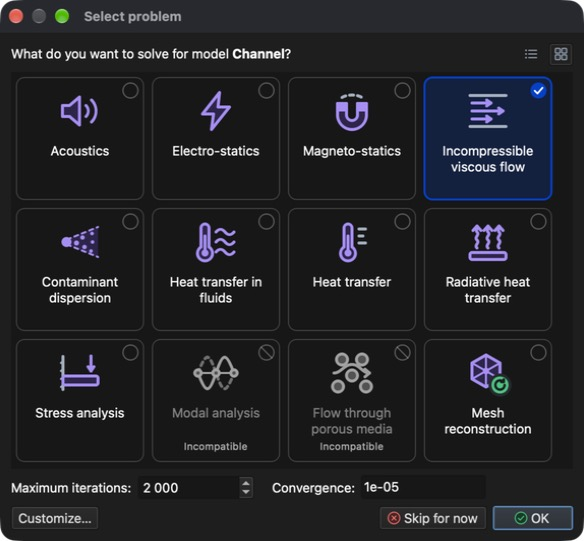
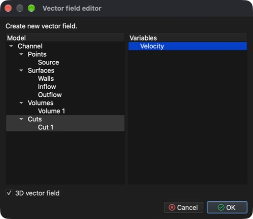
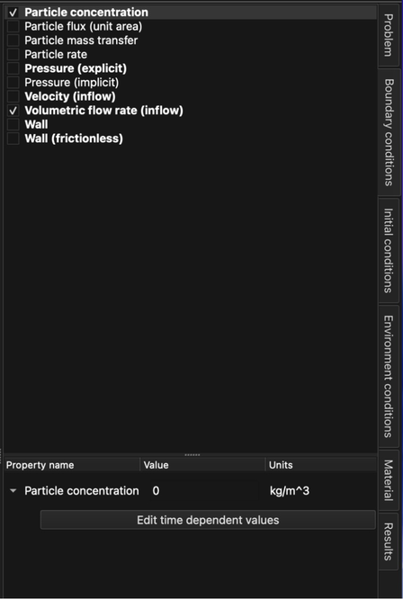
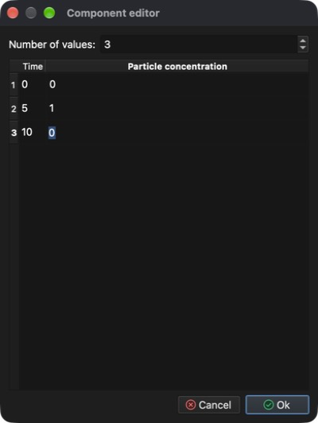
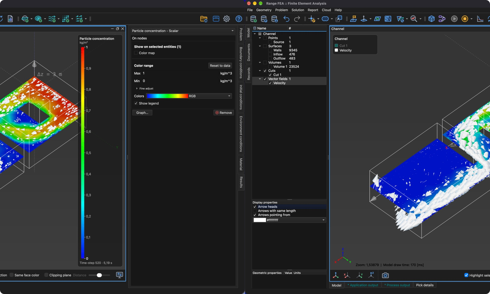
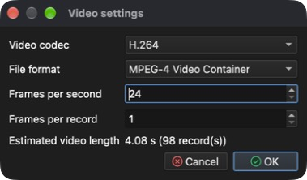

# Schadstoffausbreitung in Fluiden

Dieses Tutorial zeigt, wie eine Multiphysik-Simulation eingerichtet und gelöst wird, die ein nichtlineares, iteratives Problem – **CFD (Computational Fluid Dynamics, numerische Strömungsmechanik)** – mit dem Transport eines von der Strömung mitgeführten Schadstoffs kombiniert.

Es werden zwei Problemtypen benötigt:

1. **Incompressible viscous flow** (inkompressible viskose Strömung) – berechnet Geschwindigkeit und Druck des Fluids (stationäre oder transiente Strömung newtonscher Fluide).
2. **Contaminant dispersion** (Schadstoffausbreitung) – berechnet, wie sich ein Schadstoff in diesem Strömungsfeld ausbreitet.

Da das Strömungsproblem nichtlinear ist, wird es iterativ gelöst. Die Simulation läuft daher in zwei Stufen ab:

1. **Stationäre Strömung** – zuerst werden ohne Schadstoff ein konvergiertes „Anfangs“-Strömungsfeld und die Druckverteilung berechnet.
2. **Transiente Simulation** – danach wird ausgehend von diesem Strömungsfeld mit **Zeitschritten** verfolgt, wie ein in den Kanal eintretender Schadstoffpuls durch ihn transportiert wird.

## 1. Modell laden

**Menü:** _Datei -> Modell öffnen_

Wählen Sie im Dialog **Modell öffnen** **Channel.rbm** und klicken Sie auf **Open** (Öffnen).

Das Modell besteht aus einer Punktentität – **Source** – und drei Flächenentitäten – **Walls**, **Inflow** und **Outflow**. Da dem Modell noch kein Problemtyp zugewiesen ist, öffnet sich nach dem Laden automatisch der Dialog **Problem auswählen**.

## 2. Problem auswählen (Stufe 1 – stationäre Strömung)

In der ersten Stufe wird nur die Strömung gelöst, mit vielen nichtlinearen Iterationen, damit sie konvergieren kann.

1. Klicken Sie im Dialog **Problem auswählen** auf die Kachel **Incompressible viscous flow**.
2. Lassen Sie **Maximale Iterationen** auf **2000** und **Konvergenz** auf **1e-05**; das sind die Standardwerte für eine stationäre Strömung.
3. Schließen Sie den Dialog mit **OK**.

Der Dialog kann jederzeit über die Schaltfläche **Problem auswählen** in der Werkzeugleiste erneut geöffnet werden.

## 3. Volumennetz erzeugen

Das Modell ist nur durch seine Flächen definiert. Um eine Strömung in seinem Inneren zu lösen, muss zuerst ein Volumennetz (Tetraedernetz) erzeugt werden.

**Menü:** _Geometrie -> Volumen -> Tetraedernetz erzeugen_

Die vorausgefüllten Werte im Dialog **3D-Netz erzeugen** genügen. Klicken Sie auf **OK**. Nach dem Vernetzen erscheint im **Modellbaum** unter **Volumen** eine neue Entität **Volume 1**.

## 4. Material zuweisen

Allen Modellentitäten muss ein Material zugewiesen sein.

1. Klappen Sie im **Modellbaum** **Volumen** auf, klicken Sie auf **Source** und dann mit gedrückter _Umschalttaste_ auf **Volume 1**, um alle Entitäten auszuwählen.
2. Öffnen Sie die Registerkarte **Material** auf der rechten Seite des Hauptfensters.
3. Aktivieren Sie **Water** (Wasser; es steht am Ende der Liste).

## 5. Randbedingungen (Stufe 1)

Randbedingungen werden in der Registerkarte **Randbedingungen** der im **Modellbaum** ausgewählten Entität zugewiesen. Weisen Sie den **Flächen**-Entitäten folgende Bedingungen zu:

1. **Walls**
    - _Wall_ (Wand; kein Wert nötig)
2. **Inflow**
    - _Volumetric flow rate (inflow)_ (Volumenstrom, Einlass)
        - Volumetric flow rate = 50 `[m^3/s]`
3. **Outflow**
    - _Pressure (implicit)_ (Druck, implizit)
        - Pressure = 0 `[Pa]` (der Standardwert ist 1000 `[Pa]`)

Für jede Entität: Wählen Sie sie im **Modellbaum** aus, aktivieren Sie die Bedingung in der Registerkarte **Randbedingungen**, wählen Sie die Bedingung aus, damit ihre Eigenschaften unter der Liste angezeigt werden, doppelklicken Sie dann auf den Wert, geben Sie den neuen ein und drücken Sie _Enter_.

## 6. Stationäre Strömung lösen

**Menü:** _Lösung -> Löser starten_

Das Modell **Channel** wurde aus einer Datei geöffnet und wird daher automatisch dort gespeichert. Klicken Sie im Dialog **Löser starten** auf **OK**. Listet der Dialog einen Fehler wie **Entity Source has no material assigned.**, ist die Schaltfläche **OK** deaktiviert; weisen Sie dieser Entität zuerst das Material zu.

Der Löser läuft im Hintergrund, und seine Ausgabe wird in der Registerkarte **Prozessausgabe** angezeigt. Die Berechnung aller 2000 Iterationen dauert einige Minuten; sie ist beendet, wenn die Ausgabe mit **SOLVER - END** endet. Die Konvergenz der Lösung kann jederzeit geprüft werden mit:

**Menü:** _Bericht -> Konvergenz des Lösers_

## 7. Einen Schnitt erstellen

Eine gute Möglichkeit, eine Strömung zu untersuchen, ist die Darstellung der Geschwindigkeit als **Vektorfeld**, in dem jeder Pfeil Richtung und Betrag der Strömung an einem Punkt zeigt. Ein im gesamten Volumen gezeichnetes Vektorfeld wird jedoch schnell zu einer dichten Wolke sich überlagernder Pfeile, die schwer zu lesen ist. Meist ist es übersichtlicher, das Modell zuerst mit einem **Schnitt** – einer Ebene durch das Volumen – zu zerschneiden und das Vektorfeld nur auf dieser Ebene anzuzeigen.

_Tipp: Aktivieren Sie vor dem Start **Volumen** im **Modellbaum**, damit das Volumen beim Positionieren des Schnitts sichtbar ist._

**Menü:** _Geometrie -> Schnitt -> Schnitt erstellen_

Im Dialog **Schnitteditor**:

1. Wählen Sie in der Liste **Modell** **Volume 1** aus. Der Schnitt wird durch dieses Volumen erstellt.
2. **Ebenenposition** legt einen Punkt fest, durch den die Schnittebene verläuft. Die Standardwerte setzen sie in die Mitte des Modells (**X** = 7,5, **Y** = 2,5, **Z** = 1,5 `[m]`); behalten Sie sie bei.
3. **Ebenennormale** legt die Ausrichtung der Ebene fest. Die Standardnormale (**X** = 1) ergibt eine senkrechte Ebene; ändern Sie sie auf **X** = 0, **Y** = 0, **Z** = 1, um eine waagerechte Ebene in halber Höhe des Kanals zu erhalten. Wechseln Sie zwischen den Feldern mit _Tab_: _Enter_ bestätigt den ganzen Dialog.

Die Schnittebene wird während der Änderung der Werte im **3D-Modellbereich** in der Vorschau angezeigt. Klicken Sie auf **OK**, um den Schnitt zu erstellen. Im **Modellbaum** erscheint unter **Schnitte** eine neue Entität **Cut 1**.

## 8. Ein Vektorfeld erstellen

Zeigen Sie nun die berechnete Geschwindigkeit als Pfeile auf der Schnittebene an.

**Menü:** _Geometrie -> Vektorfeld -> Vektorfeld erstellen_

Im Dialog **Vektorfeld-Editor**:

1. Wählen Sie in der Liste **Modell** **Cut 1** aus. Die Pfeile werden auf der im vorigen Schritt erstellten Schnittebene gezeichnet.
2. Wählen Sie in der Liste **Variablen** **Velocity** (Geschwindigkeit) aus.
3. Lassen Sie **3D-Vektorfeld** aktiviert. Die Pfeile zeigen dann den vollständigen Geschwindigkeitsvektor. Ist es deaktiviert, wird jeder Pfeil auf die Schnittebene projiziert und nur der Strömungsanteil in der Ebene gezeigt.

Klicken Sie auf **OK**, um das Vektorfeld zu erstellen. Es erscheint im **Modellbaum** unter **Vektorfelder** mit dem Namen **Velocity**. Deaktivieren Sie **Volumen**, damit das Volumen die Pfeile nicht verdeckt, und aktivieren Sie **Vektorfelder**.

Die Pfeile können zu kurz sein, um gut sichtbar zu sein, da ihre Länge proportional zur Strömungsgeschwindigkeit ist. Um sie zu verlängern, wählen Sie das Vektorfeld im **Modellbaum** aus, öffnen Sie die Registerkarte **Ergebnisse** und erhöhen Sie den Wert im Abschnitt **Maßstab für Verformung und Pfeile**, zum Beispiel auf **100**. Geben Sie den Wert ein oder ziehen Sie den Schieberegler daneben.

## 9. Problem auswählen (Stufe 2 – transient)

Mit einem konvergierten Strömungsfeld kann die **transiente** Simulation einschließlich **Contaminant dispersion** eingerichtet werden.

In einer transienten Simulation werden die Probleme einmal pro Zeitschritt gelöst. **Incompressible viscous flow** ist weiterhin nichtlinear und benötigt daher in jedem Zeitschritt eigene nichtlineare Iterationen, während **Contaminant dispersion** einmal pro Zeitschritt nach der Strömung gelöst wird. Öffnen Sie den Dialog **Problem auswählen** erneut (Schaltfläche **Problem auswählen** in der Werkzeugleiste) und richten Sie ihn wie folgt ein:

1. Klicken Sie auf die Kachel **Contaminant dispersion** (**Incompressible viscous flow** bleibt ausgewählt und ist als **Erforderlich** gekennzeichnet) und dann auf **Anpassen…**, um den Aufgabenablauf anzuzeigen.
2. Wählen Sie **Incompressible viscous flow** aus und klicken Sie auf die Schaltfläche **>**. Damit wird die Aufgabe in eine neue, verschachtelte Iterationsgruppe verschoben.
3. Doppelklicken Sie auf den Wert des äußeren **# of iterations:** und ändern Sie ihn von **2000** auf **1**. Ändern Sie dann das innere (verschachtelte) **# of iterations:** von **1** auf **10**.

Bestätigen Sie mit **OK**.

## 10. Einstellungen des Zeitlösers

Öffnen Sie die Registerkarte **Problem** auf der rechten Seite des Hauptfensters und stellen Sie ein (wechseln Sie zwischen den Feldern mit _Tab_):

1. Aktivieren Sie **Zeitlöser**.
2. **Approximation**: **Backward difference (stable)** (Rückwärtsdifferenz, stabil).
3. **Zeitschrittweite**: **0,01** `[s]`.
4. **Anzahl der Zeitschritte**: **2000**.
5. **Ausgabefrequenz**: **10** – jeder 10. Zeitschritt wird ein Ergebnisdatensatz geschrieben.

Die **Endzeit** wird automatisch berechnet (2000 × 0,01 s = 20 s).

Setzen Sie im Abschnitt **Einstellungen der Schadstoffausbreitung** **Maximum saturation** auf **2,4** `[kg/m^3]` und **Diffusion coefficient** auf **0,01** `[m^2/s]`. Weitere Informationen finden Sie im Theoriehandbuch.

## 11. Randbedingungen (Stufe 2)

Der Schadstoff tritt durch den Einlass in den Kanal ein. Wählen Sie **Inflow** im **Modellbaum** aus und aktivieren Sie in der Registerkarte **Randbedingungen** **Particle concentration** (Partikelkonzentration; lassen Sie **Volumetric flow rate (inflow)** aktiviert).

Statt eines konstanten Werts wird ein zeitabhängiger Wert verwendet. Klappen Sie die Eigenschaft **Particle concentration** auf (Pfeil vor ihrem Namen) und klicken Sie auf **Zeitabhängige Werte bearbeiten**.

Setzen Sie im Dialog **Komponenteneditor** **Anzahl der Werte** auf **3**, geben Sie die folgenden Werte ein (Doppelklick auf eine Zelle zum Bearbeiten) und klicken Sie auf **Ok**.

| Zeit `[s]` | Particle concentration `[kg/m^3]` |
| ---------- | --------------------------------- |
| 0          | 0                                 |
| 5          | 1                                 |
| 10         | 0                                 |

Zwischen zwei angegebenen Zeiten wird der Wert linear interpoliert, und nach der letzten angegebenen Zeit bleibt der letzte Wert erhalten. Mit diesen Werten steigt die Konzentration am Einlass in den ersten 5 Sekunden von 0 auf 1 `[kg/m^3]` und fällt zwischen 5 und 10 Sekunden wieder auf 0.

## 12. Transientes Problem lösen (Neustart)

**Menü:** _Lösung -> Löser starten_

Aktivieren Sie im Dialog **Löser starten** **Löser neu starten / fortsetzen** und klicken Sie auf **OK**. Der Löser verwendet dann die bereits berechnete stationäre Strömung als Ausgangspunkt und setzt mit der zeitschrittweisen Simulation fort.

Die Warnung **Contaminant dispersion: No implicit boundary condition assigned.** ist zu erwarten und kann ignoriert werden.

## 13. Ergebnisse während der Berechnung anzeigen

Der transiente Löser läuft im Hintergrund, sodass Ergebnisse schon während der Berechnung betrachtet werden können. Sobald die ersten Datensätze geschrieben sind, erscheint auf der linken Seite des Hauptfensters die Registerkarte **Datensätze**. Die Ergebnisse der transienten Berechnung werden erst nach dem Laden eines Datensatzes angezeigt: Öffnen Sie die Registerkarte **Datensätze**, doppelklicken Sie auf den neuesten Datensatz und kehren Sie zur Registerkarte **Modell** zurück (mehr zu Datensätzen in Schritt 14). Weitere Anzeigeentitäten wie Schnitte, ISOs, Stromlinien, Vektor- oder Skalarfelder können jederzeit erstellt und berechnete Ergebnisse darauf angezeigt werden. Hier werden der Schnitt und das Vektorfeld aus den Schritten 7 und 8 wiederverwendet.

### 13.1 Schadstoffkonzentration auf dem Schnitt

1. Klappen Sie im **Modellbaum** **Schnitte** auf, aktivieren Sie **Cut 1**, damit er sichtbar ist, und wählen Sie ihn aus.
2. Öffnen Sie die Registerkarte **Ergebnisse** und wählen Sie im Dropdown-Menü oben **Particle concentration - Scalar**. Bietet die Liste nur **Velocity** und **Pressure** an, wurde noch kein Datensatz der transienten Berechnung geladen.
3. Aktivieren Sie unter **Auf ausgewählten Entitäten anzeigen** **Farbkarte**. Der Schnitt ist nun nach der Schadstoffkonzentration eingefärbt.
4. Setzen Sie unter **Farbbereich** **Max** auf **1** und **Min** auf **0** (Wert eingeben und _Enter_ drücken). Das entspricht dem Bereich der Einlasskonzentration, sodass gleiche Farben in jedem Zeitschritt dieselbe Konzentration bedeuten.
5. Aktivieren Sie **Legende anzeigen**, um die Farbskala im **3D-Modellbereich** anzuzeigen.

### 13.2 Pfeile des Vektorfelds

Damit die Strömungsrichtung auf dem eingefärbten Schnitt besser lesbar ist, zeichnen Sie die Pfeile mit Spitzen und in Weiß:

1. Aktivieren Sie **Vektorfelder** und wählen Sie das Vektorfeld (**Velocity** unter **Vektorfelder**) im **Modellbaum** aus.
2. Aktivieren Sie in den **Anzeigeeigenschaften** unter dem Baum **Pfeilspitzen**.
3. Klicken Sie auf die Farbauswahl unter den Kontrollkästchen und wählen Sie Weiß (**#ffffffff**).

Die übrigen Anzeigeeigenschaften legen fest, ob alle Pfeile gleich lang sind (**Pfeile mit gleicher Länge**) und ob die Pfeile an dem Punkt beginnen, an dem die Geschwindigkeit ausgewertet wird (**Pfeile vom Punkt ausgehend**).

## 14. Modelldatensätze (Ergebnisse über die Zeit)

Jeden 10. Zeitschritt (die **Ausgabefrequenz**) schreibt der Löser einen Modelldatensatz mit der Lösung für diesen Zeitpunkt. Die Datensätze sind in der Registerkarte **Datensätze** auf der linken Seite des Hauptfensters aufgeführt; die Spalte **Datensatz** zeigt die Nummer des Zeitschritts (Datensatz **500** enthält die Lösung zum Zeitpunkt 500 × 0,01 s = 5 s). Doppelklicken Sie auf einen Datensatz, um die Ergebnisse seines Zeitschritts zu laden; der geladene Datensatz ist mit einem Pfeil markiert, und die in der Registerkarte **Ergebnisse** angewendeten Ergebnisse bleiben erhalten und werden für ihn neu gezeichnet. Die Legende im **3D-Modellbereich** zeigt Zeitschritt und Zeit des geladenen Datensatzes (z. B. **Time-step 520 · 5,19 s**). Mit den Schaltflächen unten in der Registerkarte werden die Datensätze nacheinander abgespielt.

Die Berechnung aller 2000 Zeitschritte dauert eine Weile (etwa 20 Minuten auf einem aktuellen Computer). Der Löser kann jederzeit angehalten werden, und die bis dahin geschriebenen Datensätze bleiben erhalten:

**Menü:** _Lösung -> Löser anhalten_ (mit **Yes** (Ja) bestätigen)

Wenn der Löser anhält, wird der zuletzt geschriebene Datensatz geladen.

## 15. Ein Video aufnehmen

Ein Video wird aus dem erstellt, was gerade im **3D-Modellbereich** angezeigt wird; richten Sie daher zuerst die Ansicht und die angezeigten Ergebnisse ein (siehe Schritt 13). Anzeigeeinstellungen werden nicht mit dem Modell gespeichert und müssen nach dem erneuten Öffnen wieder eingestellt werden. Öffnen Sie dann die Registerkarte **Datensätze**, wählen Sie mit den Feldern **Von** und **Bis** unten den Bereich der Datensätze und klicken Sie auf die rote Aufnahmeschaltfläche.

Der Dialog **Videoeinstellungen** erscheint, in dem Videocodec, Dateiformat, Bilder pro Sekunde und Bilder pro Datensatz eingestellt werden können; darunter werden die geschätzte Videolänge und die Anzahl der Datensätze angezeigt. Mit 98 Datensätzen (der Löser wurde bei etwa 9,8 s angehalten), 24 Bildern pro Sekunde und 1 Bild pro Datensatz ist das Video etwa 4,1 Sekunden lang; alle 200 Datensätze einer vollständigen Berechnung ergeben etwa 8,3 Sekunden. Klicken Sie auf **OK**, um die Aufnahme zu starten.

Die Aufnahme kann einige Zeit dauern, da jeder Modelldatensatz nacheinander geladen und ein Screenshot des **3D-Modellbereichs** als Videobild aufgenommen wird.

Das Video und alle Bilder (ein PNG-Bild pro Datensatz) finden Sie in der Registerkarte **Dokumente** unter **Channel**: das Video **Channel.mp4** unter **Videos** und die Bilder unter **Bilder**. Doppelklicken Sie auf das Video, um es abzuspielen.

