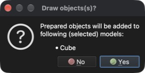

# Würfel zeichnen

Dieses Tutorial zeigt, wie eine einfache Geometrie wie ein Würfel gezeichnet (erzeugt) wird.

## 1. Ein neues Modell erstellen

**Menü:** _Datei -> Neues Modell_

Geben Sie **Cube** als Modellnamen ein (die Beschreibung ist optional) und klicken Sie auf **OK**. Ein neues, leeres Modell mit dem Namen **Cube** wird erstellt. Da dem neu erstellten Modell kein Problem zugewiesen ist, wird der Dialog **Problem auswählen** angezeigt.

### 1.1 Problemtyp zuweisen

Um einen Problemtyp zuzuweisen, klicken Sie auf die Kachel **Heat transfer** und dann auf die Schaltfläche **OK**.

## 2. Einen Würfel zeichnen

**Menü:** _Geometrie -> Zeichnen -> Quader zeichnen_

Nach dem Aufruf des Menüpunkts wird auf der rechten Seite des Hauptfensters das Panel **Objekt zeichnen** angezeigt, in dem Position und Größe des Objekts sowie die Anzahl der Unterteilungen in X-, Y- und Z-Richtung geändert werden können. Das Standardobjekt ist ein Würfel mit 1 `[m]` Kantenlänge im Ursprung.

Das angezeigte Objekt ändert sich gleichzeitig mit den Werten im Panel **Objekt zeichnen**. Lassen Sie **Nahe Knoten zusammenführen** aktiviert und klicken Sie auf **OK**, um das Objekt dem Modell hinzuzufügen. Ein Bestätigungsdialog **Draw objects(s)?** mit der Liste der ausgewählten Modelle, denen das Objekt hinzugefügt wird, erscheint.

Klicken Sie zur Bestätigung auf **Yes** (Ja); der Würfel wird dem Modell **Cube** als eine **Fläche**-Entität hinzugefügt.

## 3. Modell speichern

Um das Modell zu speichern, führen Sie folgende Aktion aus.

**Menü:** _Datei -> Modell speichern_

Wurde das Modell noch nicht gespeichert, zeigt das Programm den Dialog **Modell speichern** mit einem vorgeschlagenen Dateinamen (**Cube.rbm**) und Ordner an. Klicken Sie zur Bestätigung auf **Save** (Sichern).
