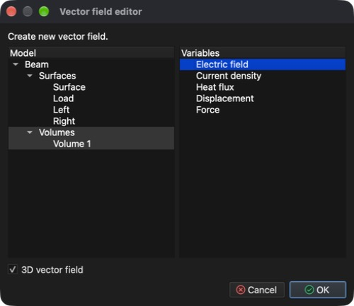

# Multiphysik

Dieses Tutorial zeigt, wie mehrere gekoppelte Probleme an einem Modell gelöst werden. Erneut wird das Modell **Beam** (Balken) aus dem Tutorial **Spannungs- und Verformungsanalyse** verwendet. Diesmal fließt ein elektrischer Strom durch den Balken, der Strom erwärmt den Balken (Joulesche Wärme), und die Wärme lässt den Balken sich ausdehnen und verformen.

Es werden drei Problemtypen benötigt, die in dieser Reihenfolge gelöst werden:

1. **Electro-statics** (Elektrostatik) – berechnet das elektrische Potential, das elektrische Feld, die Stromdichte und die vom Strom erzeugte Joulesche Wärme.
2. **Heat transfer** (Wärmeübertragung) – berechnet die durch die Joulesche Wärme verursachte Temperaturverteilung.
3. **Stress analysis** (Spannungsanalyse) – berechnet die Wärmeausdehnung (Verschiebungen) und die daraus entstehende Spannung.

Jedes Problem verwendet die Ergebnisse des vorherigen, daher ist die Reihenfolge der Probleme wichtig.

## 1. Modell laden

**Menü:** _Datei -> Modell öffnen_

Wählen Sie im Dialog **Modell öffnen** **Beam.rbm** und klicken Sie auf **Open** (Öffnen).

Da dem Modell noch kein Problemtyp zugewiesen ist, öffnet sich nach dem Laden automatisch der Dialog **Problem auswählen**.

## 2. Probleme auswählen

Klicken Sie im Dialog **Problem auswählen** auf die Kacheln **Electro-statics**, **Heat transfer** und **Stress analysis**. Unter den Kacheln zeigt der Dialog die **Lösungsreihenfolge**: Electro-statics → Heat transfer → Stress analysis. **Modal analysis** ist als **Inkompatibel** gekennzeichnet, da sie nicht mit anderen Problemtypen kombiniert werden kann. Bestätigen Sie mit **OK**.

Der Dialog kann jederzeit über die Schaltfläche **Problem auswählen** in der Werkzeugleiste erneut geöffnet werden.

## 3. 3D-Netz erzeugen

Alle drei Probleme werden auf einem Volumennetz gelöst.

**Menü:** _Geometrie -> Volumen -> Tetraedernetz erzeugen_

Die vorausgefüllten Werte im Dialog **3D-Netz erzeugen** genügen. Klicken Sie auf **OK**. Nach dem Vernetzen erscheint im **Modellbaum** unter **Volumen** eine neue Entität **Volume 1**.

## 4. Material zuweisen

Allen Modellentitäten muss ein Material zugewiesen sein. Das Material muss die von allen drei Problemen benötigten Eigenschaften enthalten; **Iron** (Eisen) enthält sie.

1. Klappen Sie im **Modellbaum** **Volumen** auf, klicken Sie auf **Surface** und dann mit gedrückter _Umschalttaste_ auf **Volume 1**, um alle Entitäten auszuwählen.
2. Öffnen Sie die Registerkarte **Material** auf der rechten Seite des Hauptfensters.
3. Aktivieren Sie **Iron**.

## 5. Randbedingungen zuweisen

Da mehrere Problemtypen ausgewählt sind, bietet die Registerkarte **Randbedingungen** nun die Bedingungen aller dieser Probleme an, und einer Entität können mehrere Bedingungen zugewiesen werden – eine für jedes Problem. Weisen Sie den **Flächen**-Entitäten folgende Bedingungen zu:

1. **Surface** (die Außenfläche des Balkens)
    - _Simple convection_ (einfache Konvektion)
        - Convection coefficient = 100 `[W/(m^2*K)]`
        - Fluid temperature = 293,15 `[K]`
2. **Load** (die Fläche in der Mitte des Balkens)
    - _Electric potential_ (elektrisches Potential)
        - Electric potential = 0,04 `[V]`
    - _Simple convection_ (Werte wie bei **Surface**)
3. **Left** und **Right** (die Flächen an beiden Enden des Balkens)
    - _Displacement_ (Verschiebung)
        - Displacement in X, Y and Z direction = 0 `[m]`
    - _Electric potential_
        - Electric potential = -0,04 `[V]`
    - _Simple convection_ (Werte wie bei **Surface**)

Der Strom fließt also von der Mitte des Balkens zu beiden Enden, und alle Flächen geben durch Konvektion Wärme an die umgebende Luft ab.

Für jede Entität: Wählen Sie sie im **Modellbaum** aus (halten Sie _Strg_ / _⌘ Cmd_ gedrückt, um **Left** und **Right** auszuwählen), aktivieren Sie die Bedingung in der Registerkarte **Randbedingungen**, wählen Sie die Bedingung aus, damit ihre Eigenschaften unter der Liste angezeigt werden, doppelklicken Sie dann auf den Wert, geben Sie den neuen ein und drücken Sie _Enter_. Die Standardwerte von **Simple convection** (100 `[W/(m^2*K)]` und 293,15 `[K]`) und **Displacement** (0 `[m]`) passen bereits, sodass nur **Electric potential** geändert werden muss.

## 6. Umgebungsbedingungen prüfen

Umgebungsbedingungen gelten für das gesamte Modell und werden nicht wie Randbedingungen aktiviert. Öffnen Sie die Registerkarte **Umgebungsbedingungen** und wählen Sie jede Bedingung aus, um ihre Werte zu prüfen:

- _Gravitational acceleration_ (Erdbeschleunigung)
    - 0, 0 und -9,80665 `[m/s^2]` in X-, Y- und Z-Richtung
- _Temperature_ (Temperatur)
    - Temperature = 293,15 `[K]`

## 7. Problem lösen

**Menü:** _Lösung -> Löser starten_

Das Modell muss gespeichert sein, bevor der Löser starten kann. Das Modell **Beam** wurde aus einer Datei geöffnet und wird daher automatisch dort gespeichert; ein Modell, das noch nie gespeichert wurde, zeigt zuerst den Dialog **Modell speichern**. Danach wird der Dialog **Löser starten** angezeigt.

Der Dialog listet drei Warnungen auf: **Electro-statics: No implicit boundary condition assigned.**, **Heat transfer: No explicit boundary condition assigned.** und **Stress analysis: No implicit boundary condition assigned.** Sie sind für diese Einrichtung zu erwarten und können ignoriert werden. Klicken Sie auf **OK**, um den Löser zu starten.

Der Löser läuft im Hintergrund, und seine Ausgabe wird in der Registerkarte **Prozessausgabe** angezeigt. Die Probleme werden nacheinander in der Reihenfolge des Aufgabenablaufs gelöst; die Berechnung ist beendet, wenn die Ausgabe mit **SOLVER - END** endet.

## 8. Ein Vektorfeld erstellen

Ein **Vektorfeld** ist eine Anzeigeentität, die eine Vektorvariable als Pfeile darstellt. Hier wird es verwendet, um das elektrische Feld im Balken zu zeigen.

**Menü:** _Geometrie -> Vektorfeld -> Vektorfeld erstellen_

Wählen Sie im Dialog **Vektorfeld-Editor** in der Liste **Modell** **Volume 1** und in der Liste **Variablen** **Electric field** aus und lassen Sie **3D-Vektorfeld** aktiviert. Die Liste **Variablen** zeigt die für die ausgewählte Entität berechneten Vektorvariablen (**Electric field**, **Current density**, **Heat flux**, **Displacement** und **Force**).

Klicken Sie auf **OK**, um das Vektorfeld zu erstellen. Es wird dem **Modellbaum** unter **Vektorfelder** mit dem Namen **Electric field** hinzugefügt, und berechnete Ergebnisse können darauf wie auf jede andere Modellentität angewendet werden.

## 9. Ergebnisse anzeigen

Ergebnisse werden in der Registerkarte **Ergebnisse** auf der im **Modellbaum** ausgewählten Entität angezeigt, genauso wie im Tutorial **Spannungs- und Verformungsanalyse**.

### 9.1. Temperatur und Verformung des Volumens

1. Aktivieren Sie im **Modellbaum** **Volumen** (die Flächen bleiben deaktiviert) und wählen Sie dann **Volume 1** aus.
2. Wählen Sie in der Registerkarte **Ergebnisse** im Dropdown-Menü **Temperature - Scalar**, aktivieren Sie **Farbkarte** und **Legende anzeigen**. Passt der angezeigte Bereich nicht zu den Ergebnissen, klicken Sie auf **Auf Daten zurücksetzen**.
3. Wählen Sie im Dropdown-Menü **Displacement - Vector [3]**, aktivieren Sie **Verformte Form** und setzen Sie **Maßstab für Verformung und Pfeile** auf **20**, damit die Verformung sichtbar wird (die berechneten Verschiebungen betragen nur etwa 1,2 mm).
4. Wählen Sie erneut **Temperature - Scalar**, damit die Legende die Temperatur zeigt.

Die Temperatur reicht von etwa 468 K bis 558 K; der Balken ist in der Mitte seiner beiden äußeren Abschnitte am wärmsten und biegt sich nach oben, weil die festen Enden ihn sich nicht frei ausdehnen lassen.

### 9.2. Temperatur auf dem Vektorfeld

1. Deaktivieren Sie im **Modellbaum** **Volumen**, aktivieren Sie **Vektorfelder** und wählen Sie **Electric field** aus.
2. Wählen Sie in der Registerkarte **Ergebnisse** **Temperature - Scalar**, aktivieren Sie **Farbkarte** und **Legende anzeigen** (falls noch nicht aktiviert). Die Pfeile sind nun nach der Temperatur an ihrer Position eingefärbt.
3. Aktivieren Sie in den **Anzeigeeigenschaften** unter dem Baum **Pfeilspitzen**, um die Richtung des elektrischen Feldes zu zeigen. Das elektrische Feld zeigt von der Mitte des Balkens (höheres Potential) zu beiden Enden.

