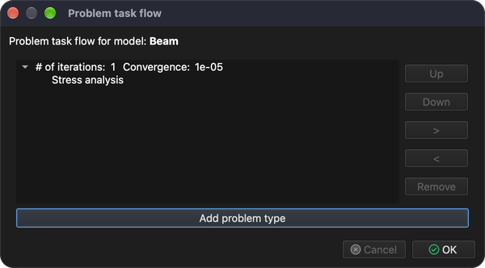
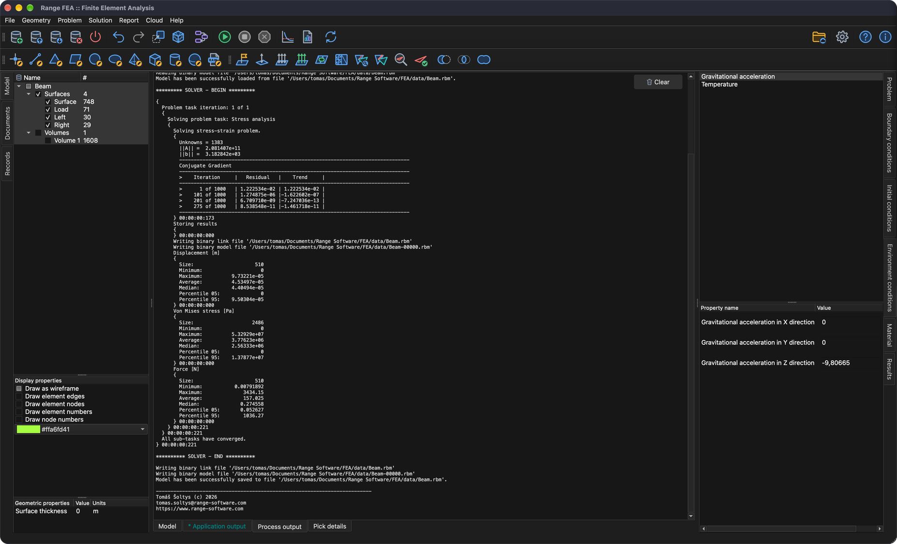
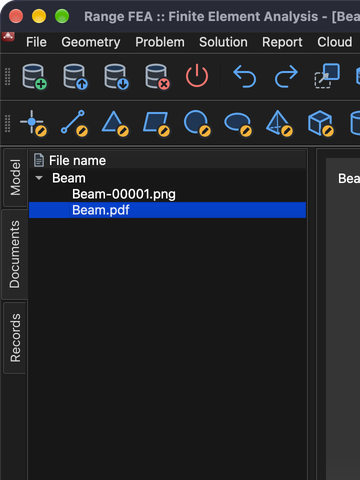

# Spannungs- und Verformungsanalyse

Dieses Tutorial zeigt, wie ein Problem vom Typ **Stress analysis** (Spannungsanalyse) eingerichtet und gelöst wird. Dazu wird ein einfacher Balken an beiden Enden gelagert und in der Mitte belastet.

## 1. Modell laden

**Menü:** _Datei -> Modell öffnen_

Es öffnet sich der Dialog **Modell öffnen**. Wählen Sie die Datei **Beam.tmsh** und klicken Sie auf **Öffnen**, um das Modell zu laden.

Da diesem Modell kein physikalisches Problem zugewiesen ist, erscheint kurz nach dem Laden des Modells das Dialogfenster **Aufgabenablauf des Problems**.

Klicken Sie auf die Schaltfläche **Problemtyp hinzufügen**, woraufhin das Dialogfenster **Problemtyp-Auswahl** angezeigt wird. Suchen und aktivieren Sie **Stress analysis** und bestätigen Sie mit **OK**.

Der **Aufgabenablauf des Problems** sollte nun 1 Iteration von **Stress analysis** anzeigen. Bestätigen Sie mit **OK**.

## 2. 3D-Netz erzeugen

Um dieses Problem zu lösen, muss ein Volumennetz erzeugt werden.

**Menü:** _Geometrie -> Volumen -> Tetraedernetz erzeugen_

Diese Aktion öffnet den Dialog **3D-Netz erzeugen**.

Für den Moment reichen die vorausgefüllten Werte aus. Bestätigen Sie mit **OK**.

Sobald das Netz erzeugt ist, erscheint im Modellbaum (Registerkarte **Modell**) eine neue **Volumen**-Entität. Um das erzeugte Netz zu sehen, blenden Sie die Flächenentitäten aus, zeigen Sie nur **Volumen** an und aktivieren Sie in den **Anzeigeeigenschaften** die Option **Als Drahtgitter zeichnen**.

## 3. Material zuweisen

Ein Material kann nur einer ausgewählten Modellentität zugewiesen werden. Entitäten werden im Modellbaum ausgewählt. Um mehrere Entitäten auszuwählen, halten Sie beim Auswählen die Taste _Strg_ (_⌘ Cmd_ unter macOS) gedrückt, oder halten Sie die Taste _Umschalt_ gedrückt, um einen Bereich auszuwählen. Sobald alle Entitäten ausgewählt sind, kann das Material auf der Registerkarte **Material** auf der rechten Seite des Hauptfensters zugewiesen werden.

Der Modellbaum **Modell** und die Materialliste sind im folgenden Screenshot zu sehen.

Ein Material ist zugewiesen, wenn das Kontrollkästchen vor seinem Namen aktiviert ist. In diesem Tutorial wird **Iron** (Eisen) verwendet.

_Hinweis: Allen Modellentitäten muss ein Material zugewiesen sein._

## 4. Randbedingungen zuweisen

Randbedingungen sind vorgegebene Werte der Feldvariablen (oder verwandter Größen wie Ableitungen) an den Rändern des Feldes. Randbedingungen werden in **explizite** und **implizite** Bedingungen unterteilt. **Explizite** Bedingungen werden **fett** hervorgehoben.

In diesem Tutorial werden die Randbedingungen wie folgt auf **Flächen**-Entitäten angewendet:

1. **Load**
    - _Weight_ (Gewicht)
        - Weight = 1000 `[kg]`
2. **Left** und **Right**
    - _Displacement_ (Verschiebung)
        - Displacement in X direction = 0 `[m]`
        - Displacement in Y direction = 0 `[m]`
        - Displacement in Z direction = 0 `[m]`

Um die Randbedingung **Weight** anzuwenden, gehen Sie wie folgt vor:

1. Wählen Sie im Modellbaum die Entität **Load** aus.
2. Öffnen Sie die Registerkarte **Randbedingungen**, wählen Sie die Randbedingung **Weight** aus und aktivieren Sie sie.
3. Ersetzen Sie im Wertfeld der Eigenschaft **Weight** den Wert **1** durch **1000** `[kg]`.

Um die Randbedingung **Displacement** anzuwenden, gehen Sie wie folgt vor:

1. Wählen Sie im Modellbaum die Entitäten **Left** und **Right** aus (halten Sie _Strg_ / _⌘ Cmd_ gedrückt, um beide auszuwählen).
2. Wählen Sie auf der Registerkarte **Randbedingungen** die Randbedingung **Displacement** aus und aktivieren Sie sie.
3. Überprüfen Sie, dass alle Eigenschaftswerte auf **0** `[m]` gesetzt sind.

## 5. Umgebungsbedingungen zuweisen

Damit die Randbedingung **Weight** richtig funktioniert, muss die Umgebungsbedingung **Gravitational acceleration** (Erdbeschleunigung) korrekt gesetzt sein.

Umgebungsbedingungen werden nicht wie Randbedingungen aktiviert. Öffnen Sie die Registerkarte **Umgebungsbedingungen** und wählen Sie **Gravitational acceleration**, um ihre Werte zu überprüfen: 0, 0 und -9.80665 `[m/s^2]` in X-, Y- und Z-Richtung.

## 6. Problem lösen

Sobald das Problem korrekt konfiguriert ist, kann es gelöst werden.

**Menü:** _Lösung -> Löser starten_

Das Modell muss gespeichert sein, bevor der Löser gestartet werden kann. Wurde es noch nicht gespeichert, wird zuerst der Dialog **Modell speichern** angezeigt; bestätigen Sie mit **Speichern** (falls bereits eine Datei mit demselben Namen existiert, bestätigen Sie das Ersetzen). Danach wird der Dialog **Löser für Modell starten** angezeigt.

Klicken Sie auf **OK**, um den Löserprozess zu starten.

Der Löserprozess läuft im Hintergrund, und seine gesamte Ausgabe wird auf der Registerkarte **Prozessausgabe** angezeigt, wie im folgenden Screenshot zu sehen ist.

## 7. Berechnete Ergebnisse anwenden

Nachdem der Löserprozess erfolgreich abgeschlossen ist, sollten die berechneten Ergebnisse automatisch geladen werden. Um diese Ergebnisse anzuzeigen, müssen sie auf Modellentitäten angewendet werden. Dies geschieht auf der Registerkarte **Ergebnisse**. Die Ergebnisse werden auf die ausgewählten Modellentitäten angewendet. Blenden Sie dazu alle Flächenentitäten aus und zeigen Sie nur **Volumen** an.

### 7.1. Verschiebung

Wählen Sie im Dropdown-Menü **Displacement** (falls noch nicht ausgewählt). **Displacement** ist eine Vektorvariable; sie kann als **Scalar** (die Entität wird nach dem Betrag eingefärbt) und/oder als **Displacement** (die Entität verformt sich) angewendet werden. Aktivieren Sie diesmal das Kontrollkästchen **Displacement** und setzen Sie **Maßstab** auf **500**, um die Verformung zu sehen.

### 7.2. Vergleichsspannung nach von Mises

Wenden Sie analog zu **Displacement** auch **Von Mises Stress** (Vergleichsspannung nach von Mises) auf die ausgewählte **Volumen**-Entität an. Aktivieren Sie zusätzlich das Kontrollkästchen **Wertebereich anzeigen**, um den Wertebereich im 3D-Bereich anzuzeigen.

## 8. Bericht erstellen

Manchmal ist es notwendig, einen Bericht zu erstellen, um die berechneten Ergebnisse zu veröffentlichen.

**Menü:** _Bericht -> Bericht erstellen_

Die Software kann Berichte in mehreren Formaten erstellen (HTML, Markdown, ODF und PDF), die standardmäßig alle aktiviert sind. Diesmal genügt ein **PDF**-Dokument; deaktivieren Sie daher alle Formate außer **Portable Document Format(PDF)** und klicken Sie auf **Ok**.

Nach dem Erstellen des Berichts wird die Meldung **Documents have been generated.** (Dokumente wurden erstellt) angezeigt. Schließen Sie sie mit **OK**.

Erstellte Dokumente werden nicht automatisch angezeigt. Wechseln Sie dazu in den Baum **Dokumente** und doppelklicken Sie auf das Dokument, das Sie anzeigen möchten.

