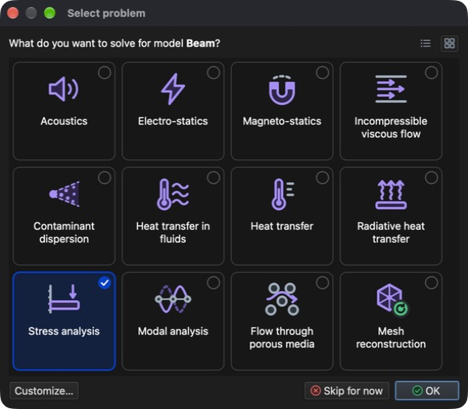
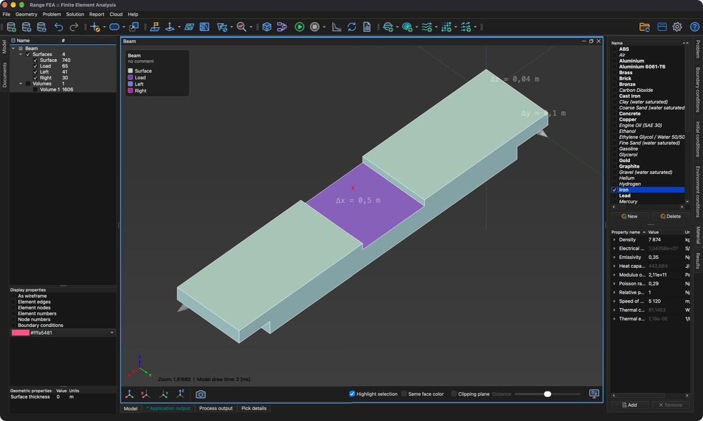
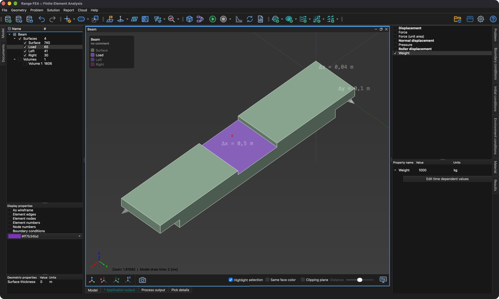
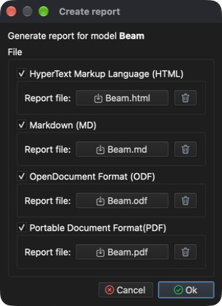

# Spannungs- und Verformungsanalyse

Dieses Tutorial zeigt, wie ein Problem **Stress analysis** (Spannungsanalyse) eingerichtet und gelöst wird. Dazu wird ein einfacher Balken an beiden Enden gelagert und in der Mitte belastet.

## 1. Modell laden

**Menü:** _Datei -> Modell öffnen_

Der Dialog **Modell öffnen** wird angezeigt. Wählen Sie die Datei **Beam.rbm** und klicken Sie auf **Open** (Öffnen), um das Modell zu laden.

Da diesem Modell kein physikalisches Problem zugewiesen ist, erscheint kurz nach dem Laden der Dialog **Problem auswählen**.

Klicken Sie auf die Kachel **Stress analysis** und bestätigen Sie mit **OK**.

## 2. 3D-Netz erzeugen

Um dieses Problem zu lösen, muss ein Volumennetz erzeugt werden.

**Menü:** _Geometrie -> Volumen -> Tetraedernetz erzeugen_

Diese Aktion zeigt den Dialog **3D-Netz erzeugen**.

Vorerst genügen die vorausgefüllten Werte. Bestätigen Sie mit **OK**.

Nach dem Erzeugen des Netzes erscheint im **Modellbaum** eine neue Entität **Volumen**. Um das erzeugte Netz zu sehen, blenden Sie die Flächenentitäten aus, zeigen Sie nur **Volumen** an und aktivieren Sie in den **Anzeigeeigenschaften** **Als Drahtgitter**.

## 3. Material zuweisen

Ein Material kann nur einer ausgewählten Modellentität zugewiesen werden. Entitäten werden im **Modellbaum** ausgewählt. Um mehrere Entitäten auszuwählen, halten Sie beim Auswählen die Taste _Strg_ (_⌘ Cmd_ unter macOS) gedrückt, oder die _Umschalttaste_, um einen Bereich auszuwählen. Sind alle Entitäten ausgewählt, kann das Material in der Registerkarte **Material** auf der rechten Seite des Hauptfensters zugewiesen werden.

**Modellbaum** und **Materialliste** sind im folgenden Screenshot zu sehen.

Ein Material ist zugewiesen, wenn das Kontrollkästchen vor seinem Namen aktiviert ist. In diesem Tutorial wird **Iron** (Eisen) verwendet.

_Hinweis: Allen Modellentitäten muss ein Material zugewiesen sein._

## 4. Randbedingungen zuweisen

Randbedingungen sind die vorgegebenen Werte der Feldvariablen (oder verwandter Größen wie Ableitungen) an den Rändern des Feldes. Randbedingungen werden in **explizite** und **implizite** Bedingungen unterteilt. **Explizite** Bedingungen sind **fett** hervorgehoben.

In diesem Tutorial werden den **Flächen**-Entitäten folgende Randbedingungen zugewiesen:

1. **Load**
    - _Weight_ (Gewicht)
        - Weight = 1000 `[kg]`
2. **Left** und **Right**
    - _Displacement_ (Verschiebung)
        - Displacement in X direction = 0 `[m]`
        - Displacement in Y direction = 0 `[m]`
        - Displacement in Z direction = 0 `[m]`

So weisen Sie die Randbedingung **Weight** zu:

1. Wählen Sie die Entität **Load** im **Modellbaum** aus.
2. Öffnen Sie die Registerkarte **Randbedingungen**, wählen Sie die Randbedingung **Weight** aus und aktivieren Sie sie.
3. Ersetzen Sie in der Eigenschaft **Weight** den Wert **1** durch **1000** `[kg]`.

So weisen Sie die Randbedingung **Displacement** zu:

1. Wählen Sie die Entitäten **Left** und **Right** im **Modellbaum** aus (halten Sie _Strg_ / _⌘ Cmd_ gedrückt, um beide auszuwählen).
2. Wählen Sie in der Registerkarte **Randbedingungen** die Randbedingung **Displacement** aus und aktivieren Sie sie.
3. Prüfen Sie, ob alle Eigenschaftswerte auf **0** `[m]` gesetzt sind.

## 5. Umgebungsbedingungen zuweisen

Damit die Randbedingung **Weight** richtig wirkt, muss die richtige Umgebungsbedingung **Gravitational acceleration** (Erdbeschleunigung) zugewiesen sein.

Umgebungsbedingungen werden nicht wie Randbedingungen aktiviert. Öffnen Sie die Registerkarte **Umgebungsbedingungen** und wählen Sie **Gravitational acceleration**, um die Werte zu prüfen: 0, 0 und -9,80665 `[m/s^2]` in X-, Y- und Z-Richtung.

## 6. Problem lösen

Sobald das Problem richtig eingerichtet ist, kann es gelöst werden.

**Menü:** _Lösung -> Löser starten_

Das Modell muss gespeichert sein, bevor der Löser starten kann. Das Modell **Beam** wurde aus einer Datei geöffnet und wird daher automatisch dort gespeichert; ein Modell, das noch nie gespeichert wurde, zeigt zuerst den Dialog **Modell speichern** (bestätigen Sie mit **Save** (Sichern), und falls bereits eine Datei mit demselben Namen existiert, bestätigen Sie das Ersetzen). Danach wird der Dialog **Löser starten** angezeigt.

Klicken Sie auf **OK**, um den Löserprozess zu starten.

Der Löserprozess läuft im Hintergrund, und seine gesamte Ausgabe wird in der Registerkarte **Prozessausgabe** unter dem 3D-Bereich angezeigt, wie im Screenshot unten zu sehen. Die Berechnung ist beendet, wenn die Ausgabe mit **SOLVER - END** endet.

## 7. Berechnete Ergebnisse anzeigen

Nach erfolgreichem Abschluss des Löserprozesses sollten die berechneten Ergebnisse automatisch geladen werden. Um sie anzuzeigen, müssen sie auf Modellentitäten angewendet werden. Dies geschieht in der Registerkarte **Ergebnisse**. Ergebnisse werden auf den ausgewählten Modellentitäten angezeigt. Kehren Sie dazu zur Registerkarte **Modell** unter dem 3D-Bereich zurück, blenden Sie alle Flächenentitäten aus, zeigen Sie nur **Volumen** an und wählen Sie im **Modellbaum** **Volume 1** aus.

### 7.1. Verschiebung

Wählen Sie im Dropdown-Menü **Displacement** (falls nicht bereits ausgewählt). **Displacement** ist eine Vektorvariable; sie kann als **Farbkarte** (die Entität wird nach dem Betrag eingefärbt) und/oder als **Verformte Form** (die Entität biegt sich) angezeigt werden. Aktivieren Sie diesmal das Kontrollkästchen **Verformte Form** und setzen Sie **Maßstab für Verformung und Pfeile** auf **500**, um die Verformung zu sehen.

### 7.2. Von-Mises-Spannung

Zeigen Sie wie bei **Displacement** **Von Mises stress** auf der ausgewählten Entität **Volumen** an: Wählen Sie im Dropdown-Menü **Von Mises stress - Scalar** und aktivieren Sie **Farbkarte**. Die für **Displacement** eingestellte verformte Form bleibt sichtbar. Aktivieren Sie zusätzlich **Legende anzeigen**, um den Wertebereich im 3D-Bereich anzuzeigen.

**Von Mises stress** wird auf Elementen berechnet, daher wird jedes Element in einer Farbe gezeichnet. Aktivieren Sie **Geglättete Anzeige**, um die Elementwerte an den Knoten zu mitteln und ein stetiges Bild zu erhalten; dies ändert nur die Anzeige, nicht die Ergebnisse.

## 8. Bericht erstellen

Manchmal ist es nötig, einen Bericht zu erstellen, um die berechneten Ergebnisse zu veröffentlichen.

**Menü:** _Bericht -> Bericht erstellen_

Das Programm kann Berichte in mehreren Formaten erstellen (HTML, Markdown, ODF und PDF); alle sind standardmäßig aktiviert. Diesmal genügt ein **PDF**-Dokument, deaktivieren Sie daher alle Formate außer **Portable Document Format(PDF)** und klicken Sie auf **Ok**.

Nach dem Erstellen des Berichts wird die Meldung **Documents have been generated.** (Dokumente wurden erstellt) angezeigt. Schließen Sie sie mit **OK**.

Erstellte Dokumente werden nicht automatisch angezeigt. Öffnen Sie dazu die Registerkarte **Dokumente** auf der linken Seite des Hauptfensters; dort sind sie unter dem Modellnamen (**Beam**) aufgeführt: der Bericht unter **Dokumente** und das im Bericht verwendete Bild des 3D-Bereichs unter **Bilder**. Doppelklicken Sie auf das Dokument, das Sie ansehen möchten.

