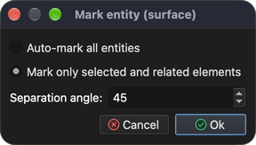
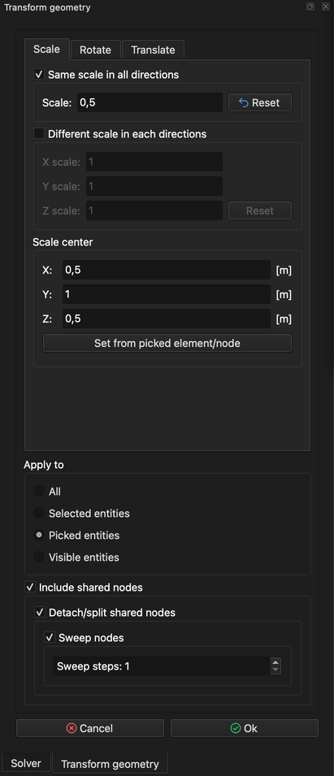
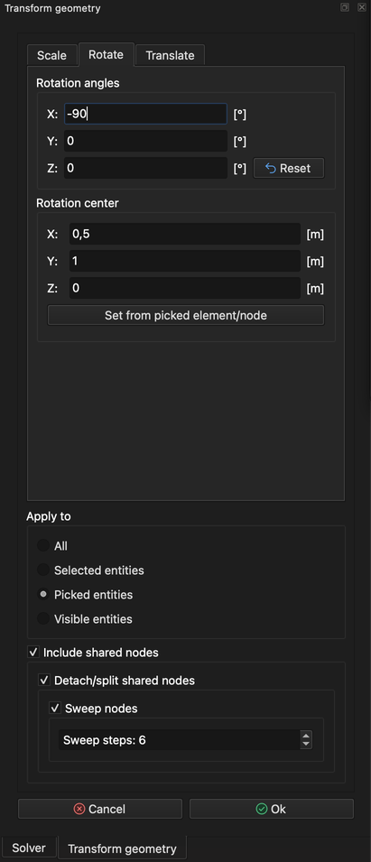

# Geometrie transformieren

Dieses Tutorial ist eine Fortsetzung des Tutorials **Würfel zeichnen** und zeigt, wie die gesamte Geometrie oder nur Teile davon skaliert, gedreht und verschoben werden.

## 1. Modell laden

Falls das Modell **Cube** noch nicht geladen ist, kann dies mit der Menüaktion **_Modell öffnen_** erfolgen.

**Menü:** _Datei -> Modell öffnen_

Es öffnet sich der Dialog **Modell öffnen**. Wählen Sie die Datei **Cube.rbm** und klicken Sie auf **Öffnen**.

Sobald das Modell bereit ist, kann seine Geometrie (ganz oder teilweise) geändert (transformiert) werden.

## 2. Vorbereitung

**Menü:** _Geometrie -> Skalieren, verschieben, drehen_

Sobald der Menüeintrag aktiviert ist, wird auf der rechten Seite des Hauptfensters das Panel **Geometrie transformieren** mit drei Registerkarten angezeigt: **Maßstab**, **Drehen** und **Verschieben**.

In diesem Tutorial werden alle Transformationen nacheinander auf eine Seite des Würfels angewendet.

Derzeit sind alle Seiten des Modells **Cube** in derselben **Flächenentität** zusammengefasst. Daher muss eine Seite als eigene **Flächenentität** **markiert** werden, damit die Transformationen nur auf diese Seite und nicht auf die anderen angewendet werden. Dies geschieht mit der Menüaktion **_Fläche markieren_**. Zuvor muss jedoch die Würfelseite angewählt werden.

## 3. Eine Seite anwählen

Halten Sie die Taste **_Strg_** (**_⌘ Cmd_** unter macOS) gedrückt und klicken Sie mit der **_linken Maustaste_** auf eine Seite des Würfels. Dadurch wird das angewählte Element hervorgehoben. Da das Modell **Cube** aus 6 rechteckigen Elementen (Vierecken) besteht, entspricht ein Element einer Seite des Würfels.

## 4. Fläche markieren

**Menü:** _Geometrie -> Fläche -> Fläche markieren_

Diese Aktion öffnet den Dialog **Entität markieren (Fläche)**. Da im vorherigen Schritt ein Element **angewählt** wurde, ist die Option **_Nur ausgewählte und zugehörige Elemente markieren_** vorausgewählt. Durch Klicken auf **Ok** wird eine Seite des Modells **Cube** als eigene **Flächenentität** markiert.

_**Hinweis:** Jede Entität kann umbenannt werden, indem Sie im **Modellbaum** auf der linken Seite des Hauptfensters mit der **linken Maustaste** auf ihren Namen **doppelklicken**._

## 5. Angewählte Entität (Würfelseite) skalieren

Wählen Sie die markierte Fläche an (**_Strg_** / **_⌘ Cmd_** + **_linke Maustaste_**) und öffnen Sie das Panel **Geometrie transformieren**.

**Menü:** _Geometrie -> Skalieren, verschieben, drehen_

1. Aktivieren Sie **Gleicher Maßstab in allen Richtungen**.
2. Setzen Sie den Wert **Maßstab** auf 0.5 (verwenden Sie das Dezimaltrennzeichen Ihres Systems, z. B. 0,5).
3. Klicken Sie auf die Schaltfläche **Aus angewähltem Element/Knoten setzen**.
4. Wählen Sie in der Gruppe **Anwenden auf** die Option **Angewählte Entitäten**.
5. Stellen Sie sicher, dass **Gemeinsame Knoten einbeziehen** sowie **alle** untergeordneten Kontrollkästchen aktiviert sind.

Die richtige Einstellung ist im folgenden Screenshot zu sehen.

Klicken Sie auf **Ok**. Das Ergebnis ist im folgenden Screenshot zu sehen.

## 6. Angewählte Entität (skalierte Würfelseite) drehen

Durch Drehen der angewählten Fläche kann eine extrudierte Fläche erstellt werden. Öffnen Sie das Panel **Geometrie transformieren**.

**Menü:** _Geometrie -> Skalieren, verschieben, drehen_

Wechseln Sie zur Registerkarte **Drehen** und geben Sie die Werte wie im folgenden Screenshot ein:

1. Setzen Sie bei **Drehwinkel** den Wert **X** auf -90.
2. Klicken Sie auf die Schaltfläche **Aus angewähltem Element/Knoten setzen** und ändern Sie anschließend beim **Drehzentrum** den Wert **Z** auf 0.
3. Wählen Sie in der Gruppe **Anwenden auf** die Option **Angewählte Entitäten**.
4. Stellen Sie sicher, dass **Gemeinsame Knoten einbeziehen**, **Gemeinsame Knoten lösen/trennen** und **Knoten extrudieren** aktiviert sind, und setzen Sie **Extrusionsschritte** auf 6.

_Hinweis: **Extrusionsschritte: 6** ergibt sechs neue Segmente._

Klicken Sie auf **Ok**. Das Ergebnis ist im folgenden Screenshot zu sehen.

