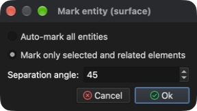
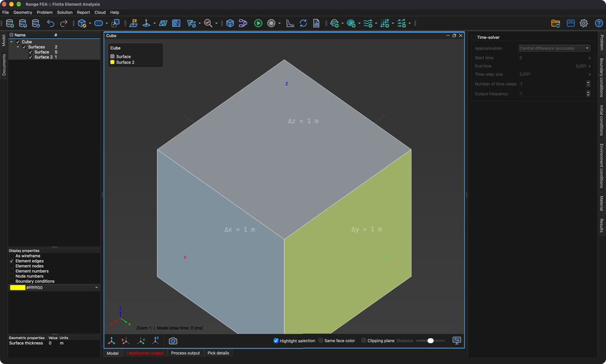

# Geometrie transformieren

Dieses Tutorial setzt das Tutorial **Würfel zeichnen** fort und zeigt, wie die gesamte Geometrie oder nur Teile davon skaliert, gedreht und verschoben werden.

## 1. Modell laden

Ist das Modell **Cube** noch nicht geladen, kann es mit der Aktion **_Modell öffnen_** geladen werden.

**Menü:** _Datei -> Modell öffnen_

Der Dialog **Modell öffnen** wird angezeigt. Wählen Sie die Datei **Cube.rbm** und klicken Sie auf **Open** (Öffnen).

Sobald das Modell bereit ist, kann seine Geometrie (ganz oder teilweise) verändert (transformiert) werden.

## 2. Vorbereitung

**Menü:** _Geometrie -> Skalieren, verschieben, drehen_

Nach dem Aufruf des Menüpunkts wird auf der rechten Seite des Hauptfensters das Panel **Geometrie transformieren** mit drei Registerkarten angezeigt: **Maßstab**, **Drehen** und **Verschieben**. Die Gruppe **Anwenden auf** unter den Registerkarten legt fest, welcher Teil des Modells transformiert wird.

In diesem Tutorial werden alle Transformationen nacheinander auf eine Seite des Würfels angewendet. Schließen Sie das Panel vorerst mit **Abbrechen**.

Derzeit sind alle Seiten des Modells **Cube** in derselben **Flächenentität** zusammengefasst. Daher muss eine Seite als eigene **Flächenentität** **markiert** werden, damit die Transformationen nur auf diese Seite und nicht auf die anderen angewendet werden. Dazu dient die Aktion **_Fläche markieren_**. Zuerst muss jedoch die Würfelseite angewählt werden.

## 3. Eine Seite anwählen

Halten Sie die Taste **_Strg_** (**_⌘ Cmd_** unter macOS) gedrückt und klicken Sie mit der **_linken Maustaste_** auf die Seite des Würfels, die zur **Y**-Achse zeigt. Das angewählte Element wird hervorgehoben und im Abschnitt **Picked entities** der Übersicht in der linken oberen Ecke des 3D-Bereichs aufgeführt. Da das Modell **Cube** aus 6 rechteckigen (viereckigen) Elementen besteht, entspricht ein Element einer Seite des Würfels.

## 4. Fläche markieren

**Menü:** _Geometrie -> Fläche -> Fläche markieren_

Diese Aktion zeigt den Dialog **Mark entity (surface)**. Da im vorigen Schritt ein Element **angewählt** wurde, ist die Option **_Nur ausgewählte und zugehörige Elemente markieren_** vorausgewählt. Mit einem Klick auf **Ok** wird eine Seite des Modells **Cube** als eigene **Flächenentität** mit dem Namen **Surface 2** markiert.

_**Hinweis:** Jede Entität kann durch **Doppelklick** mit der **linken Maustaste** auf ihren Namen im **Modellbaum** auf der linken Seite des Hauptfensters umbenannt werden._

## 5. Angewählte Entität (Würfelseite) skalieren

Wählen Sie die markierte Fläche an (**_Strg_** / **_⌘ Cmd_** + **_linke Maustaste_**) und öffnen Sie das Panel **Geometrie transformieren**.

**Menü:** _Geometrie -> Skalieren, verschieben, drehen_

1. Lassen Sie auf der Registerkarte **Maßstab** **Gleicher Maßstab in allen Richtungen** aktiviert.
2. Setzen Sie den Wert **Maßstab** auf 0,5 (verwenden Sie das Dezimaltrennzeichen Ihres Systems, z. B. 0,5 oder 0.5).
3. Klicken Sie auf **Aus angewähltem Element/Knoten setzen**. Das **Skalierungszentrum** wird auf die Mitte der angewählten Seite gesetzt (0,5; 1; 0,5).
4. Wählen Sie in der Gruppe **Anwenden auf** **Angewählte Entitäten**.
5. Stellen Sie sicher, dass **Gemeinsame Knoten einbeziehen** sowie alle untergeordneten Kontrollkästchen aktiviert sind.

Die richtige Einstellung zeigt der folgende Screenshot.

Klicken Sie auf **Ok**. Die angewählte Seite wird auf die Hälfte verkleinert, und der Spalt zwischen der verkleinerten Seite und dem Rest des Würfels wird mit einer neuen Flächenentität (**Surface 3**) gefüllt. Das Ergebnis zeigt der folgende Screenshot.

## 6. Angewählte Entität (skalierte Würfelseite) drehen

Durch Drehen der angewählten Fläche kann eine extrudierte Fläche erzeugt werden. Öffnen Sie das Panel **Geometrie transformieren**.

**Menü:** _Geometrie -> Skalieren, verschieben, drehen_

Wechseln Sie zur Registerkarte **Drehen** und geben Sie die Werte wie im folgenden Screenshot ein:

1. Setzen Sie **Drehwinkel** **X** auf -90.
2. Klicken Sie auf **Aus angewähltem Element/Knoten setzen** und ändern Sie dann **Drehzentrum** **Z** auf 0.
3. Wählen Sie in der Gruppe **Anwenden auf** **Angewählte Entitäten**.
4. Stellen Sie sicher, dass **Gemeinsame Knoten einbeziehen**, **Gemeinsame Knoten lösen/trennen** und **Knoten extrudieren** aktiviert sind, und setzen Sie **Extrusionsschritte** auf 6.

_Hinweis: **Extrusionsschritte: 6** erzeugt sechs neue Segmente._

Klicken Sie auf **Ok**. Die extrudierten Segmente werden als neue Flächenentität (**Surface 4**) hinzugefügt. Das Ergebnis zeigt der folgende Screenshot.

