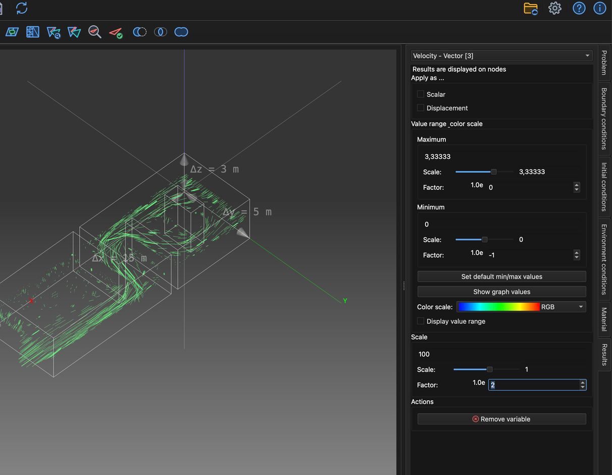
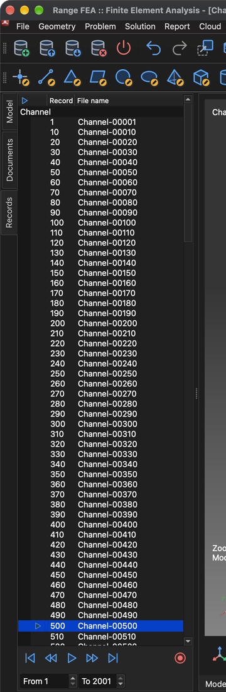

# Contaminant dispersion in fluids

This tutorial shows how to set up and solve a multi-physics simulation that combines a nonlinear, iterative problem - **CFD (Computational Fluid Dynamics)** - with the transport of a contaminant carried by the flow.

Two problem types are needed:

1. **Incompressible viscous flow** - computes the velocity and pressure of the fluid (steady-state or transient flow of Newtonian fluids).
2. **Contaminant dispersion** - computes how a contaminant spreads in that flow field.

Because the flow problem is nonlinear, it is solved iteratively. The simulation is therefore run in two stages:

1. **Steady-state flow** - first, a converged "initial" flow field and pressure distribution are computed, without any contaminant.
2. **Transient simulation** - then, starting from that flow field, **time marching** is used to follow how a pulse of contaminant entering the channel is carried through it.

## 1. Load the model

**Menu:** _File -> Open model_

In the **Open model** dialog select **Channel.tmsh** and click **Open**.

The model consists of three surface entities - **Walls**, **Inflow** and **Outflow**. Since no problem type is assigned to the model yet, the **Problem task flow** dialog opens automatically once loading is complete.

## 2. Problem task flow (stage 1 - steady-state flow)

For the first stage only the flow is solved, using many nonlinear iterations so that it can converge.

1. In the **Problem task flow** dialog click **Add problem type**.
2. In the **Problem type selector** check **Incompressible viscous flow** and click **OK**.
3. Double-click the value **1** next to **# of iterations:**, type **2000** and press _Enter_.
4. Click **OK** to close the dialog.

The dialog can be opened again at any time with the **Problem(s) task flow** button in the toolbar. It should now look like this:

## 3. Generate the volume mesh

The model is defined by its surfaces only. To solve a flow inside it, a volume (tetrahedral) mesh must be generated first.

**Menu:** _Geometry -> Volume -> Generate tetrahedral mesh_

The prefilled values in the **Generate 3D mesh** dialog are sufficient. Click **OK**. When meshing is finished, a new entity **Volume 1** appears under **Volumes** in the **Model** tree.

## 4. Assign material

All model entities must have a material assigned.

1. In the **Model** tree click **Walls** and then _Shift_-click **Volume 1** to select all entities.
2. Open the **Material** tab on the right side of the main window.
3. Check **Water**.

## 5. Boundary conditions (stage 1)

Boundary conditions are assigned in the **Boundary conditions** tab to the entity selected in the **Model** tree. Assign the following conditions to the **surface** entities:

1. **Walls**
    - _Wall_ (no value needed)
2. **Inflow**
    - _Volumetric flow rate (inflow)_
        - Volumetric flow rate = 50 `[m^3/s]`
3. **Outflow**
    - _Pressure (implicit)_
        - Pressure = 0 `[Pa]` (the default value is 1000 `[Pa]`)

For each entity: select it in the **Model** tree, check the condition in the **Boundary conditions** tab, select the condition to show its properties below the list, then double-click the value, type the new one and press _Enter_.

## 6. Solve the steady-state flow

**Menu:** _Solution -> Start solver_

If the model has not been saved yet, a **Save model** dialog is shown first. Click **Save** to accept the offered file name (**Channel.rbm**), then click **OK** in the **Start solver** dialog.

The solver runs in the background and its output is shown in the **Process output** tab. Computing all 2000 iterations takes a few minutes; the run is finished when the output ends with **SOLVER - END**. The convergence of the solution can be checked at any time with:

**Menu:** _Report -> Solver convergence_

## 7. Create a cut

A good way to inspect a flow is to display the velocity as a **vector field**, where every arrow shows the direction and magnitude of the flow at one point. A vector field drawn through the whole volume, however, quickly becomes a dense cloud of overlapping arrows that is hard to read. It is usually clearer to first slice the model with a **cut** - a plane through the volume - and then display the vector field only on that plane.

_Tip: check **Volumes** in the **Model** tree before you start, so that the volume is visible while the cut is being positioned._

**Menu:** _Geometry -> Cut -> Create cut_

In the **Cut editor** dialog:

1. Select **Volume 1** in the **Model** list. The cut will be created through this volume.
2. **Plane position** sets a point the cut plane passes through. The default values place it in the center of the model (**X** = 7.5, **Y** = 2.5, **Z** = 1.5 `[m]`); keep them.
3. **Plane normal** sets the orientation of the plane. The default normal (**X** = 1) gives a vertical plane; change it to **X** = 0, **Y** = 0, **Z** = 1 to get a horizontal plane cutting through the mid-height of the channel.

The cut plane is previewed in the **3D model area** while the values are being changed. Click **OK** to create the cut. A new entity **Cut 1** appears in the **Model** tree under **Cuts**.

## 8. Create a vector field

Now display the computed velocity as arrows on the cut plane.

**Menu:** _Geometry -> Vector field -> Create vector field_

In the **Vector field editor** dialog:

1. Select **Cut 1** in the **Model** list. The arrows will be drawn on the cut plane created in the previous step.
2. Select **Velocity** in the **Variables** list.
3. Leave **3D vector field** checked. The arrows then show the full velocity vector. When unchecked, each arrow is projected onto the cut plane and only the in-plane part of the flow is shown.

Click **OK** to create the vector field. It appears in the **Model** tree under **Vector fields**. Uncheck **Volumes** so that the solid volume does not hide the arrows.

The arrows may be too short to be clearly visible, because their length is proportional to the flow velocity. To make them longer, select the vector field in the **Model** tree, open the **Results** tab and increase the value in the **Scale** section. The scale is the product of the **Scale** value and the power of ten set in **Factor**; in the example below **Scale** 1 and **Factor** 2 give a scale of `1 × 10^2 = 100`.

## 9. Problem task flow (stage 2 - transient)

With a converged flow field available, the **transient** simulation including **Contaminant dispersion** can be configured.

In a transient simulation the problems are solved once per time-step. **Incompressible viscous flow** is still nonlinear, so it needs its own nonlinear iterations inside every time-step, while **Contaminant dispersion** is solved once per time-step after the flow. Open the **Problem task flow** dialog again (toolbar button **Problem(s) task flow**) and set it up as follows:

1. Select **Incompressible viscous flow** and click the **>** button. This moves it into a new, nested iteration group.
2. Double-click the value of the outer **# of iterations:** and change it from **2000** to **1**. Then change the inner (nested) **# of iterations:** from **1** to **10**.
3. Click **Add problem type**, check **Contaminant dispersion** and click **OK**. **Incompressible viscous flow** is checked automatically as well, because contaminant dispersion needs a flow field. If a second **Incompressible viscous flow** entry is added at the outer level, select it and click **Remove**.

The task flow should look like the screenshot below. Click **OK** to accept.

## 10. Time solver setup

Open the **Problem** tab on the right side of the main window and set:

1. Check **Time-solver**.
2. **Approximation**: **Backward difference (stable)**.
3. **Time-step size**: **0.01** `[s]`.
4. **Number of time-steps**: **2000**.
5. **Output frequency**: **10** - a result record is written every 10th time-step.

**End time** is computed automatically (2000 × 0.01 s = 20 s).

In the **Contaminant dispersion setup** section set **Maximum saturation** to **2.4** `[kg/m^3]` and **Diffusion coefficient** to **0.01** `[m^2/s]`. For more information refer to the theory manual.

## 11. Boundary conditions (stage 2)

The contaminant enters the channel through the inflow. Select **Inflow** in the **Model** tree and in the **Boundary conditions** tab check **Particle concentration** (keep **Volumetric flow rate (inflow)** checked).

Instead of a constant value, a time-dependent value will be used. Expand the **Particle concentration** property (arrow in front of its name) and click **Edit time dependent values**.

In the **Component editor** dialog set **Number of values** to **3** and enter the values below (double-click a cell to edit it), then click **Ok**.

| Time `[s]` | Particle concentration `[kg/m^3]` |
| ---------- | --------------------------------- |
| 0          | 0                                 |
| 5          | 1                                 |
| 10         | 0                                 |

Between two specified times the value is interpolated linearly, and after the last specified time the last value is kept. With these values the inflow concentration rises from 0 to 1 `[kg/m^3]` during the first 5 seconds and falls back to 0 between 5 and 10 seconds.

## 12. Solve the transient problem (restart)

**Menu:** _Solution -> Start solver_

In the **Start solver** dialog check **Restart solver / continue** and click **OK**. The solver then uses the already computed steady-state flow as its starting point and continues with the time-marching simulation.

A warning **Contaminant dispersion: No implicit boundary condition assigned.** is expected and can be ignored.

## 13. Display results while the solver runs

The transient solver runs in the background, so results can be inspected while it is still computing. Further display entities such as cuts, isos, stream lines, vector fields or scalar fields can be created at any time, and computed results can be displayed on them. Here the cut and the vector field from steps 7 and 8 are reused.

### 13.1 Contaminant concentration on the cut

1. In the **Model** tree expand **Cuts**, check **Cut 1** so that it is visible and select it.
2. Open the **Results** tab and choose **Particle concentration - Scalar** in the drop-down list at the top.
3. Under **Apply as ...** check **Scalar**. The cut is now colored by the contaminant concentration.
4. Under **Value range and color scale** set **Maximum** to **1** and **Minimum** to **0** (type the value and press _Enter_). This matches the range of the inflow concentration, so the same colors mean the same concentration in every time-step.
5. Check **Display value range** to show the color scale in the **3D model area**.

### 13.2 Arrows of the vector field

To make the flow direction easier to read on top of the colored cut, draw the arrows with heads and in white:

1. Select the vector field (**Velocity** under **Vector fields**) in the **Model** tree.
2. In **Display properties** below the tree check **Draw arrow heads**.
3. Click the color selector below the check-boxes and choose white (**#ffffffff**).

The other display properties control whether all arrows have the same length (**Draw arrows with same length**) and whether arrows start at the point where the velocity is evaluated (**Draw arrows pointing from**).

## 14. Model records (results in time)

Every 10th time-step (the **Output frequency**) the solver writes a model record containing the solution for that time. The records are listed in the **Records** tab on the left side of the main window; the **Record** column shows the time-step number (record **500** holds the solution at 500 × 0.01 s = 5 s). Double-click a record to load the results for its time-step; results applied in the **Results** tab are kept and redrawn for the loaded record.

Computing all 2000 time-steps takes a while (about 20 minutes on a current computer). The solver can be stopped at any time and the records written so far are kept:

**Menu:** _Solution -> Stop solver_ (confirm with **Yes**)

## 15. Record a video

A video is made from what is currently shown in the **3D model area**, so first set up the view and the displayed results (see step 13). Display settings are not stored with the model, so after reopening it they have to be set again. Then open the **Records** tab, use the **From** and **To** fields at the bottom to choose the range of records and click the red **Record** button.

The **Video settings** dialog appears, where the video codec, file format, frames per second and frames per record can be set; the estimated video length is shown below. With 202 records, 24 frames per second and 1 frame per record the video is about 8.4 seconds long. Click **OK** to start recording.

Recording can take some time, because each model record is loaded in turn and a screenshot of the **3D model area** is taken as a video frame.

The video and all frames (one PNG image per record) can be found in the **Documents** tab under **Channel**; the video **Channel.mp4** is at the end of the list. Double-click it to play the video.

