# Electro-statics and magneto-statics

This tutorial shows the complete workflow of an **Electro-statics** and **Magneto-statics** analysis, from an empty model to a report: a copper bar is connected to a small voltage, the current that flows through it is computed, and the magnetic field of that current is evaluated.

The two problem types always work as a pair. **Electro-statics** computes the electric potential, the electric field, the current density and the Joule heat. **Magneto-statics** takes the current density and evaluates the magnetic field it produces with the Biot-Savart law. The order matters, so the electro-statics task is always solved first.

The steps are:

1. Create a geometry
2. Set up a problem
3. Solve the problem
4. Post-process the results
5. Generate a report

The bar is `0.1` `[m]` long with a square cross section of `0.01` `[m]` by `0.01` `[m]`. These dimensions make the hand calculations at the end of the setup easy to follow.

_Note: Number fields use the decimal separator of your system, e.g. `0,01` instead of `0.01` on a system with decimal comma. The screenshots in this tutorial were made on such a system._

## 1. Create a geometry

### 1.1 Create a new model

**Menu:** _File -> New model_

Enter **Bar** as the model name (the description is optional) and click **OK**.

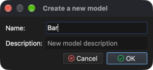

Since the newly created model has no problem assigned, the **Select problem** dialog pops up. Click **Skip for now**; the problem is selected in [step 2](#2-set-up-a-problem), once the geometry is ready.

### 1.2 Draw the bar

**Menu:** _Geometry -> Draw -> Draw hexahedron_

The **Draw object** panel is shown on the right side of the main window. Set the values so that the bar lies along the X axis:

| Property | Value |
|---|---|
| Position | 0;0;0 |
| X size | 0.1 |
| Y size | 0.01 |
| Z size | 0.01 |
| X divisions | 10 |
| Y divisions | 1 |
| Z divisions | 1 |

To change a value double-click it, type the new one and press _Enter_. Leave **Merge near nodes** checked and click **OK**, then confirm the **Draw objects(s)?** question with **Yes**.

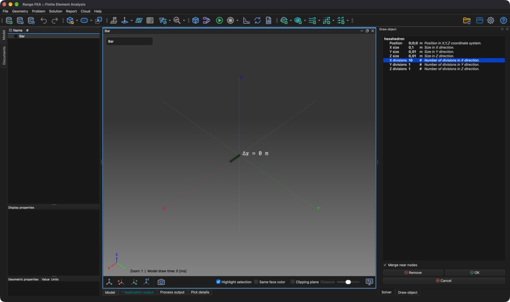

The bar is added to the model as one **Surface** entity made of quadrilateral elements. The dimensions of the bar are displayed in the 3D area.

### 1.3 Mark the faces

Boundary conditions can only be assigned to entities, and at this moment all faces of the bar belong to the same **Surface** entity. Split it into logical surfaces by **marking**:

**Menu:** _Geometry -> Surface -> Mark surface_

Nothing is picked, so **Auto-mark all entities** is preselected. Keep the **Separation angle** of `45` and click **Ok**. The faces are grouped by their angle, which gives one entity for each of the six faces of the bar.

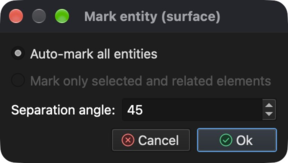

Expand the **Surfaces** group in the **Model tree**. The four long faces (**Surface 1** to **Surface 4**) are made of ten elements each, the two end faces (**Surface 5** and **Surface 6**) of a single element. The two end faces are the ones that will carry the electric potential, so rename them by double-clicking their names in the **Model tree**:

- **Surface 6**, the face at `x = 0`, to **Ground**
- **Surface 5**, the face at `x = 0.1`, to **Supply**

_Note: Select an entity in the **Model tree** to see it highlighted in the 3D area, if you are not sure which face it is. Which of the two is which is not important for the result, only the sign of the current direction depends on it._

### 1.4 Generate the volume mesh

Both problem types are solved on a volume mesh.

**Menu:** _Geometry -> Volume -> Generate tetrahedral mesh_

The prefilled values in the **Generate 3D mesh** dialog (the **Range** mesh generator, **Linear** elements and a **Maximum element volume** of `1e-08` `[m^3]`) are sufficient. Click **OK**.

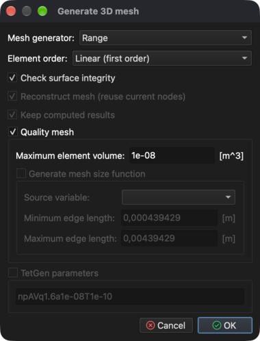

When meshing finishes, a new **Volumes** group with **Volume 1** appears in the **Model tree**. With the prefilled values the volume consists of 1693 tetrahedra and 517 nodes. The message about the nearly flat elements in the **Application output** is a quality warning of the mesh generator and can be ignored for this simple bar.

### 1.5 Save the model

**Menu:** _File -> Save model_

The **Save model** dialog offers the file name **Bar.rbm** and the **data** folder. Click **Save** to accept.

## 2. Set up a problem

### 2.1 Select the problem types

**Menu:** _Problem -> Select problem_ (or the **Select problem** button in the toolbar, or in the right panel)

Click the **Magneto-statics** tile. The **Electro-statics** tile is checked automatically and marked **Required**, because the magnetic field is computed from the current density which only the electro-statics task produces. The **Solve order** shown below the tiles is **Electro-statics -> Magneto-statics**. **Modal analysis** is marked **Incompatible**. Click **OK**.

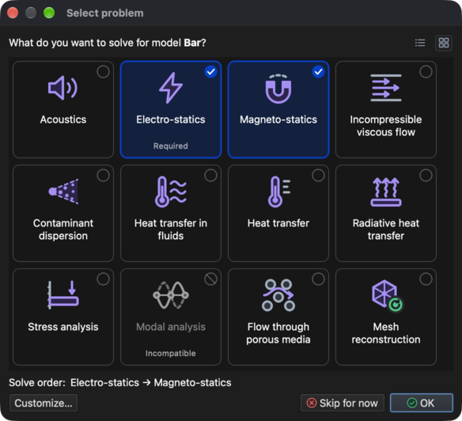

Neither problem type has a time solver, so there is nothing to configure in the **Problem** tab.

### 2.2 Assign material

All model entities must have a material assigned, the surfaces as well as the volume. Otherwise the solver refuses to start with the error **Entity ... has no material assigned**.

1. In the **Model tree** click **Surface 1**, then hold down _Shift_ and click **Volume 1** to select all entities.
2. Open the **Material** tab on the right side of the main window.
3. Check **Copper**.

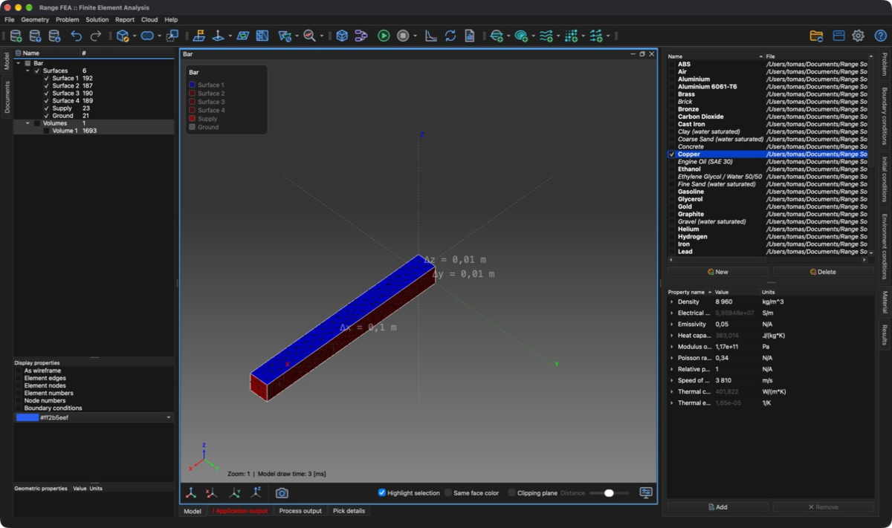

Select **Copper** in the list to see its properties. Electro-statics needs three of them:

| Property | Value for copper | Used for |
|---|---|---|
| Relative permittivity | `1` | drives the electric field |
| Electrical conductivity | `5.95948e+07` `[S/m]` | converts the field into current density |
| Density | `8 960` `[kg/m^3]` | required to be present, never read |

Magneto-statics needs no material property at all: it works in free space and takes only the current density.

### 2.3 Assign boundary conditions

The only boundary condition that makes the problem solvable is **Electric potential**. A potential is defined only up to an additive constant, so at least one must be prescribed, and two different values are needed to make a current flow. Assign them to the **surface** entities:

1. **Ground**
    - _Electric potential_
        - Electric potential = 0 `[V]`
2. **Supply**
    - _Electric potential_
        - Electric potential = 0.01 `[V]`

For each entity: select it in the **Model tree**, open the **Boundary conditions** tab, check **Electric potential**, select the condition to show its value in the lower part of the tab, then double-click the value, type the new one and click an empty area of the tab to confirm. A newly assigned potential starts at `1` `[V]`.

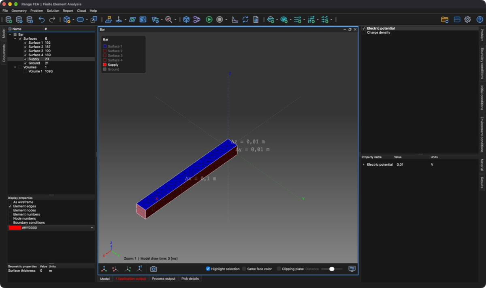

Do not assign a **Charge density**. A conductor with prescribed end potentials carries no space charge, and the potential is then a straight line between the two ends.

Magneto-statics has no boundary, initial or environment conditions of its own. The **Electric potential** and **Charge density** conditions in the list belong to the electro-statics task and reach the magnetic field through the current density.

### 2.4 Predict the result

Before solving, work out what the solver should report. The numbers follow from Ohm's law for a uniform bar of length `L` = 0.1 `[m]` and cross section `A` = 1e-4 `[m^2]` held at a potential difference `U` = 0.01 `[V]`, with the conductivity `sigma` = 5.95948e7 `[S/m]` of copper:

```
E = U / L                       = 0.01 / 0.1                = 0.1      V/m
J = sigma * E                   = 5.95948e7 * 0.1           = 5.96e6   A/m^2
I = J * A                       = 5.96e6 * 1e-4             = 596      A
R = L / ( sigma * A )           = 0.1 / (5.95948e7 * 1e-4)  = 1.68e-5  ohm
P = U * I                       = 0.01 * 596                = 5.96     W
```

Near the surface in the middle of a long face the magnetic flux density is of the order of the value for a round conductor of radius `r` = 0.005 `[m]`,

```
B = u0 * I / (2 * pi * r) = 1.2566e-6 * 596 / (2 * pi * 0.005) = 0.024 T
```

Because the section is square and not round, the computed value is somewhat lower.

The current is large because a solid copper bar is an excellent conductor and `0.01` `[V]` across it is practically a short circuit. An electrostatic model happily computes situations that would destroy the real part.

## 3. Solve the problem

**Menu:** _Solution -> Start solver_

The model must be saved before the solver can start. A model that has been saved before is saved again automatically. Then the **Start solver** dialog appears.

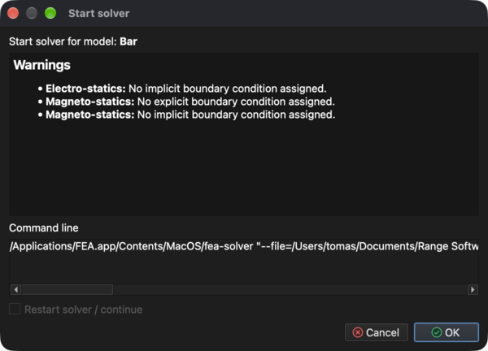

The dialog lists three warnings, **Electro-statics: No implicit boundary condition assigned**, **Magneto-statics: No explicit boundary condition assigned** and **Magneto-statics: No implicit boundary condition assigned**. They are expected for this setup: only explicit potentials are used, and magneto-statics needs no boundary condition at all. Click **OK** to start the solver.

The solver runs in the background and its output is shown in the **Process output** tab below the 3D area. The two tasks are solved one after another: the electro-statics task first, which prints the statistics of the electric potential, the electric field, the current density, the electric energy, the electrical resistivity and the Joule heat, then the magneto-statics task, which evaluates the Biot-Savart integral for the 1693 current carrying cells at the 517 nodes and prints the statistics of the magnetic field. The run is finished when the output ends with **SOLVER - END**; it takes less than a second on this mesh.

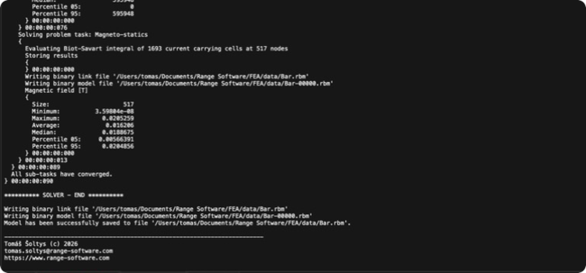

The values printed by the electro-statics task are those predicted in step 2.4: the median electric field is `0.1` `[V/m]`, the current density `5.95948e+06` `[A/m^2]`, the electrical resistivity `1.678e-08` `[V*m/A]` and the Joule heat `595948` `[W/m^3]`. The minimum of these element variables is `0`, because the surface elements of a surface with zero thickness carry no current. The maximum of the magnetic field is `0.0205` `[T]`.

The output of the last run can be reviewed later with **Menu:** _Report -> Solver log file_.

If the **Magnetic field** comes out as zero and the log warns that no element carries a current, check that the two potentials differ and that the material has an electrical conductivity.

## 4. Post-process the results

Results are applied in the **Results** tab to the entities selected in the **Model tree**. Return to the **Model** tab below the 3D area, uncheck the **Surfaces**, check the **Volumes** and select **Volume 1**. Open the **Results** tab. The drop-down menu at the top lists the computed variables:

- **Electric potential - Scalar**
- **Electric field - Vector [3]**
- **Current density - Vector [3]**
- **Electric energy - Scalar**
- **Electrical resistivity - Scalar**
- **Joule heat - Scalar**
- **Magnetic field - Vector [3]**

Each variable keeps its own display settings, so check **Color map** and **Show legend** for every variable you want to see, and uncheck **Show legend** when you switch to another variable to avoid several legends in the 3D area.

### 4.1 Electric potential

Select **Electric potential - Scalar**, check **Color map** and **Show legend**.

The potential falls linearly from `10` `[mV]` at the **Supply** end to `0` at the **Ground** end, with flat equipotential planes perpendicular to the axis of the bar. Any curvature in this uniform bar would mean that the mesh is not connected as expected.

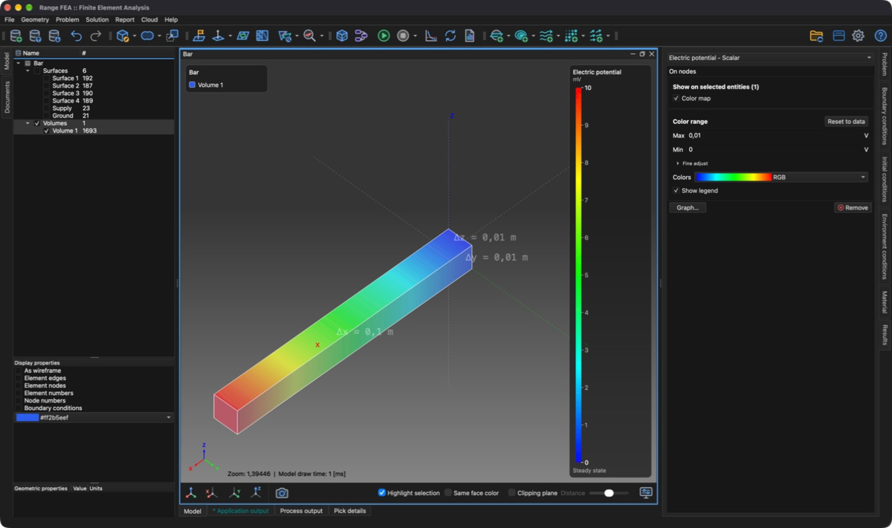

### 4.2 Electric field, current density, resistivity and Joule heat

Select the other variables the same way. **Electric field** and **Current density** are vector variables computed on elements, so each element is drawn with one color. Both are densities and independent of the element size, so the color range runs up to `0.1` `[V/m]` and `5.95948e+06` `[A/m^2]`, as predicted in step 2.4. The bar is colored uniformly, as the current flows evenly through its section.

**Electrical resistivity** is the quickest check that the material reached the elements. It reads `1/5.95948e7` = `1.678e-8` `[V*m/A]` on every element, whatever the field does. **Joule heat** is the dissipation density `sigma * E^2` = `5.95948e5` `[W/m^3]`; multiplied by the volume of the bar (`1e-5` `[m^3]`) it gives the `5.96` `[W]` of step 2.4. To feed it into a heat analysis, add **Heat transfer** after **Electro-statics** in the **Select problem** dialog; see the **Multiphysics** tutorial.

### 4.3 Magnetic field

Select **Magnetic field - Vector [3]**. It is stored on nodes, so each node has a value and the drawing is smooth. Check **Color map** and **Show legend**. The color range runs from about `3.6e-8` `[T]` to `0.0205` `[T]`.


What to expect:

- The field **circulates around the bar**, perpendicular to the current, in the sense of the right-hand rule.
- It is **zero on the axis** (blue at the center of the end faces) and grows towards the surface, where it is largest, along the middle of the long faces.
- It is **weaker near the ends** of the bar than in the middle. The model holds only the bar itself, so the current appears at one end and vanishes at the other, and the supply leads that would close the loop are missing. The result is the field of the modelled conductor only.
- The largest value, `20.5` `[mT]`, is about 15 % below the `24` `[mT]` estimated for a round conductor in step 2.4, because the square section puts much of the current further from the surface than a round one would.

### 4.4 Vector field

A vector field draws a vector variable as arrows, which shows the circulation of the magnetic field.

**Menu:** _Geometry -> Vector field -> Create vector field_

In the **Vector field editor** select **Volume 1** in the **Model** list and **Magnetic field** in the **Variables** list (it lists the vector variables of the entity: **Electric field**, **Current density** and **Magnetic field**), keep **3D vector field** checked and click **OK**.

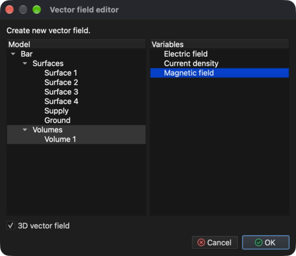

The vector field is added to the **Model tree** under **Vector fields**. Uncheck **Volumes**, check **Vector fields** and select **Magnetic field**. Check **Color map** and **Arrow heads** (in **Display properties** below the tree) and, if the arrows are too large, decrease the **Deformation and arrow scale**.

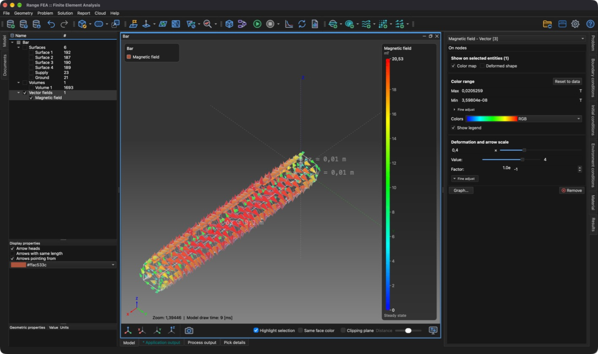

Use the same steps with **Current density** to see the direction of the current, from the **Supply** end to the **Ground** end.

## 5. Generate a report

Put the 3D area into the state you want to publish first, because the report contains an image of it: check **Volumes** only (uncheck **Vector fields**), select **Volume 1** and show the variable you want to present, here **Magnetic field** with **Color map** and **Show legend**.

**Menu:** _Report -> Create report_

Software can produce reports in multiple formats (HTML, Markdown, ODT and PDF), all of them are checked by default. This time it is enough to produce only **PDF** document, so uncheck all formats except **Portable Document Format(PDF)** and click **Ok**.

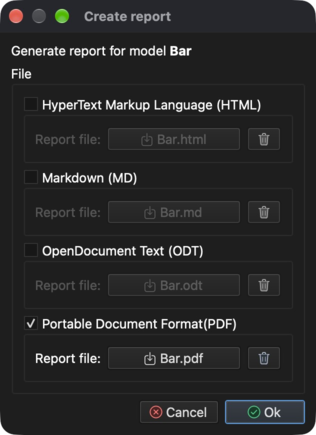

Once the report is generated, a message **Documents have been generated.** is shown. Click **OK** to close it.

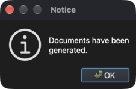

Generated documents are not displayed automatically. To view them open the **Documents** tab on the left side of the main window, where they are listed under the model name (**Bar**): the report (**Bar.pdf**) under **Documents** and the image of the 3D area used in the report (**Bar-00001.png**) under **Images**. Double click on the document you would like to view.


The **Report** menu offers more specific views which can be used next to the report: **Model statistics**, **Solver log file**, **Solver convergence** and **Monitoring points**.

## 6. Troubleshooting

| Symptom | Cause |
|---|---|
| **Entity ... has no material assigned** when starting the solver | a material must be assigned to every entity, the surfaces as well as the volume |
| The electro-statics solve does not converge | no **Electric potential** condition is assigned anywhere |
| The whole bar sits at one potential | only one potential was assigned, or both have the same value |
| **Entity has material assigned which is missing required properties** | the material misses relative permittivity, electrical conductivity or density |
| The potential is zero except on the prescribed faces | the entity has zero relative permittivity, so it has no stiffness |
| Electrical resistivity is zero everywhere | the electrical conductivity is zero, so no current flows |
| The magnetic field is zero everywhere | no current density: the potentials are equal, or the material has no electrical conductivity |
| **Electro-statics** cannot be unchecked on its own | expected, **Magneto-statics** requires it |
| The magnetic field is weaker at the ends of the bar | expected, the current path is open, see 4.3 |

## 7. Where to go next

- The **Electro-statics** and **Magneto-statics** theory manuals describe the equations, every input and the limitations of both solvers, and show how a check of the magnetic field away from the conductor is done.
- The **Multiphysics** tutorial chains **Electro-statics** with **Heat transfer** and **Stress analysis** to show the thermal effect of the current.
- Values at a point can be read with **Monitoring points**, defined with **Menu:** _Problem -> Define monitoring points_ and shown with **Menu:** _Report -> Monitoring points_.
- The magnetic field can be shown in the space around the conductor by meshing an air region as a separate volume entity with a material that has no electrical conductivity; see the section **Results and records** of the **Magneto-statics** manual.
