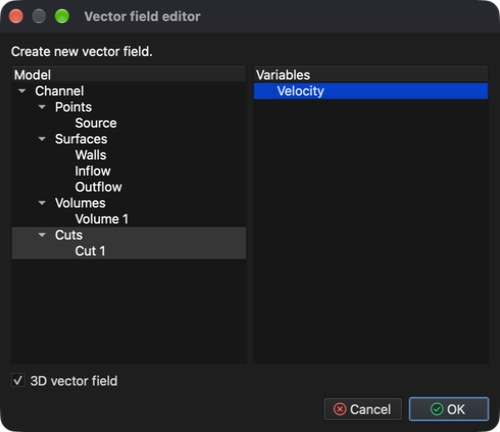
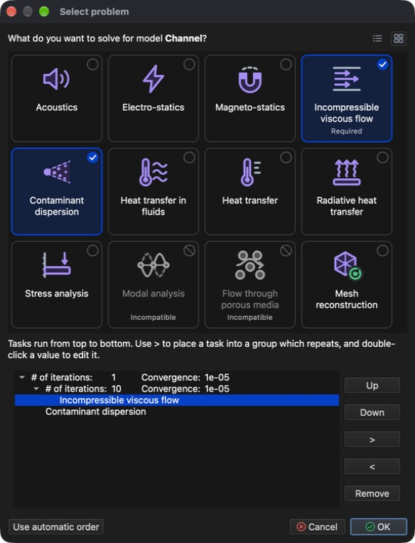
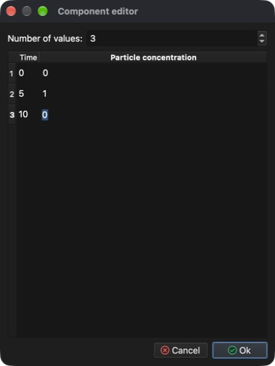
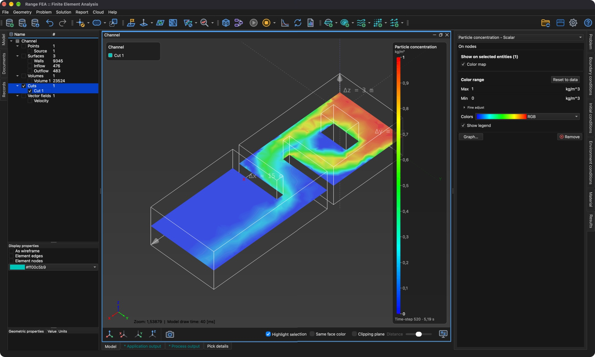
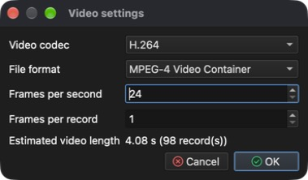

# Dispersión de contaminantes en fluidos

Este tutorial muestra cómo configurar y resolver una simulación multifísica que combina un problema no lineal e iterativo – **CFD (Computational Fluid Dynamics, dinámica de fluidos computacional)** – con el transporte de un contaminante arrastrado por el flujo.

Se necesitan dos tipos de problema:

1. **Incompressible viscous flow** (flujo viscoso incompresible) – calcula la velocidad y la presión del fluido (flujo estacionario o transitorio de fluidos newtonianos).
2. **Contaminant dispersion** (dispersión de contaminantes) – calcula cómo se propaga un contaminante en ese campo de flujo.

Como el problema de flujo es no lineal, se resuelve de forma iterativa. Por ello la simulación se realiza en dos etapas:

1. **Flujo estacionario** – primero se calculan, sin contaminante, un campo de flujo «inicial» convergido y la distribución de presión.
2. **Simulación transitoria** – después, partiendo de ese campo de flujo, se usa el **avance en el tiempo** para seguir cómo un pulso de contaminante que entra en el canal es transportado a través de él.

## 1. Cargar el modelo

**Menú:** _Archivo -> Abrir modelo_

En el diálogo **Abrir modelo** seleccione **Channel.rbm** y haga clic en **Open** (Abrir).

El modelo consta de una entidad de punto – **Source** – y tres entidades de superficie – **Walls**, **Inflow** y **Outflow**. Como el modelo aún no tiene asignado ningún tipo de problema, el diálogo **Seleccionar problema** se abre automáticamente al terminar la carga.

## 2. Seleccionar el problema (etapa 1 – flujo estacionario)

En la primera etapa solo se resuelve el flujo, con muchas iteraciones no lineales para que pueda converger.

1. En el diálogo **Seleccionar problema** haga clic en el mosaico **Incompressible viscous flow**.
2. Deje **Iteraciones máximas** en **2000** y **Convergencia** en **1e-05**, que son los valores predeterminados para un flujo estacionario.
3. Cierre el diálogo con **Aceptar**.

El diálogo puede volver a abrirse en cualquier momento con el botón **Seleccionar problema** de la barra de herramientas.

## 3. Generar la malla de volumen

El modelo está definido solo por sus superficies. Para resolver un flujo en su interior, primero debe generarse una malla de volumen (tetraédrica).

**Menú:** _Geometría -> Volumen -> Generar malla tetraédrica_

Los valores rellenados de antemano en el diálogo **Generar malla 3D** son suficientes. Haga clic en **Aceptar**. Al terminar el mallado, aparece una nueva entidad **Volume 1** bajo **Volúmenes** en el **árbol del modelo**.

## 4. Asignar el material

Todas las entidades del modelo deben tener un material asignado.

1. En el **árbol del modelo** expanda **Volúmenes**, haga clic en **Source** y después haga clic con _Mayús_ en **Volume 1** para seleccionar todas las entidades.
2. Abra la pestaña **Material** en el lado derecho de la ventana principal.
3. Marque **Water** (agua; está al final de la lista).

## 5. Condiciones de contorno (etapa 1)

Las condiciones de contorno se asignan en la pestaña **Condiciones de contorno** a la entidad seleccionada en el **árbol del modelo**. Asigne las siguientes condiciones a las entidades de **superficie**:

1. **Walls**
    - _Wall_ (pared; no necesita valor)
2. **Inflow**
    - _Volumetric flow rate (inflow)_ (caudal volumétrico, entrada)
        - Volumetric flow rate = 50 `[m^3/s]`
3. **Outflow**
    - _Pressure (implicit)_ (presión, implícita)
        - Pressure = 0 `[Pa]` (el valor predeterminado es 1000 `[Pa]`)

Para cada entidad: selecciónela en el **árbol del modelo**, marque la condición en la pestaña **Condiciones de contorno**, seleccione la condición para mostrar sus propiedades debajo de la lista y después haga doble clic en el valor, escriba el nuevo y pulse _Intro_.

## 6. Resolver el flujo estacionario

**Menú:** _Solución -> Iniciar solver_

El modelo **Channel** se abrió desde un archivo, por lo que se guarda en él automáticamente. Haga clic en **Aceptar** en el diálogo **Iniciar solver**. Si el diálogo muestra un error como **Entity Source has no material assigned.**, el botón **Aceptar** está desactivado; asigne primero el material a esa entidad.

El solver se ejecuta en segundo plano y su salida se muestra en la pestaña **Salida del proceso**. Calcular las 2000 iteraciones lleva unos minutos; el cálculo ha terminado cuando la salida acaba con **SOLVER - END**. La convergencia de la solución puede comprobarse en cualquier momento con:

**Menú:** _Informe -> Convergencia del solver_

## 7. Crear un corte

Una buena forma de examinar un flujo es mostrar la velocidad como **campo vectorial**, donde cada flecha indica la dirección y la magnitud del flujo en un punto. Sin embargo, un campo vectorial dibujado en todo el volumen se convierte rápidamente en una nube densa de flechas superpuestas difícil de leer. Suele ser más claro cortar primero el modelo con un **corte** – un plano que atraviesa el volumen – y mostrar el campo vectorial solo en ese plano.

_Consejo: marque **Volúmenes** en el **árbol del modelo** antes de empezar, para que el volumen sea visible mientras se coloca el corte._

**Menú:** _Geometría -> Corte -> Crear corte_

En el diálogo **Editor de cortes**:

1. Seleccione **Volume 1** en la lista **Modelo**. El corte se creará a través de este volumen.
2. **Posición del plano** define un punto por el que pasa el plano de corte. Los valores predeterminados lo sitúan en el centro del modelo (**X** = 7,5, **Y** = 2,5, **Z** = 1,5 `[m]`); manténgalos.
3. **Normal del plano** define la orientación del plano. La normal predeterminada (**X** = 1) da un plano vertical; cámbiela a **X** = 0, **Y** = 0, **Z** = 1 para obtener un plano horizontal que corte el canal a media altura. Pase de un campo a otro con _Tab_: pulsar _Intro_ confirma todo el diálogo.

El plano de corte se muestra como vista previa en el **área 3D del modelo** mientras se cambian los valores. Haga clic en **Aceptar** para crear el corte. Aparece una nueva entidad **Cut 1** en el **árbol del modelo** bajo **Cortes**.

## 8. Crear un campo vectorial

Ahora muestre la velocidad calculada como flechas en el plano de corte.

**Menú:** _Geometría -> Campo vectorial -> Crear campo vectorial_

En el diálogo **Editor de campos vectoriales**:

1. Seleccione **Cut 1** en la lista **Modelo**. Las flechas se dibujarán en el plano de corte creado en el paso anterior.
2. Seleccione **Velocity** (velocidad) en la lista **Variables**.
3. Deje marcado **Campo vectorial 3D**. Las flechas muestran entonces el vector de velocidad completo. Si se desmarca, cada flecha se proyecta sobre el plano de corte y solo se muestra la componente del flujo contenida en el plano.

Haga clic en **Aceptar** para crear el campo vectorial. Aparece en el **árbol del modelo** bajo **Campos vectoriales** con el nombre **Velocity**. Desmarque **Volúmenes** para que el volumen sólido no oculte las flechas y marque **Campos vectoriales**.

Las flechas pueden ser demasiado cortas para verse bien, porque su longitud es proporcional a la velocidad del flujo. Para alargarlas, seleccione el campo vectorial en el **árbol del modelo**, abra la pestaña **Resultados** y aumente el valor de la sección **Escala de deformación y flechas**, por ejemplo a **100**. Escriba el valor o arrastre el control deslizante situado al lado.

## 9. Seleccionar el problema (etapa 2 – transitoria)

Con un campo de flujo convergido disponible, puede configurarse la simulación **transitoria** que incluye **Contaminant dispersion**.

En una simulación transitoria los problemas se resuelven una vez por paso de tiempo. **Incompressible viscous flow** sigue siendo no lineal, por lo que necesita sus propias iteraciones no lineales dentro de cada paso de tiempo, mientras que **Contaminant dispersion** se resuelve una vez por paso de tiempo después del flujo. Vuelva a abrir el diálogo **Seleccionar problema** (botón **Seleccionar problema** de la barra de herramientas) y configúrelo así:

1. Haga clic en el mosaico **Contaminant dispersion** (**Incompressible viscous flow** sigue seleccionado y aparece marcado como **Requerido**) y después haga clic en **Personalizar…** para mostrar el flujo de tareas.
2. Seleccione **Incompressible viscous flow** y haga clic en el botón **>**. Así se mueve a un nuevo grupo de iteraciones anidado.
3. Haga doble clic en el valor del **# of iterations:** exterior y cámbielo de **2000** a **1**. Después cambie el **# of iterations:** interior (anidado) de **1** a **10**.

Acepte con **Aceptar**.

## 10. Configuración del solver temporal

Abra la pestaña **Problema** en el lado derecho de la ventana principal y establezca (pase de un campo a otro con _Tab_):

1. Marque **Solver temporal**.
2. **Aproximación**: **Backward difference (stable)** (diferencia hacia atrás, estable).
3. **Tamaño del paso de tiempo**: **0,01** `[s]`.
4. **Número de pasos de tiempo**: **2000**.
5. **Frecuencia de salida**: **10** – se escribe un registro de resultados cada 10 pasos de tiempo.

El **Tiempo final** se calcula automáticamente (2000 × 0,01 s = 20 s).

En la sección **Configuración de la dispersión de contaminantes** establezca **Maximum saturation** en **2,4** `[kg/m^3]` y **Diffusion coefficient** en **0,01** `[m^2/s]`. Para más información, consulte el manual de teoría.

## 11. Condiciones de contorno (etapa 2)

El contaminante entra en el canal por la entrada. Seleccione **Inflow** en el **árbol del modelo** y en la pestaña **Condiciones de contorno** marque **Particle concentration** (concentración de partículas; deje marcado **Volumetric flow rate (inflow)**).

En lugar de un valor constante, se usará un valor dependiente del tiempo. Expanda la propiedad **Particle concentration** (flecha delante de su nombre) y haga clic en **Editar valores dependientes del tiempo**.

En el diálogo **Editor de componentes** establezca **Número de valores** en **3** e introduzca los valores siguientes (haga doble clic en una celda para editarla), y después haga clic en **Aceptar**.

| Tiempo `[s]` | Particle concentration `[kg/m^3]` |
| ------------ | --------------------------------- |
| 0            | 0                                 |
| 5            | 1                                 |
| 10           | 0                                 |

Entre dos instantes especificados el valor se interpola linealmente y, después del último instante especificado, se mantiene el último valor. Con estos valores la concentración en la entrada sube de 0 a 1 `[kg/m^3]` durante los primeros 5 segundos y vuelve a bajar a 0 entre los 5 y los 10 segundos.

## 12. Resolver el problema transitorio (reinicio)

**Menú:** _Solución -> Iniciar solver_

En el diálogo **Iniciar solver** marque **Reiniciar el solver / continuar** y haga clic en **Aceptar**. El solver usa entonces el flujo estacionario ya calculado como punto de partida y continúa con la simulación de avance en el tiempo.

La advertencia **Contaminant dispersion: No implicit boundary condition assigned.** es esperable y puede ignorarse.

## 13. Mostrar resultados mientras el solver calcula

El solver transitorio se ejecuta en segundo plano, por lo que los resultados pueden examinarse mientras sigue calculando. En cuanto se escriben los primeros registros, aparece una pestaña **Registros** en el lado izquierdo de la ventana principal. Los resultados del cálculo transitorio se muestran solo después de cargar un registro: abra la pestaña **Registros**, haga doble clic en el último registro y vuelva a la pestaña **Modelo** (más sobre los registros en el paso 14). Pueden crearse en cualquier momento otras entidades de visualización, como cortes, isosuperficies, líneas de corriente, campos vectoriales o escalares, y mostrar en ellas los resultados calculados. Aquí se reutilizan el corte y el campo vectorial de los pasos 7 y 8.

### 13.1 Concentración del contaminante en el corte

1. En el **árbol del modelo** expanda **Cortes**, marque **Cut 1** para que sea visible y selecciónelo.
2. Abra la pestaña **Resultados** y elija **Particle concentration - Scalar** en el menú desplegable superior. Si la lista solo ofrece **Velocity** y **Pressure**, todavía no se ha cargado ningún registro del cálculo transitorio.
3. En **Mostrar en las entidades seleccionadas** marque **Mapa de colores**. El corte se colorea ahora según la concentración del contaminante.
4. En **Rango de colores** establezca **Máx** en **1** y **Mín** en **0** (escriba el valor y pulse _Intro_). Esto coincide con el rango de la concentración de entrada, de modo que los mismos colores significan la misma concentración en cada paso de tiempo.
5. Marque **Mostrar leyenda** para mostrar la escala de colores en el **área 3D del modelo**.

### 13.2 Flechas del campo vectorial

Para que la dirección del flujo se lea mejor sobre el corte coloreado, dibuje las flechas con punta y en blanco:

1. Marque **Campos vectoriales** y seleccione el campo vectorial (**Velocity** bajo **Campos vectoriales**) en el **árbol del modelo**.
2. En **Propiedades de visualización**, debajo del árbol, marque **Puntas de flecha**.
3. Haga clic en el selector de color debajo de las casillas y elija blanco (**#ffffffff**).

Las demás propiedades de visualización determinan si todas las flechas tienen la misma longitud (**Flechas de igual longitud**) y si las flechas parten del punto donde se evalúa la velocidad (**Flechas que parten de**).

## 14. Registros del modelo (resultados en el tiempo)

Cada 10 pasos de tiempo (la **Frecuencia de salida**) el solver escribe un registro del modelo con la solución para ese instante. Los registros aparecen en la pestaña **Registros** del lado izquierdo de la ventana principal; la columna **Registro** muestra el número del paso de tiempo (el registro **500** contiene la solución en 500 × 0,01 s = 5 s). Haga doble clic en un registro para cargar los resultados de su paso de tiempo; el registro cargado se marca con una flecha y los resultados aplicados en la pestaña **Resultados** se conservan y se vuelven a dibujar para él. La leyenda del **área 3D del modelo** muestra el paso de tiempo y el instante del registro cargado (p. ej. **Time-step 520 · 5,19 s**). Los botones de la parte inferior de la pestaña reproducen los registros uno tras otro.

Calcular los 2000 pasos de tiempo lleva un rato (unos 20 minutos en un ordenador actual). El solver puede detenerse en cualquier momento y los registros escritos hasta entonces se conservan:

**Menú:** _Solución -> Detener solver_ (confirme con **Yes** (Sí))

Cuando el solver se detiene, se carga el último registro escrito.

## 15. Grabar un vídeo

Un vídeo se crea a partir de lo que se muestra en ese momento en el **área 3D del modelo**, así que primero configure la vista y los resultados mostrados (véase el paso 13). La configuración de visualización no se guarda con el modelo, por lo que tras volver a abrirlo hay que configurarla de nuevo. Después abra la pestaña **Registros**, elija el rango de registros con los campos **Desde** y **Hasta** de la parte inferior y haga clic en el botón rojo de grabación.

Aparece el diálogo **Configuración del vídeo**, donde pueden ajustarse el códec de vídeo, el formato de archivo, los fotogramas por segundo y los fotogramas por registro; debajo se muestran la duración estimada del vídeo y el número de registros. Con 98 registros (el solver se detuvo hacia los 9,8 s), 24 fotogramas por segundo y 1 fotograma por registro, el vídeo dura unos 4,1 segundos; los 200 registros de un cálculo completo dan unos 8,3 segundos. Haga clic en **Aceptar** para empezar a grabar.

La grabación puede tardar un poco, porque cada registro del modelo se carga por turno y se toma una captura del **área 3D del modelo** como fotograma del vídeo.

El vídeo y todos los fotogramas (una imagen PNG por registro) se encuentran en la pestaña **Documentos** bajo **Channel**: el vídeo **Channel.mp4** en **Vídeos** y los fotogramas en **Imágenes**. Haga doble clic en el vídeo para reproducirlo.

