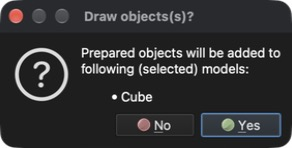

# Dibujar un cubo

Este tutorial muestra cómo dibujar (generar) una geometría sencilla, por ejemplo un cubo.

## 1. Crear un nuevo modelo

**Menú:** _Archivo -> Nuevo modelo_

Introduzca **Cube** como nombre del modelo (la descripción es opcional) y haga clic en **Aceptar**. Se creará un nuevo modelo vacío llamado **Cube**. Como el modelo recién creado no tiene ningún problema asignado, se mostrará el diálogo **Seleccionar problema**.

### 1.1 Asignar el tipo de problema

Para asignar un tipo de problema, haga clic en el mosaico **Heat transfer** y después en el botón **Aceptar**.

## 2. Dibujar un cubo

**Menú:** _Geometría -> Dibujar -> Dibujar hexaedro_

Al activar este elemento del menú, se muestra el panel **Dibujar objeto** en el lado derecho de la ventana principal, donde se pueden cambiar la posición y el tamaño del objeto y el número de divisiones en las direcciones X, Y y Z. El objeto predeterminado es un cubo de 1 `[m]` de lado situado en el origen.

El objeto mostrado cambia a la vez que se cambian los valores en el panel **Dibujar objeto**. Deje marcada la opción **Fusionar nodos cercanos** y haga clic en el botón **Aceptar** para añadir el objeto al modelo. Aparecerá un diálogo de confirmación **Draw objects(s)?** con la lista de los modelos seleccionados a los que se añadirá el objeto.

Haga clic en **Yes** (Sí) para confirmar y el cubo se añadirá al modelo **Cube** como una entidad **Superficie**.

## 3. Guardar el modelo

Para guardar el modelo, ejecute la siguiente acción.

**Menú:** _Archivo -> Guardar modelo_

Si el modelo no se ha guardado antes, el programa muestra el diálogo **Guardar modelo** con un nombre de archivo propuesto (**Cube.rbm**) y una carpeta donde guardarlo. Haga clic en **Save** (Guardar) para aceptar.
