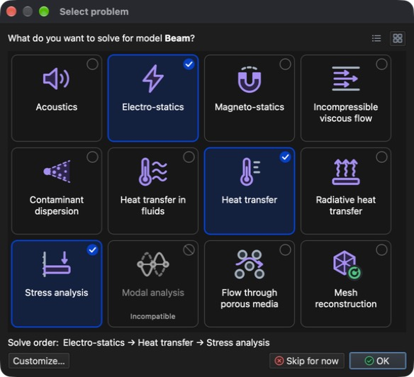
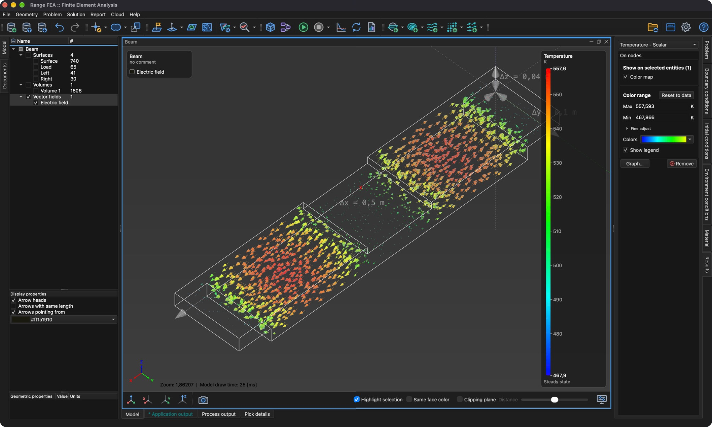

# Multifísica

Este tutorial muestra cómo resolver varios problemas acoplados en un mismo modelo. Se vuelve a usar el modelo **Beam** (viga) del tutorial **Análisis de tensiones y deformaciones**. Esta vez una corriente eléctrica atraviesa la viga, la corriente calienta la viga (calor de Joule) y el calor hace que la viga se dilate y se deforme.

Se necesitan tres tipos de problema, que se resuelven en este orden:

1. **Electro-statics** (electrostática) – calcula el potencial eléctrico, el campo eléctrico, la densidad de corriente y el calor de Joule producido por la corriente.
2. **Heat transfer** (transferencia de calor) – calcula la distribución de temperatura causada por el calor de Joule.
3. **Stress analysis** (análisis de tensiones) – calcula la dilatación térmica (desplazamientos) y la tensión resultante.

Cada problema usa los resultados del anterior, por lo que el orden de los problemas es importante.

## 1. Cargar el modelo

**Menú:** _Archivo -> Abrir modelo_

En el diálogo **Abrir modelo** seleccione **Beam.rbm** y haga clic en **Open** (Abrir).

Como el modelo aún no tiene asignado ningún tipo de problema, el diálogo **Seleccionar problema** se abre automáticamente al terminar la carga.

## 2. Seleccionar los problemas

En el diálogo **Seleccionar problema** haga clic en los mosaicos **Electro-statics**, **Heat transfer** y **Stress analysis**. Debajo de los mosaicos, el diálogo muestra el **Orden de resolución**: Electro-statics → Heat transfer → Stress analysis. **Modal analysis** aparece marcado como **Incompatible**, porque no puede combinarse con otros tipos de problema. Acepte con **Aceptar**.

El diálogo puede volver a abrirse en cualquier momento con el botón **Seleccionar problema** de la barra de herramientas.

## 3. Generar la malla 3D

Los tres problemas se resuelven sobre una malla de volumen.

**Menú:** _Geometría -> Volumen -> Generar malla tetraédrica_

Los valores rellenados de antemano en el diálogo **Generar malla 3D** son suficientes. Haga clic en **Aceptar**. Al terminar el mallado, aparece una nueva entidad **Volume 1** bajo **Volúmenes** en el **árbol del modelo**.

## 4. Asignar el material

Todas las entidades del modelo deben tener un material asignado. El material debe aportar las propiedades necesarias para los tres problemas; **Iron** (hierro) las tiene.

1. En el **árbol del modelo** expanda **Volúmenes**, haga clic en **Surface** y después haga clic con _Mayús_ en **Volume 1** para seleccionar todas las entidades.
2. Abra la pestaña **Material** en el lado derecho de la ventana principal.
3. Marque **Iron**.

## 5. Asignar las condiciones de contorno

Como hay varios tipos de problema seleccionados, la pestaña **Condiciones de contorno** ofrece ahora las condiciones de todos ellos, y una entidad puede tener asignadas varias condiciones, una por cada problema. Asigne las siguientes condiciones a las entidades de **superficie**:

1. **Surface** (la superficie exterior de la viga)
    - _Simple convection_ (convección simple)
        - Convection coefficient = 100 `[W/(m^2*K)]`
        - Fluid temperature = 293,15 `[K]`
2. **Load** (la cara en el centro de la viga)
    - _Electric potential_ (potencial eléctrico)
        - Electric potential = 0,04 `[V]`
    - _Simple convection_ (valores como en **Surface**)
3. **Left** y **Right** (las caras en ambos extremos de la viga)
    - _Displacement_ (desplazamiento)
        - Displacement in X, Y and Z direction = 0 `[m]`
    - _Electric potential_
        - Electric potential = -0,04 `[V]`
    - _Simple convection_ (valores como en **Surface**)

Así, la corriente fluye desde el centro de la viga hacia ambos extremos, y todas las caras ceden calor al aire circundante por convección.

Para cada entidad: selecciónela en el **árbol del modelo** (mantenga pulsada _Ctrl_ / _⌘ Cmd_ para seleccionar **Left** y **Right**), marque la condición en la pestaña **Condiciones de contorno**, seleccione la condición para mostrar sus propiedades debajo de la lista y después haga doble clic en el valor, escriba el nuevo y pulse _Intro_. Los valores predeterminados de **Simple convection** (100 `[W/(m^2*K)]` y 293,15 `[K]`) y de **Displacement** (0 `[m]`) ya coinciden, por lo que solo hay que cambiar **Electric potential**.

## 6. Comprobar las condiciones de entorno

Las condiciones de entorno se aplican a todo el modelo y no se marcan como las condiciones de contorno. Abra la pestaña **Condiciones de entorno** y seleccione cada condición para comprobar sus valores:

- _Gravitational acceleration_ (aceleración de la gravedad)
    - 0, 0 y -9,80665 `[m/s^2]` en las direcciones X, Y y Z
- _Temperature_ (temperatura)
    - Temperature = 293,15 `[K]`

## 7. Resolver el problema

**Menú:** _Solución -> Iniciar solver_

El modelo debe estar guardado antes de que el solver pueda iniciarse. El modelo **Beam** se abrió desde un archivo, por lo que se guarda en él automáticamente; un modelo que nunca se ha guardado muestra primero el diálogo **Guardar modelo**. A continuación se muestra el diálogo **Iniciar solver**.

El diálogo muestra tres advertencias: **Electro-statics: No implicit boundary condition assigned.**, **Heat transfer: No explicit boundary condition assigned.** y **Stress analysis: No implicit boundary condition assigned.** Son esperables con esta configuración y pueden ignorarse. Haga clic en **Aceptar** para iniciar el solver.

El solver se ejecuta en segundo plano y su salida se muestra en la pestaña **Salida del proceso**. Los problemas se resuelven uno tras otro en el orden del flujo de tareas; el cálculo ha terminado cuando la salida acaba con **SOLVER - END**.

## 8. Crear un campo vectorial

Un **campo vectorial** es una entidad de visualización que dibuja una variable vectorial como flechas. Aquí se usa para mostrar el campo eléctrico dentro de la viga.

**Menú:** _Geometría -> Campo vectorial -> Crear campo vectorial_

En el diálogo **Editor de campos vectoriales** seleccione **Volume 1** en la lista **Modelo** y **Electric field** en la lista **Variables**, y deje marcado **Campo vectorial 3D**. La lista **Variables** muestra las variables vectoriales calculadas para la entidad seleccionada (**Electric field**, **Current density**, **Heat flux**, **Displacement** y **Force**).

Haga clic en **Aceptar** para crear el campo vectorial. Se añade al **árbol del modelo** bajo **Campos vectoriales** con el nombre **Electric field**, y los resultados calculados pueden aplicarse a él como a cualquier otra entidad del modelo.

## 9. Mostrar los resultados

Los resultados se muestran en la pestaña **Resultados** sobre la entidad seleccionada en el **árbol del modelo**, igual que en el tutorial **Análisis de tensiones y deformaciones**.

### 9.1. Temperatura y deformación del volumen

1. En el **árbol del modelo** marque **Volúmenes** (deje las superficies sin marcar) y después seleccione **Volume 1**.
2. En la pestaña **Resultados** elija **Temperature - Scalar** en el menú desplegable, marque **Mapa de colores** y **Mostrar leyenda**. Si el rango mostrado no coincide con los resultados, haga clic en **Restablecer según datos**.
3. Elija **Displacement - Vector [3]** en el menú desplegable, marque **Forma deformada** y establezca **Escala de deformación y flechas** en **20** para que la deformación sea visible (los desplazamientos calculados son de solo 1,2 mm aproximadamente).
4. Vuelva a elegir **Temperature - Scalar** para que la leyenda muestre la temperatura.

La temperatura va de unos 468 K a 558 K; la viga está más caliente en el centro de sus dos tramos exteriores y se curva hacia arriba porque los extremos fijos no le permiten dilatarse libremente.

### 9.2. Temperatura en el campo vectorial

1. En el **árbol del modelo** desmarque **Volúmenes**, marque **Campos vectoriales** y seleccione **Electric field**.
2. En la pestaña **Resultados** elija **Temperature - Scalar**, marque **Mapa de colores** y **Mostrar leyenda** (si no están ya marcados). Las flechas se colorean ahora según la temperatura en su posición.
3. En **Propiedades de visualización**, debajo del árbol, marque **Puntas de flecha** para mostrar la dirección del campo eléctrico. El campo eléctrico apunta desde el centro de la viga (potencial más alto) hacia ambos extremos.

