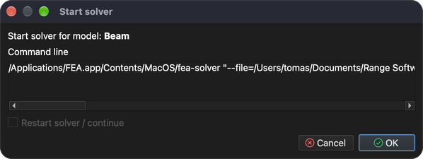
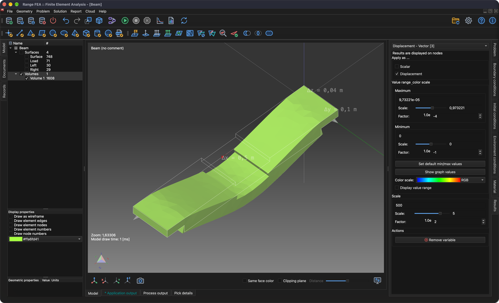
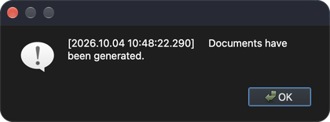

# Análisis de tensiones y deformaciones

Este tutorial muestra cómo configurar y resolver un problema de tipo **Stress analysis** (análisis de tensiones). Para ello, una viga sencilla se apoya en sus dos extremos y se carga en el centro.

## 1. Cargar el modelo

**Menú:** _Archivo -> Abrir modelo_

Se abrirá la ventana **Abrir modelo**. Seleccione el archivo **Beam.tmsh** y haga clic en **Abrir** para cargar el modelo.

Como este modelo no tiene asignado ningún problema físico, la ventana **Flujo de tareas del problema** aparecerá poco después de que termine la carga del modelo.

Haga clic en el botón **Añadir tipo de problema** y se mostrará la ventana **Selector de tipo de problema**. Busque y marque **Stress analysis** y haga clic en **Aceptar** para confirmar.

El **Flujo de tareas del problema** debería mostrar ahora 1 iteración de **Stress analysis**. Haga clic en **Aceptar** para confirmar.

## 2. Generar la malla 3D

Para resolver este problema hay que generar una malla de volumen.

**Menú:** _Geometría -> Volumen -> Generar malla tetraédrica_

Esta acción abre la ventana **Generar malla 3D**.

Por ahora, los valores predeterminados son suficientes. Haga clic en **Aceptar** para confirmar.

Una vez generada la malla, aparece una nueva entidad **Volume** en el **árbol del modelo**. Para ver la malla generada, oculte las entidades de superficie, muestre solo los **Volúmenes** y marque **Dibujar en alambre** en las **Propiedades de visualización**.

## 3. Asignar el material

El material solo se puede asignar a una entidad del modelo seleccionada. Las entidades se seleccionan en el **árbol del modelo**. Para seleccionar varias entidades, mantenga pulsada la tecla _Ctrl_ (_⌘ Cmd_ en macOS) mientras las selecciona, o mantenga pulsada la tecla _Mayús_ para seleccionar un rango. Una vez seleccionadas todas las entidades, el material se puede asignar en la pestaña **Material**, en el lado derecho de la ventana principal.

El **árbol del modelo** y la **lista de materiales** pueden verse en la captura de pantalla siguiente.

El material queda asignado cuando se marca la casilla situada delante de su nombre. En este tutorial se utiliza **Iron** (hierro).

_Nota: todas las entidades del modelo deben tener un material asignado._

## 4. Asignar las condiciones de contorno

Las condiciones de contorno son los valores especificados de las variables de campo (o de variables relacionadas, como las derivadas) en los contornos del campo. Las condiciones de contorno se dividen en condiciones **explícitas** e **implícitas**. Las condiciones **explícitas** se resaltan en **negrita**.

En este tutorial las condiciones de contorno se aplicarán a las entidades de **superficie** como se describe a continuación:

1. **Load**
    - _Weight_ (peso)
        - Weight = 1000 `[kg]`
2. **Left** y **Right**
    - _Displacement_ (desplazamiento)
        - Displacement in X direction = 0 `[m]`
        - Displacement in Y direction = 0 `[m]`
        - Displacement in Z direction = 0 `[m]`

Para aplicar la condición de contorno **Weight**, siga estos pasos:

1. Seleccione la entidad **Load** en el **árbol del modelo**.
2. Abra la pestaña **Condiciones de contorno** y, a continuación, seleccione y marque la condición de contorno **Weight**.
3. En el campo de valor de la propiedad **Weight**, sustituya **1** por **1000** `[kg]`.

Para aplicar la condición de contorno **Displacement**, siga estos pasos:

1. Seleccione las entidades **Left** y **Right** en el **árbol del modelo** (mantenga pulsada _Ctrl_ / _⌘ Cmd_ para seleccionar ambas).
2. Seleccione y marque la condición de contorno **Displacement** en la pestaña **Condiciones de contorno**.
3. Compruebe que todos los valores de las propiedades sean **0** `[m]`.

## 5. Asignar las condiciones de entorno

Para que la condición de contorno **Weight** funcione correctamente, debe asignarse correctamente la condición de entorno **Gravitational acceleration** (aceleración de la gravedad).

Las condiciones de entorno no se marcan como las condiciones de contorno. Abra la pestaña **Condiciones de entorno** y seleccione **Gravitational acceleration** para comprobar sus valores: 0, 0 y -9.80665 `[m/s^2]` en las direcciones X, Y y Z.

## 6. Resolver el problema

Una vez configurado correctamente el problema, se puede resolver.

**Menú:** _Solución -> Iniciar solver_

El modelo debe guardarse antes de que pueda iniciarse el solver. Si aún no se ha guardado, primero se mostrará la ventana **Guardar modelo**; haga clic en **Guardar** para confirmar (si ya existe un archivo con el mismo nombre, confirme que desea reemplazarlo). A continuación se mostrará la ventana **Iniciar el solver para el modelo**.

Haga clic en **Aceptar** para iniciar el proceso del solver.

El proceso del solver se ejecuta en segundo plano y toda su salida se muestra en la pestaña **Salida del proceso**, como puede verse en la captura de pantalla siguiente.

## 7. Aplicar los resultados calculados

Cuando el proceso del solver termina correctamente, los resultados calculados deberían cargarse automáticamente. Para mostrarlos, hay que aplicarlos a las entidades del modelo. Esto se hace en la pestaña **Resultados**. Los resultados se aplican a las entidades del modelo seleccionadas. Para ello, oculte todas las entidades de superficie y muestre solo los **Volúmenes**.

### 7.1. Desplazamiento

En el menú desplegable, seleccione **Displacement** (si no está ya seleccionado). **Displacement** es una variable vectorial; puede aplicarse como **Scalar** (la entidad se colorea según su magnitud) y/o como **Displacement** (la entidad se deforma). Esta vez marque la casilla **Displacement** y ajuste la **Escala** a **500** para ver la deformación.

### 7.2. Tensión de von Mises

Del mismo modo que **Displacement**, aplique **Von Mises Stress** (tensión de von Mises) a la entidad de modelo **Volume** seleccionada. Además, marque la casilla **Mostrar el rango de valores** para mostrar el rango de valores en el área 3D.

## 8. Generar un informe

A veces es necesario generar un informe para publicar los resultados calculados.

**Menú:** _Informe -> Crear informe_

El software puede generar informes en varios formatos (HTML, Markdown, ODF y PDF), todos marcados por defecto. Esta vez basta con generar solo un documento **PDF**, así que desmarque todos los formatos excepto **Portable Document Format(PDF)** y haga clic en **Aceptar**.

Una vez generado el informe, se mostrará el mensaje **Documents have been generated.** (se han generado los documentos). Haga clic en **Aceptar** para cerrarlo.

Los documentos generados no se muestran automáticamente. Para verlos, vaya al árbol **Documentos** y haga doble clic en el documento que desee ver.

