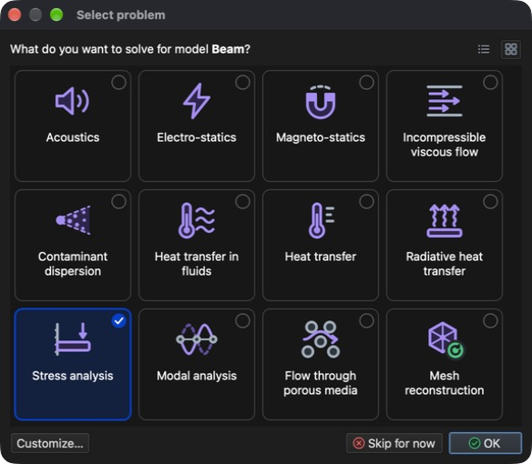
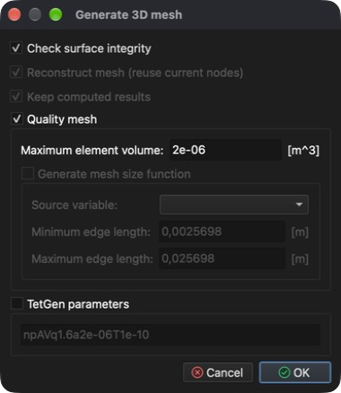
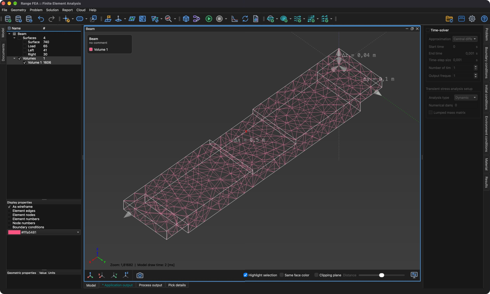
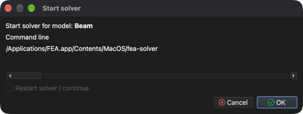
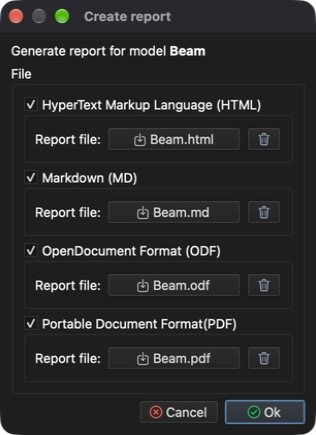

# Análisis de tensiones y deformaciones

Este tutorial muestra cómo configurar y resolver un problema **Stress analysis** (análisis de tensiones). Para ello, una viga sencilla se apoyará en ambos extremos con una carga en el centro.

## 1. Cargar el modelo

**Menú:** _Archivo -> Abrir modelo_

Se mostrará el diálogo **Abrir modelo**. Seleccione el archivo **Beam.rbm** y haga clic en **Open** (Abrir) para cargar el modelo.

Como no hay ningún problema físico asignado a este modelo, poco después de terminar la carga aparecerá el diálogo **Seleccionar problema**.

Haga clic en el mosaico **Stress analysis** y acepte con **Aceptar**.

## 2. Generar la malla 3D

Para resolver este problema es necesario generar una malla de volumen.

**Menú:** _Geometría -> Volumen -> Generar malla tetraédrica_

Esta acción muestra el diálogo **Generar malla 3D**.

Por ahora bastan los valores rellenados de antemano. Acepte con el botón **Aceptar**.

Una vez generada la malla, aparece una nueva entidad **Volumen** en el **árbol del modelo**. Para ver la malla generada, oculte las entidades de superficie, muestre solo los **Volúmenes** y marque **En alambre** en las **Propiedades de visualización**.

## 3. Asignar el material

El material solo puede asignarse a una entidad del modelo seleccionada. Las entidades se seleccionan en el **árbol del modelo**. Para seleccionar varias entidades, mantenga pulsada la tecla _Ctrl_ (_⌘ Cmd_ en macOS) mientras selecciona, o la tecla _Mayús_ para seleccionar un rango. Una vez seleccionadas todas las entidades, el material puede asignarse en la pestaña **Material** del lado derecho de la ventana principal.

El **árbol del modelo** y la **lista de materiales** pueden verse en la siguiente captura de pantalla.

El material está asignado cuando la casilla delante de su nombre está marcada. En este tutorial se usa **Iron** (hierro).

_Nota: todas las entidades del modelo deben tener un material asignado._

## 4. Asignar las condiciones de contorno

Las condiciones de contorno son los valores prescritos de las variables de campo (o de magnitudes relacionadas, como las derivadas) en los contornos del campo. Se dividen en condiciones **explícitas** e **implícitas**. Las condiciones **explícitas** se resaltan en **negrita**.

En este tutorial las condiciones de contorno se asignarán a las entidades de **superficie** como se describe a continuación:

1. **Load**
    - _Weight_ (peso)
        - Weight = 1000 `[kg]`
2. **Left** y **Right**
    - _Displacement_ (desplazamiento)
        - Displacement in X direction = 0 `[m]`
        - Displacement in Y direction = 0 `[m]`
        - Displacement in Z direction = 0 `[m]`

Para asignar la condición de contorno **Weight**, siga estos pasos:

1. Seleccione la entidad **Load** en el **árbol del modelo**.
2. Abra la pestaña **Condiciones de contorno**, y seleccione y marque la condición **Weight**.
3. Sustituya **1** por **1000** `[kg]` en el campo de valor de la propiedad **Weight**.

Para asignar la condición de contorno **Displacement**, siga estos pasos:

1. Seleccione las entidades **Left** y **Right** en el **árbol del modelo** (mantenga pulsada _Ctrl_ / _⌘ Cmd_ para seleccionar ambas).
2. Seleccione y marque la condición **Displacement** en la pestaña **Condiciones de contorno**.
3. Compruebe que todos los valores de las propiedades están establecidos en **0** `[m]`.

## 5. Asignar las condiciones de entorno

Para que la condición de contorno **Weight** funcione correctamente, debe asignarse la condición de entorno **Gravitational acceleration** (aceleración de la gravedad) correcta.

Las condiciones de entorno no se marcan como las condiciones de contorno. Abra la pestaña **Condiciones de entorno** y seleccione **Gravitational acceleration** para comprobar sus valores: 0, 0 y -9,80665 `[m/s^2]` en las direcciones X, Y y Z.

## 6. Resolver el problema

Una vez configurado correctamente, el problema puede resolverse.

**Menú:** _Solución -> Iniciar solver_

El modelo debe estar guardado antes de que el solver pueda iniciarse. El modelo **Beam** se abrió desde un archivo, por lo que se guarda en él automáticamente; un modelo que nunca se ha guardado muestra primero el diálogo **Guardar modelo** (haga clic en **Save** (Guardar) y, si ya existe un archivo con el mismo nombre, confirme su sustitución). A continuación se muestra el diálogo **Iniciar solver**.

Haga clic en el botón **Aceptar** para iniciar el proceso del solver.

El proceso del solver se ejecuta en segundo plano y toda su salida se muestra en la pestaña **Salida del proceso**, debajo del área 3D, como puede verse en la captura de pantalla siguiente. El cálculo ha terminado cuando la salida acaba con **SOLVER - END**.

## 7. Mostrar los resultados calculados

Cuando el proceso del solver termina correctamente, los resultados calculados deberían cargarse automáticamente. Para mostrarlos hay que aplicarlos a las entidades del modelo. Esto se hace en la pestaña **Resultados**. Los resultados se muestran en las entidades del modelo seleccionadas. Para ello, vuelva a la pestaña **Modelo** debajo del área 3D, oculte todas las entidades de superficie, muestre solo los **Volúmenes** y seleccione **Volume 1** en el **árbol del modelo**.

### 7.1. Desplazamiento

En el menú desplegable seleccione **Displacement** (si no está ya seleccionado). **Displacement** es una variable vectorial; puede mostrarse como **Mapa de colores** (la entidad se colorea según su magnitud) y/o como **Forma deformada** (la entidad se flexiona). Esta vez marque la casilla **Forma deformada** y establezca **Escala de deformación y flechas** en **500** para ver la deformación.

### 7.2. Tensión de von Mises

Igual que con **Displacement**, muestre **Von Mises stress** en la entidad **Volumen** seleccionada: elija **Von Mises stress - Scalar** en el menú desplegable y marque **Mapa de colores**. La forma deformada configurada para **Displacement** sigue visible. Además, marque la casilla **Mostrar leyenda** para mostrar el rango de valores en el área 3D.

**Von Mises stress** se calcula en los elementos, por lo que cada elemento se dibuja de un solo color. Marque **Visualización suavizada** para promediar los valores de los elementos en los nodos y obtener una imagen continua; esto cambia solo la visualización, no los resultados.

## 8. Crear un informe

A veces es necesario crear un informe para publicar los resultados calculados.

**Menú:** _Informe -> Crear informe_

El programa puede crear informes en varios formatos (HTML, Markdown, ODF y PDF), todos marcados de forma predeterminada. Esta vez basta con crear solo un documento **PDF**, así que desmarque todos los formatos excepto **Portable Document Format(PDF)** y haga clic en el botón **Aceptar**.

Una vez creado el informe, se mostrará el mensaje **Documents have been generated.** (Se han generado los documentos). Ciérrelo haciendo clic en **Aceptar**.

Los documentos creados no se muestran automáticamente. Para verlos, abra la pestaña **Documentos** en el lado izquierdo de la ventana principal, donde aparecen bajo el nombre del modelo (**Beam**): el informe en **Documentos** y la imagen del área 3D usada en el informe en **Imágenes**. Haga doble clic en el documento que desee ver.

