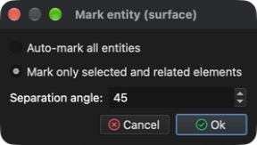
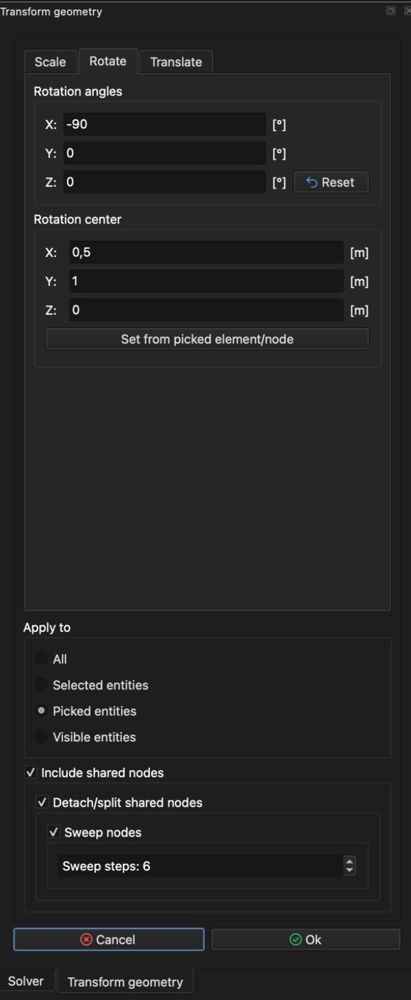

# Transformar la geometría

Este tutorial continúa el tutorial **Dibujar un cubo** y muestra cómo escalar, rotar y trasladar toda la geometría o solo algunas de sus partes.

## 1. Cargar el modelo

Si el modelo **Cube** aún no está cargado, puede cargarse con la acción **_Abrir modelo_**.

**Menú:** _Archivo -> Abrir modelo_

Se mostrará el diálogo **Abrir modelo**. Seleccione el archivo **Cube.rbm** y haga clic en **Open** (Abrir).

Una vez que el modelo está listo, su geometría (completa o en parte) puede modificarse (transformarse).

## 2. Preparación

**Menú:** _Geometría -> Escalar, trasladar, rotar_

Al activar este elemento del menú, se muestra el panel **Transformar geometría** en el lado derecho de la ventana principal, con tres pestañas: **Escala**, **Rotar** y **Trasladar**. El grupo **Aplicar a** situado debajo de las pestañas determina qué parte del modelo se transforma.

En este tutorial todas las transformaciones se aplicarán sucesivamente a una cara del cubo. Por ahora cierre el panel haciendo clic en **Cancelar**.

En este momento todas las caras del modelo **Cube** están agrupadas en la misma **entidad de superficie**. Por lo tanto, una cara debe **marcarse** como **entidad de superficie** independiente para que las transformaciones se apliquen solo a esa cara y no a las demás. Para ello se usa la acción **_Marcar superficie_**. Pero antes hay que señalar la cara del cubo.

## 3. Señalar una cara

Mantenga pulsada la tecla **_Ctrl_** (**_⌘ Cmd_** en macOS) y haga clic con el **_botón izquierdo del ratón_** en la cara del cubo orientada hacia el eje **Y**. El elemento señalado se resaltará y aparecerá en **Picked entities** en el recuadro de la esquina superior izquierda del área 3D. Como el modelo **Cube** está formado por 6 elementos rectangulares (cuadriláteros), un elemento corresponde a una cara del **Cube**.

## 4. Marcar una superficie

**Menú:** _Geometría -> Superficie -> Marcar superficie_

Esta acción muestra el diálogo **Mark entity (surface)**. Como en el paso anterior se **señaló** un elemento, está preseleccionada la opción **_Marcar solo los elementos seleccionados y relacionados_**. Al hacer clic en el botón **Aceptar**, una cara del modelo **Cube** se marcará como **entidad de superficie** independiente con el nombre **Surface 2**.

_**Nota:** cualquier entidad puede cambiarse de nombre haciendo **doble clic** con el **botón izquierdo del ratón** en su nombre en el **árbol del modelo**, en el lado izquierdo de la ventana principal._

## 5. Escalar la entidad señalada (cara del cubo)

Señale la superficie marcada (**_Ctrl_** / **_⌘ Cmd_** + **_botón izquierdo del ratón_**) y abra el panel **Transformar geometría**.

**Menú:** _Geometría -> Escalar, trasladar, rotar_

1. En la pestaña **Escala**, deje marcado **Misma escala en todas las direcciones**.
2. Establezca el valor **Escala** en 0,5 (use el separador decimal de su sistema, p. ej. 0,5 o 0.5).
3. Haga clic en el botón **Definir a partir del elemento/nodo señalado**. El **Centro de escala** se sitúa en el centro de la cara señalada (0,5; 1; 0,5).
4. En el grupo **Aplicar a**, seleccione **Entidades señaladas**.
5. Asegúrese de que **Incluir nodos compartidos** está marcado, así como todas sus casillas secundarias.

La configuración correcta puede verse en la siguiente captura de pantalla.

Haga clic en **Aceptar**. La cara señalada se reduce a la mitad y el hueco entre la cara reducida y el resto del cubo se rellena con una nueva entidad de superficie (**Surface 3**). El resultado puede verse en la siguiente captura de pantalla.

## 6. Rotar la entidad señalada (cara escalada del cubo)

Rotando la superficie señalada se puede crear una superficie extruida. Abra el panel **Transformar geometría**.

**Menú:** _Geometría -> Escalar, trasladar, rotar_

Cambie a la pestaña **Rotar** e introduzca los valores como en la siguiente captura de pantalla:

1. Establezca **Ángulos de rotación** **X** en -90.
2. Haga clic en el botón **Definir a partir del elemento/nodo señalado** y después cambie **Centro de rotación** **Z** a 0.
3. En el grupo **Aplicar a**, seleccione **Entidades señaladas**.
4. Asegúrese de que **Incluir nodos compartidos**, **Separar/dividir nodos compartidos** y **Barrer nodos** están marcados y establezca **Pasos de barrido** en 6.

_Nota: **Pasos de barrido: 6** genera seis segmentos nuevos._

Haga clic en **Aceptar**. Los segmentos barridos se añaden como una nueva entidad de superficie (**Surface 4**). El resultado puede verse en la siguiente captura de pantalla.

