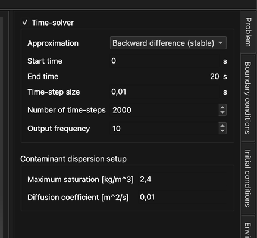
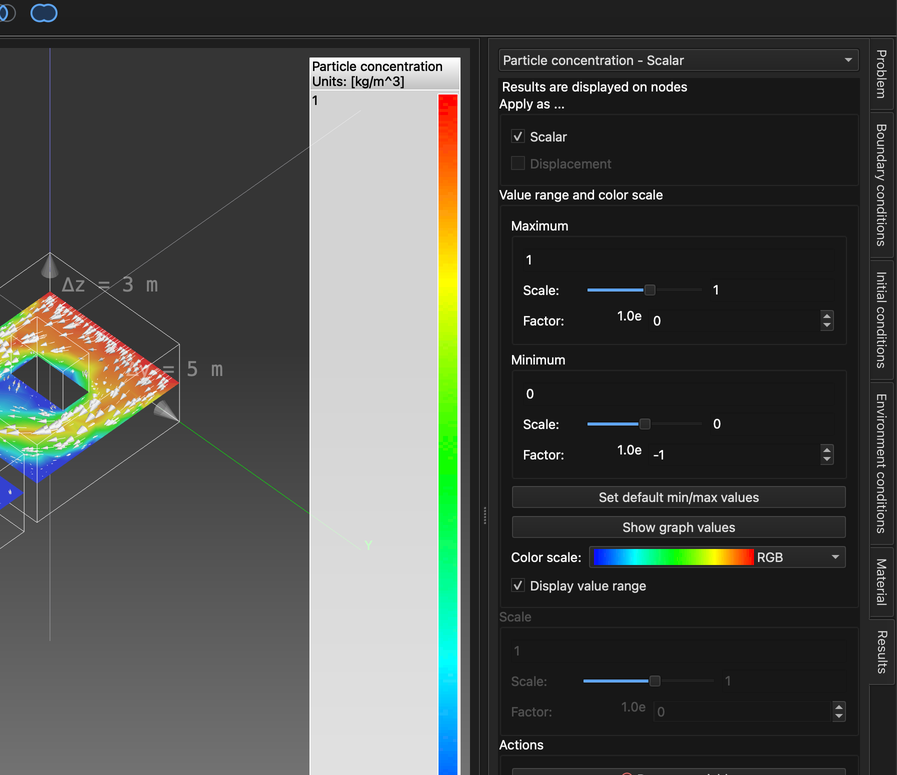
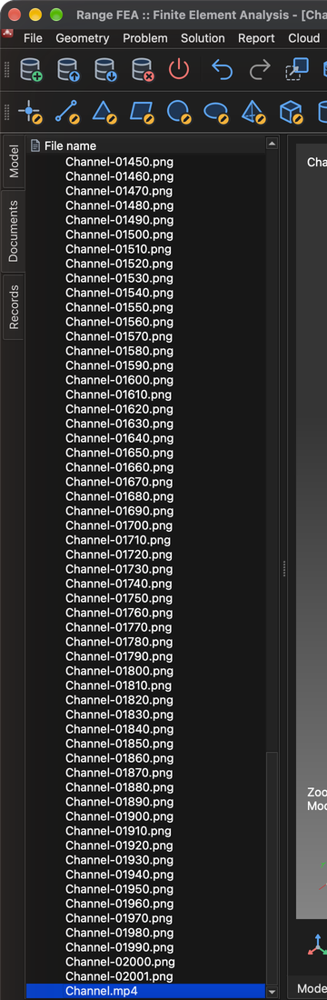

# Dispersion de contaminants dans les fluides

Ce tutoriel montre comment configurer et résoudre une simulation multiphysique qui combine un problème non linéaire et itératif – **CFD (mécanique des fluides numérique)** – avec le transport d'un contaminant entraîné par l'écoulement.

Deux types de problèmes sont nécessaires :

1. **Incompressible viscous flow** (écoulement visqueux incompressible) – calcule la vitesse et la pression du fluide (écoulement stationnaire ou transitoire de fluides newtoniens).
2. **Contaminant dispersion** (dispersion de contaminants) – calcule comment un contaminant se répand dans ce champ d'écoulement.

Comme le problème d'écoulement est non linéaire, il est résolu de manière itérative. La simulation se déroule donc en deux étapes :

1. **Écoulement stationnaire** – on calcule d'abord, sans contaminant, un champ d'écoulement « initial » convergé et la répartition de la pression.
2. **Simulation transitoire** – ensuite, à partir de ce champ d'écoulement, on utilise l'**intégration temporelle** pour suivre comment une impulsion de contaminant entrant dans le canal est transportée à travers celui-ci.

## 1. Charger le modèle

**Menu :** _Fichier -> Ouvrir un modèle_

Dans la fenêtre **Ouvrir un modèle**, sélectionnez **Channel.tmsh** et cliquez sur **Ouvrir**.

Le modèle se compose de trois entités surface – **Walls**, **Inflow** et **Outflow**. Comme aucun type de problème n'est encore affecté au modèle, la fenêtre **Enchaînement des tâches du problème** s'ouvre automatiquement une fois le chargement terminé.

## 2. Enchaînement des tâches du problème (étape 1 – écoulement stationnaire)

Dans la première étape, seul l'écoulement est résolu, avec de nombreuses itérations non linéaires pour qu'il puisse converger.

1. Dans la fenêtre **Enchaînement des tâches du problème**, cliquez sur **Ajouter un type de problème**.
2. Dans le **Sélecteur de type de problème**, cochez **Incompressible viscous flow** et cliquez sur **OK**.
3. Double-cliquez sur la valeur **1** à côté de **Nb d'itérations :**, saisissez **2000** et appuyez sur _Entrée_.
4. Cliquez sur **OK** pour fermer la fenêtre.

La fenêtre peut être rouverte à tout moment avec le bouton **Enchaînement des tâches des problèmes** de la barre d'outils. Elle doit maintenant ressembler à ceci :

## 3. Générer le maillage volumique

Le modèle n'est défini que par ses surfaces. Pour résoudre un écoulement à l'intérieur, il faut d'abord générer un maillage volumique (tétraédrique).

**Menu :** _Géométrie -> Volume -> Générer un maillage tétraédrique_

Les valeurs préremplies dans la fenêtre **Générer un maillage 3D** suffisent. Cliquez sur **OK**. Une fois le maillage terminé, une nouvelle entité **Volume 1** apparaît sous **Volumes** dans l'arbre **Modèle**.

## 4. Affecter le matériau

Un matériau doit être affecté à toutes les entités du modèle.

1. Dans l'arbre **Modèle**, cliquez sur **Walls**, puis cliquez sur **Volume 1** en maintenant _Maj_ enfoncée pour sélectionner toutes les entités.
2. Ouvrez l'onglet **Matériau** sur le côté droit de la fenêtre principale.
3. Cochez **Water** (eau).

## 5. Conditions aux limites (étape 1)

Les conditions aux limites s'affectent dans l'onglet **Conditions aux limites** à l'entité sélectionnée dans l'arbre **Modèle**. Affectez les conditions suivantes aux entités **surface** :

1. **Walls**
    - _Wall_ (paroi ; aucune valeur requise)
2. **Inflow**
    - _Volumetric flow rate (inflow)_ (débit volumique, entrée)
        - Volumetric flow rate = 50 `[m^3/s]`
3. **Outflow**
    - _Pressure (implicit)_ (pression, implicite)
        - Pressure = 0 `[Pa]` (la valeur par défaut est 1000 `[Pa]`)

Pour chaque entité : sélectionnez-la dans l'arbre **Modèle**, cochez la condition dans l'onglet **Conditions aux limites**, sélectionnez la condition pour afficher ses propriétés sous la liste, puis double-cliquez sur la valeur, saisissez la nouvelle et appuyez sur _Entrée_.

## 6. Résoudre l'écoulement stationnaire

**Menu :** _Solution -> Démarrer le solveur_

Si le modèle n'a pas encore été enregistré, la fenêtre **Enregistrer le modèle** s'affiche d'abord. Cliquez sur **Enregistrer** pour accepter le nom de fichier proposé (**Channel.rbm**), puis cliquez sur **OK** dans la fenêtre **Démarrer le solveur pour le modèle**.

Le solveur s'exécute en arrière-plan et sa sortie est affichée dans l'onglet **Sortie du processus**. Le calcul des 2000 itérations prend quelques minutes ; l'exécution est terminée lorsque la sortie se termine par **SOLVER - END**. La convergence de la solution peut être vérifiée à tout moment avec :

**Menu :** _Rapport -> Convergence du solveur_

## 7. Créer une coupe

Une bonne façon d'examiner un écoulement est d'afficher la vitesse sous forme de **champ vectoriel**, où chaque flèche indique la direction et l'intensité de l'écoulement en un point. Un champ vectoriel tracé dans tout le volume devient toutefois vite un nuage dense de flèches superposées, difficile à lire. Il est généralement plus clair de découper d'abord le modèle par une **coupe** – un plan à travers le volume – puis d'afficher le champ vectoriel uniquement sur ce plan.

_Astuce : cochez **Volumes** dans l'arbre **Modèle** avant de commencer, afin que le volume soit visible pendant le positionnement de la coupe._

**Menu :** _Géométrie -> Coupe -> Créer une coupe_

Dans la fenêtre **Éditeur de coupe** :

1. Sélectionnez **Volume 1** dans la liste **Modèle**. La coupe sera créée à travers ce volume.
2. **Position du plan** définit un point par lequel passe le plan de coupe. Les valeurs par défaut le placent au centre du modèle (**X** = 7.5, **Y** = 2.5, **Z** = 1.5 `[m]`) ; conservez-les.
3. **Normale du plan** définit l'orientation du plan. La normale par défaut (**X** = 1) donne un plan vertical ; changez-la en **X** = 0, **Y** = 0, **Z** = 1 pour obtenir un plan horizontal coupant le canal à mi-hauteur.

Le plan de coupe est prévisualisé dans la **zone 3D du modèle** pendant la modification des valeurs. Cliquez sur **OK** pour créer la coupe. Une nouvelle entité **Cut 1** apparaît dans l'arbre **Modèle** sous **Coupes**.

## 8. Créer un champ vectoriel

Affichez maintenant la vitesse calculée sous forme de flèches sur le plan de coupe.

**Menu :** _Géométrie -> Champ vectoriel -> Créer un champ vectoriel_

Dans la fenêtre **Éditeur de champ vectoriel** :

1. Sélectionnez **Cut 1** dans la liste **Modèle**. Les flèches seront tracées sur le plan de coupe créé à l'étape précédente.
2. Sélectionnez **Velocity** (vitesse) dans la liste **Variables**.
3. Laissez **Champ vectoriel 3D** coché. Les flèches montrent alors le vecteur vitesse complet. Si l'option est décochée, chaque flèche est projetée sur le plan de coupe et seule la partie de l'écoulement située dans le plan est affichée.

Cliquez sur **OK** pour créer le champ vectoriel. Il apparaît dans l'arbre **Modèle** sous **Champs vectoriels**. Décochez **Volumes** pour que le volume plein ne masque pas les flèches.

Les flèches peuvent être trop courtes pour être bien visibles, car leur longueur est proportionnelle à la vitesse de l'écoulement. Pour les allonger, sélectionnez le champ vectoriel dans l'arbre **Modèle**, ouvrez l'onglet **Résultats** et augmentez la valeur dans la section **Échelle**. L'échelle est le produit de la valeur **Échelle** et de la puissance de dix définie dans **Facteur** ; dans l'exemple ci-dessous, **Échelle** 1 et **Facteur** 2 donnent une échelle de `1 × 10^2 = 100`.

## 9. Enchaînement des tâches du problème (étape 2 – transitoire)

Une fois un champ d'écoulement convergé disponible, la simulation **transitoire** incluant **Contaminant dispersion** peut être configurée.

Dans une simulation transitoire, les problèmes sont résolus une fois par pas de temps. **Incompressible viscous flow** reste non linéaire et nécessite donc ses propres itérations non linéaires à l'intérieur de chaque pas de temps, tandis que **Contaminant dispersion** est résolu une fois par pas de temps, après l'écoulement. Rouvrez la fenêtre **Enchaînement des tâches du problème** (bouton **Enchaînement des tâches des problèmes** de la barre d'outils) et configurez-la comme suit :

1. Sélectionnez **Incompressible viscous flow** et cliquez sur le bouton **>**. Il est ainsi déplacé dans un nouveau groupe d'itérations imbriqué.
2. Double-cliquez sur la valeur du **Nb d'itérations :** extérieur et changez-la de **2000** à **1**. Changez ensuite le **Nb d'itérations :** intérieur (imbriqué) de **1** à **10**.
3. Cliquez sur **Ajouter un type de problème**, cochez **Contaminant dispersion** et cliquez sur **OK**. **Incompressible viscous flow** est également coché automatiquement, car la dispersion de contaminants nécessite un champ d'écoulement. Si une seconde entrée **Incompressible viscous flow** est ajoutée au niveau extérieur, sélectionnez-la et cliquez sur **Supprimer**.

L'enchaînement des tâches doit ressembler à la capture d'écran ci-dessous. Confirmez avec **OK**.

## 10. Paramètres du solveur temporel

Ouvrez l'onglet **Problème** sur le côté droit de la fenêtre principale et réglez :

1. Cochez **Solveur temporel**.
2. **Approximation** : **Backward difference (stable)** (différences arrière – stable).
3. **Taille du pas de temps** : **0.01** `[s]`.
4. **Nombre de pas de temps** : **2000**.
5. **Fréquence de sortie** : **10** – un enregistrement de résultats est écrit tous les 10 pas de temps.

Le **Temps de fin** est calculé automatiquement (2000 × 0.01 s = 20 s).

Dans la section **Paramètres de la dispersion de contaminants**, réglez la **Saturation maximale** sur **2.4** `[kg/m^3]` et le **Coefficient de diffusion** sur **0.01** `[m^2/s]`. Pour plus d'informations, consultez le manuel théorique.

## 11. Conditions aux limites (étape 2)

Le contaminant entre dans le canal par l'entrée. Sélectionnez **Inflow** dans l'arbre **Modèle** et, dans l'onglet **Conditions aux limites**, cochez **Particle concentration** (concentration de particules) ; laissez **Volumetric flow rate (inflow)** coché.

Au lieu d'une valeur constante, on utilisera une valeur dépendant du temps. Développez la propriété **Particle concentration** (flèche devant son nom) et cliquez sur **Modifier les valeurs dépendant du temps**.

Dans la fenêtre **Éditeur de composantes**, réglez **Nombre de valeurs** sur **3** et saisissez les valeurs ci-dessous (double-cliquez sur une cellule pour la modifier), puis cliquez sur **Ok**.

| Temps `[s]` | Particle concentration `[kg/m^3]` |
| ----------- | --------------------------------- |
| 0           | 0                                 |
| 5           | 1                                 |
| 10          | 0                                 |

Entre deux instants indiqués, la valeur est interpolée linéairement, et après le dernier instant indiqué, la dernière valeur est conservée. Avec ces valeurs, la concentration à l'entrée monte de 0 à 1 `[kg/m^3]` pendant les 5 premières secondes et redescend à 0 entre 5 et 10 secondes.

## 12. Résoudre le problème transitoire (redémarrage)

**Menu :** _Solution -> Démarrer le solveur_

Dans la fenêtre **Démarrer le solveur pour le modèle**, cochez **Redémarrer le solveur / continuer** et cliquez sur **OK**. Le solveur utilise alors l'écoulement stationnaire déjà calculé comme point de départ et poursuit par la simulation en intégration temporelle.

L'avertissement **Contaminant dispersion: No implicit boundary condition assigned.** est attendu et peut être ignoré.

## 13. Afficher les résultats pendant l'exécution du solveur

Le solveur transitoire s'exécute en arrière-plan ; les résultats peuvent donc être examinés pendant que le calcul se poursuit. D'autres entités d'affichage, comme des coupes, des iso, des lignes de courant, des champs vectoriels ou des champs scalaires, peuvent être créées à tout moment, et les résultats calculés peuvent y être affichés. Ici, la coupe et le champ vectoriel des étapes 7 et 8 sont réutilisés.

### 13.1 Concentration du contaminant sur la coupe

1. Dans l'arbre **Modèle**, développez **Coupes**, cochez **Cut 1** pour qu'elle soit visible et sélectionnez-la.
2. Ouvrez l'onglet **Résultats** et choisissez **Particle concentration - Scalar** dans la liste déroulante en haut.
3. Sous **Appliquer comme ...**, cochez **Scalar**. La coupe est maintenant colorée selon la concentration du contaminant.
4. Sous **Plage de valeurs et échelle de couleurs**, réglez **Maximum** sur **1** et **Minimum** sur **0** (saisissez la valeur et appuyez sur _Entrée_). Cela correspond à la plage de la concentration d'entrée, si bien que les mêmes couleurs signifient la même concentration à chaque pas de temps.
5. Cochez **Afficher la plage de valeurs** pour afficher l'échelle de couleurs dans la **zone 3D du modèle**.

### 13.2 Flèches du champ vectoriel

Pour rendre la direction de l'écoulement plus lisible au-dessus de la coupe colorée, tracez les flèches avec des pointes et en blanc :

1. Sélectionnez le champ vectoriel (**Velocity** sous **Champs vectoriels**) dans l'arbre **Modèle**.
2. Dans les **Propriétés d'affichage** sous l'arbre, cochez **Dessiner les pointes des flèches**.
3. Cliquez sur le sélecteur de couleur sous les cases à cocher et choisissez le blanc (**#ffffffff**).

Les autres propriétés d'affichage déterminent si toutes les flèches ont la même longueur (**Dessiner des flèches de même longueur**) et si les flèches partent du point où la vitesse est évaluée (**Dessiner les flèches partant du point**).

## 14. Enregistrements du modèle (résultats dans le temps)

Tous les 10 pas de temps (la **Fréquence de sortie**), le solveur écrit un enregistrement du modèle contenant la solution pour cet instant. Les enregistrements sont listés dans l'onglet **Enregistrements** sur le côté gauche de la fenêtre principale ; la colonne **Enregistrement** indique le numéro du pas de temps (l'enregistrement **500** contient la solution à 500 × 0.01 s = 5 s). Double-cliquez sur un enregistrement pour charger les résultats de son pas de temps ; les résultats appliqués dans l'onglet **Résultats** sont conservés et redessinés pour l'enregistrement chargé.

Le calcul des 2000 pas de temps prend un certain temps (environ 20 minutes sur un ordinateur actuel). Le solveur peut être arrêté à tout moment, et les enregistrements écrits jusque-là sont conservés :

**Menu :** _Solution -> Arrêter le solveur_ (confirmez avec **Yes**)

## 15. Enregistrer une vidéo

Une vidéo est créée à partir de ce qui est actuellement affiché dans la **zone 3D du modèle** ; configurez donc d'abord la vue et les résultats affichés (voir l'étape 13). Les paramètres d'affichage ne sont pas enregistrés avec le modèle et doivent être redéfinis après sa réouverture. Ouvrez ensuite l'onglet **Enregistrements**, utilisez les champs **De** et **À** en bas pour choisir la plage d'enregistrements et cliquez sur le bouton rouge d'enregistrement.

La fenêtre **Paramètres vidéo** s'affiche ; on peut y régler le codec vidéo, le format de fichier, le nombre d'images par seconde et d'images par enregistrement ; la durée estimée de la vidéo est indiquée en dessous. Avec 202 enregistrements, 24 images par seconde et 1 image par enregistrement, la vidéo dure environ 8.4 secondes. Cliquez sur **OK** pour lancer l'enregistrement.

L'enregistrement peut prendre un certain temps, car chaque enregistrement du modèle est chargé à tour de rôle et une capture de la **zone 3D du modèle** est prise comme image de la vidéo.

La vidéo et toutes les images (une image PNG par enregistrement) se trouvent dans l'onglet **Documents** sous **Channel** ; la vidéo **Channel.mp4** est à la fin de la liste. Double-cliquez dessus pour la lire.

