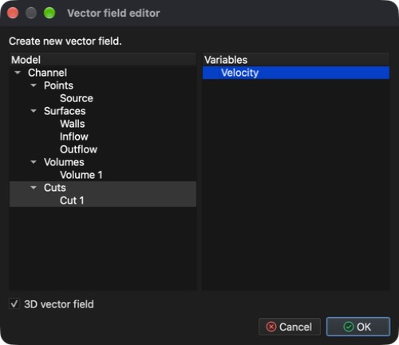
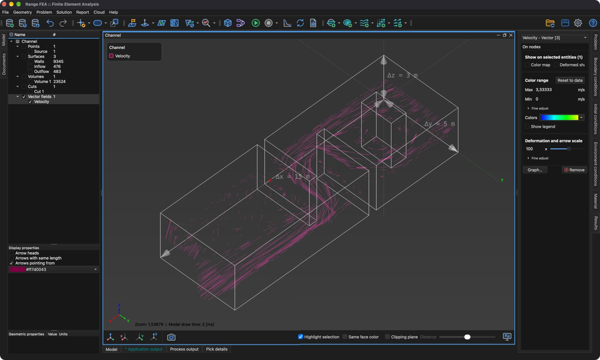
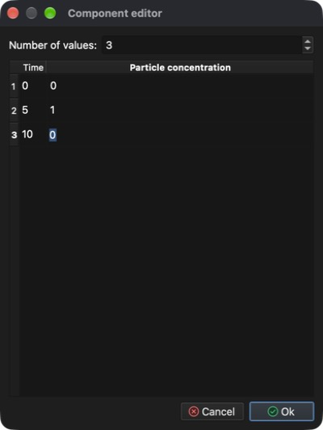
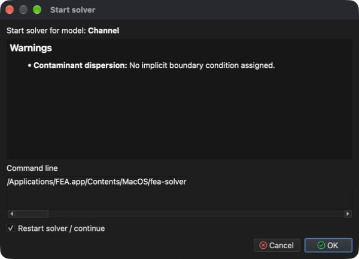

# Dispersion de contaminants dans les fluides

Ce tutoriel montre comment configurer et résoudre une simulation multiphysique qui combine un problème non linéaire et itératif – la **CFD (Computational Fluid Dynamics, mécanique des fluides numérique)** – avec le transport d'un contaminant entraîné par l'écoulement.

Deux types de problème sont nécessaires :

1. **Incompressible viscous flow** (écoulement visqueux incompressible) – calcule la vitesse et la pression du fluide (écoulement permanent ou transitoire de fluides newtoniens).
2. **Contaminant dispersion** (dispersion de contaminant) – calcule comment un contaminant se propage dans ce champ d'écoulement.

Le problème d'écoulement étant non linéaire, il est résolu de manière itérative. La simulation se déroule donc en deux étapes :

1. **Écoulement permanent** – d'abord, un champ d'écoulement « initial » convergé et la répartition de la pression sont calculés, sans contaminant.
2. **Simulation transitoire** – ensuite, à partir de ce champ d'écoulement, une **avance en temps** permet de suivre comment une impulsion de contaminant entrant dans le canal est transportée à travers lui.

## 1. Charger le modèle

**Menu :** _Fichier -> Ouvrir un modèle_

Dans la boîte de dialogue **Ouvrir un modèle**, sélectionnez **Channel.rbm** et cliquez sur **Open** (Ouvrir).

Le modèle se compose d'une entité ponctuelle – **Source** – et de trois entités surfaciques – **Walls**, **Inflow** et **Outflow**. Comme aucun type de problème n'est encore affecté au modèle, la boîte de dialogue **Sélectionner le problème** s'ouvre automatiquement à la fin du chargement.

## 2. Sélectionner le problème (étape 1 – écoulement permanent)

Lors de la première étape, seul l'écoulement est résolu, avec de nombreuses itérations non linéaires afin qu'il puisse converger.

1. Dans la boîte de dialogue **Sélectionner le problème**, cliquez sur la tuile **Incompressible viscous flow**.
2. Laissez **Itérations maximales** à **2000** et **Convergence** à **1e-05**, valeurs par défaut pour un écoulement permanent.
3. Fermez la boîte de dialogue avec **OK**.

La boîte de dialogue peut être rouverte à tout moment avec le bouton **Sélectionner le problème** de la barre d'outils.

## 3. Générer le maillage volumique

Le modèle n'est défini que par ses surfaces. Pour résoudre un écoulement à l'intérieur, un maillage volumique (tétraédrique) doit d'abord être généré.

**Menu :** _Géométrie -> Volume -> Générer un maillage tétraédrique_

Les valeurs préremplies de la boîte de dialogue **Générer un maillage 3D** suffisent. Cliquez sur **OK**. Une fois le maillage terminé, une nouvelle entité **Volume 1** apparaît sous **Volumes** dans l'**arbre du modèle**.

## 4. Affecter le matériau

Un matériau doit être affecté à toutes les entités du modèle.

1. Dans l'**arbre du modèle**, développez **Volumes**, cliquez sur **Source**, puis cliquez sur **Volume 1** en maintenant _Maj_ pour sélectionner toutes les entités.
2. Ouvrez l'onglet **Matériau** à droite de la fenêtre principale.
3. Cochez **Water** (eau ; il se trouve à la fin de la liste).

## 5. Conditions aux limites (étape 1)

Les conditions aux limites sont affectées dans l'onglet **Conditions aux limites** à l'entité sélectionnée dans l'**arbre du modèle**. Affectez les conditions suivantes aux entités **surfaciques** :

1. **Walls**
    - _Wall_ (paroi ; aucune valeur nécessaire)
2. **Inflow**
    - _Volumetric flow rate (inflow)_ (débit volumique, entrée)
        - Volumetric flow rate = 50 `[m^3/s]`
3. **Outflow**
    - _Pressure (implicit)_ (pression, implicite)
        - Pressure = 0 `[Pa]` (la valeur par défaut est 1000 `[Pa]`)

Pour chaque entité : sélectionnez-la dans l'**arbre du modèle**, cochez la condition dans l'onglet **Conditions aux limites**, sélectionnez la condition pour afficher ses propriétés sous la liste, puis double-cliquez sur la valeur, saisissez la nouvelle et appuyez sur _Entrée_.

## 6. Résoudre l'écoulement permanent

**Menu :** _Solution -> Démarrer le solveur_

Le modèle **Channel** a été ouvert depuis un fichier, il y est donc enregistré automatiquement. Cliquez sur **OK** dans la boîte de dialogue **Démarrer le solveur**. Si la boîte de dialogue liste une erreur telle que **Entity Source has no material assigned.**, le bouton **OK** est désactivé ; affectez d'abord le matériau à cette entité.

Le solveur s'exécute en arrière-plan et sa sortie est affichée dans l'onglet **Sortie du processus**. Le calcul des 2000 itérations prend quelques minutes ; il est terminé lorsque la sortie se termine par **SOLVER - END**. La convergence de la solution peut être vérifiée à tout moment avec :

**Menu :** _Rapport -> Convergence du solveur_

## 7. Créer une coupe

Un bon moyen d'examiner un écoulement est d'afficher la vitesse sous forme de **champ vectoriel**, où chaque flèche indique la direction et la norme de l'écoulement en un point. Un champ vectoriel tracé dans tout le volume devient cependant vite un nuage dense de flèches superposées, difficile à lire. Il est généralement plus clair de couper d'abord le modèle par une **coupe** – un plan traversant le volume – puis d'afficher le champ vectoriel uniquement sur ce plan.

_Astuce : cochez **Volumes** dans l'**arbre du modèle** avant de commencer, afin que le volume soit visible pendant le positionnement de la coupe._

**Menu :** _Géométrie -> Coupe -> Créer une coupe_

Dans la boîte de dialogue **Éditeur de coupe** :

1. Sélectionnez **Volume 1** dans la liste **Modèle**. La coupe sera créée à travers ce volume.
2. **Position du plan** définit un point par lequel passe le plan de coupe. Les valeurs par défaut le placent au centre du modèle (**X** = 7,5, **Y** = 2,5, **Z** = 1,5 `[m]`) ; conservez-les.
3. **Normale du plan** définit l'orientation du plan. La normale par défaut (**X** = 1) donne un plan vertical ; remplacez-la par **X** = 0, **Y** = 0, **Z** = 1 pour obtenir un plan horizontal coupant le canal à mi-hauteur. Passez d'un champ à l'autre avec _Tab_ : appuyer sur _Entrée_ valide toute la boîte de dialogue.

Le plan de coupe est prévisualisé dans la **zone 3D du modèle** pendant la modification des valeurs. Cliquez sur **OK** pour créer la coupe. Une nouvelle entité **Cut 1** apparaît dans l'**arbre du modèle** sous **Coupes**.

## 8. Créer un champ vectoriel

Affichez maintenant la vitesse calculée sous forme de flèches sur le plan de coupe.

**Menu :** _Géométrie -> Champ vectoriel -> Créer un champ vectoriel_

Dans la boîte de dialogue **Éditeur de champ vectoriel** :

1. Sélectionnez **Cut 1** dans la liste **Modèle**. Les flèches seront tracées sur le plan de coupe créé à l'étape précédente.
2. Sélectionnez **Velocity** (vitesse) dans la liste **Variables**.
3. Laissez **Champ vectoriel 3D** coché. Les flèches montrent alors le vecteur vitesse complet. Lorsqu'il est décoché, chaque flèche est projetée sur le plan de coupe et seule la composante de l'écoulement dans le plan est affichée.

Cliquez sur **OK** pour créer le champ vectoriel. Il apparaît dans l'**arbre du modèle** sous **Champs vectoriels** avec le nom **Velocity**. Décochez **Volumes** pour que le volume plein ne masque pas les flèches, et cochez **Champs vectoriels**.

Les flèches peuvent être trop courtes pour être bien visibles, car leur longueur est proportionnelle à la vitesse de l'écoulement. Pour les allonger, sélectionnez le champ vectoriel dans l'**arbre du modèle**, ouvrez l'onglet **Résultats** et augmentez la valeur dans la section **Échelle de déformation et des flèches**, par exemple à **100**. Saisissez la valeur ou faites glisser le curseur à côté.

## 9. Sélectionner le problème (étape 2 – transitoire)

Avec un champ d'écoulement convergé, la simulation **transitoire** incluant **Contaminant dispersion** peut être configurée.

Dans une simulation transitoire, les problèmes sont résolus une fois par pas de temps. **Incompressible viscous flow** reste non linéaire et a donc besoin de ses propres itérations non linéaires à chaque pas de temps, tandis que **Contaminant dispersion** est résolu une fois par pas de temps après l'écoulement. Rouvrez la boîte de dialogue **Sélectionner le problème** (bouton **Sélectionner le problème** de la barre d'outils) et configurez-la ainsi :

1. Cliquez sur la tuile **Contaminant dispersion** (**Incompressible viscous flow** reste sélectionné et est marqué **Requis**), puis cliquez sur **Personnaliser…** pour afficher le flux de tâches.
2. Sélectionnez **Incompressible viscous flow** et cliquez sur le bouton **>**. La tâche est ainsi placée dans un nouveau groupe d'itérations imbriqué.
3. Double-cliquez sur la valeur du **# of iterations:** extérieur et remplacez **2000** par **1**. Remplacez ensuite le **# of iterations:** intérieur (imbriqué) **1** par **10**.

Validez avec **OK**.

## 10. Configuration du solveur temporel

Ouvrez l'onglet **Problème** à droite de la fenêtre principale et réglez (passez d'un champ à l'autre avec _Tab_) :

1. Cochez **Solveur temporel**.
2. **Approximation** : **Backward difference (stable)** (différence arrière, stable).
3. **Taille du pas de temps** : **0,01** `[s]`.
4. **Nombre de pas de temps** : **2000**.
5. **Fréquence de sortie** : **10** – un enregistrement de résultats est écrit tous les 10 pas de temps.

Le **Temps de fin** est calculé automatiquement (2000 × 0,01 s = 20 s).

Dans la section **Paramètres de la dispersion de contaminants**, réglez **Maximum saturation** sur **2,4** `[kg/m^3]` et **Diffusion coefficient** sur **0,01** `[m^2/s]`. Pour plus d'informations, consultez le manuel théorique.

## 11. Conditions aux limites (étape 2)

Le contaminant entre dans le canal par l'entrée. Sélectionnez **Inflow** dans l'**arbre du modèle** et, dans l'onglet **Conditions aux limites**, cochez **Particle concentration** (concentration de particules ; laissez **Volumetric flow rate (inflow)** coché).

Au lieu d'une valeur constante, une valeur dépendant du temps est utilisée. Développez la propriété **Particle concentration** (flèche devant son nom) et cliquez sur **Modifier les valeurs dépendant du temps**.

Dans la boîte de dialogue **Éditeur de composantes**, réglez **Nombre de valeurs** sur **3** et saisissez les valeurs ci-dessous (double-cliquez sur une cellule pour la modifier), puis cliquez sur **Ok**.

| Temps `[s]` | Particle concentration `[kg/m^3]` |
| ----------- | --------------------------------- |
| 0           | 0                                 |
| 5           | 1                                 |
| 10          | 0                                 |

Entre deux instants donnés, la valeur est interpolée linéairement, et après le dernier instant donné, la dernière valeur est conservée. Avec ces valeurs, la concentration à l'entrée passe de 0 à 1 `[kg/m^3]` pendant les 5 premières secondes et redescend à 0 entre 5 et 10 secondes.

## 12. Résoudre le problème transitoire (redémarrage)

**Menu :** _Solution -> Démarrer le solveur_

Dans la boîte de dialogue **Démarrer le solveur**, cochez **Redémarrer le solveur / continuer** et cliquez sur **OK**. Le solveur utilise alors l'écoulement permanent déjà calculé comme point de départ et poursuit avec la simulation par avance en temps.

L'avertissement **Contaminant dispersion: No implicit boundary condition assigned.** est attendu et peut être ignoré.

## 13. Afficher les résultats pendant le calcul

Le solveur transitoire s'exécute en arrière-plan, les résultats peuvent donc être examinés pendant le calcul. Dès que les premiers enregistrements sont écrits, un onglet **Enregistrements** apparaît à gauche de la fenêtre principale. Les résultats du calcul transitoire ne sont affichés qu'après le chargement d'un enregistrement : ouvrez l'onglet **Enregistrements**, double-cliquez sur le dernier enregistrement et revenez à l'onglet **Modèle** (voir l'étape 14 pour en savoir plus sur les enregistrements). D'autres entités d'affichage telles que des coupes, des ISO, des lignes de courant, des champs vectoriels ou scalaires peuvent être créées à tout moment et les résultats calculés y être affichés. Ici, la coupe et le champ vectoriel des étapes 7 et 8 sont réutilisés.

### 13.1 Concentration du contaminant sur la coupe

1. Dans l'**arbre du modèle**, développez **Coupes**, cochez **Cut 1** pour qu'elle soit visible et sélectionnez-la.
2. Ouvrez l'onglet **Résultats** et choisissez **Particle concentration - Scalar** dans le menu déroulant en haut. Si la liste ne propose que **Velocity** et **Pressure**, aucun enregistrement du calcul transitoire n'a encore été chargé.
3. Sous **Afficher sur les entités sélectionnées**, cochez **Carte de couleurs**. La coupe est maintenant colorée selon la concentration du contaminant.
4. Sous **Plage de couleurs**, réglez **Max** sur **1** et **Min** sur **0** (saisissez la valeur et appuyez sur _Entrée_). Cela correspond à la plage de la concentration à l'entrée : les mêmes couleurs signifient donc la même concentration à chaque pas de temps.
5. Cochez **Afficher la légende** pour afficher l'échelle de couleurs dans la **zone 3D du modèle**.

### 13.2 Flèches du champ vectoriel

Pour mieux lire la direction de l'écoulement sur la coupe colorée, tracez les flèches avec des pointes et en blanc :

1. Cochez **Champs vectoriels** et sélectionnez le champ vectoriel (**Velocity** sous **Champs vectoriels**) dans l'**arbre du modèle**.
2. Dans les **Propriétés d'affichage** sous l'arbre, cochez **Pointes des flèches**.
3. Cliquez sur le sélecteur de couleur sous les cases à cocher et choisissez le blanc (**#ffffffff**).

Les autres propriétés d'affichage déterminent si toutes les flèches ont la même longueur (**Flèches de même longueur**) et si les flèches partent du point où la vitesse est évaluée (**Flèches partant du point**).

## 14. Enregistrements du modèle (résultats dans le temps)

Tous les 10 pas de temps (la **Fréquence de sortie**), le solveur écrit un enregistrement du modèle contenant la solution à cet instant. Les enregistrements sont listés dans l'onglet **Enregistrements** à gauche de la fenêtre principale ; la colonne **Enregistrement** indique le numéro du pas de temps (l'enregistrement **500** contient la solution à 500 × 0,01 s = 5 s). Double-cliquez sur un enregistrement pour charger les résultats de son pas de temps ; l'enregistrement chargé est marqué d'une flèche, et les résultats appliqués dans l'onglet **Résultats** sont conservés et redessinés pour lui. La légende de la **zone 3D du modèle** indique le pas de temps et l'instant de l'enregistrement chargé (p. ex. **Time-step 520 · 5,19 s**). Les boutons en bas de l'onglet lisent les enregistrements les uns après les autres.

Le calcul des 2000 pas de temps prend un certain temps (environ 20 minutes sur un ordinateur actuel). Le solveur peut être arrêté à tout moment et les enregistrements écrits jusque-là sont conservés :

**Menu :** _Solution -> Arrêter le solveur_ (confirmez avec **Yes** (Oui))

Lorsque le solveur s'arrête, le dernier enregistrement écrit est chargé.

## 15. Enregistrer une vidéo

Une vidéo est créée à partir de ce qui est actuellement affiché dans la **zone 3D du modèle** ; réglez donc d'abord la vue et les résultats affichés (voir l'étape 13). Les réglages d'affichage ne sont pas enregistrés avec le modèle et doivent être refaits après sa réouverture. Ouvrez ensuite l'onglet **Enregistrements**, choisissez la plage d'enregistrements avec les champs **De** et **À** en bas, puis cliquez sur le bouton rouge d'enregistrement.

La boîte de dialogue **Paramètres vidéo** s'affiche ; elle permet de régler le codec vidéo, le format de fichier, le nombre d'images par seconde et d'images par enregistrement ; la durée estimée de la vidéo et le nombre d'enregistrements sont indiqués en dessous. Avec 98 enregistrements (le solveur a été arrêté vers 9,8 s), 24 images par seconde et 1 image par enregistrement, la vidéo dure environ 4,1 secondes ; les 200 enregistrements d'un calcul complet donnent environ 8,3 secondes. Cliquez sur **OK** pour lancer l'enregistrement.

L'enregistrement peut prendre un certain temps, car chaque enregistrement du modèle est chargé tour à tour et une capture de la **zone 3D du modèle** est prise comme image de la vidéo.

La vidéo et toutes les images (une image PNG par enregistrement) se trouvent dans l'onglet **Documents** sous **Channel** : la vidéo **Channel.mp4** sous **Vidéos** et les images sous **Images**. Double-cliquez sur la vidéo pour la lire.

