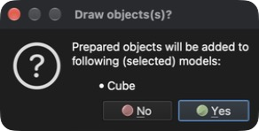

# Dessiner un cube

Ce tutoriel montre comment dessiner (générer) une géométrie simple, par exemple un cube.

## 1. Créer un nouveau modèle

**Menu :** _Fichier -> Nouveau modèle_

Saisissez **Cube** comme nom de modèle (la description est facultative) et cliquez sur **OK**. Un nouveau modèle vide nommé **Cube** est créé. Comme aucun problème n'est affecté au nouveau modèle, la boîte de dialogue **Sélectionner le problème** s'affiche.

### 1.1 Affecter un type de problème

Pour affecter un type de problème, cliquez sur la tuile **Heat transfer**, puis sur le bouton **OK**.

## 2. Dessiner un cube

**Menu :** _Géométrie -> Dessiner -> Dessiner un hexaèdre_

Une fois l'élément de menu activé, le panneau **Dessiner un objet** s'affiche à droite de la fenêtre principale ; il permet de modifier la position et la taille de l'objet ainsi que le nombre de divisions dans les directions X, Y et Z. L'objet par défaut est un cube de 1 `[m]` de côté placé à l'origine.

L'objet affiché change en même temps que les valeurs du panneau **Dessiner un objet**. Laissez **Fusionner les nœuds proches** coché et cliquez sur le bouton **OK** pour ajouter l'objet au modèle. Une boîte de confirmation **Draw objects(s)?** listant les modèles sélectionnés auxquels l'objet sera ajouté s'affiche.

Cliquez sur **Yes** (Oui) pour confirmer ; le cube est ajouté au modèle **Cube** sous la forme d'une entité **Surface**.

## 3. Enregistrer le modèle

Pour enregistrer le modèle, exécutez l'action suivante.

**Menu :** _Fichier -> Enregistrer le modèle_

Si le modèle n'a jamais été enregistré, le programme affiche la boîte de dialogue **Enregistrer le modèle** proposant un nom de fichier (**Cube.rbm**) et un dossier. Cliquez sur **Save** (Enregistrer) pour valider.
