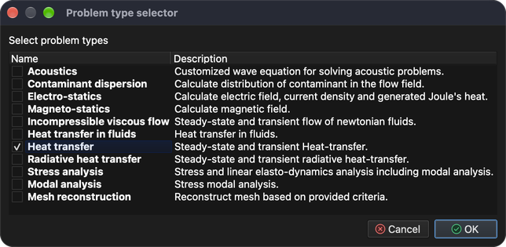
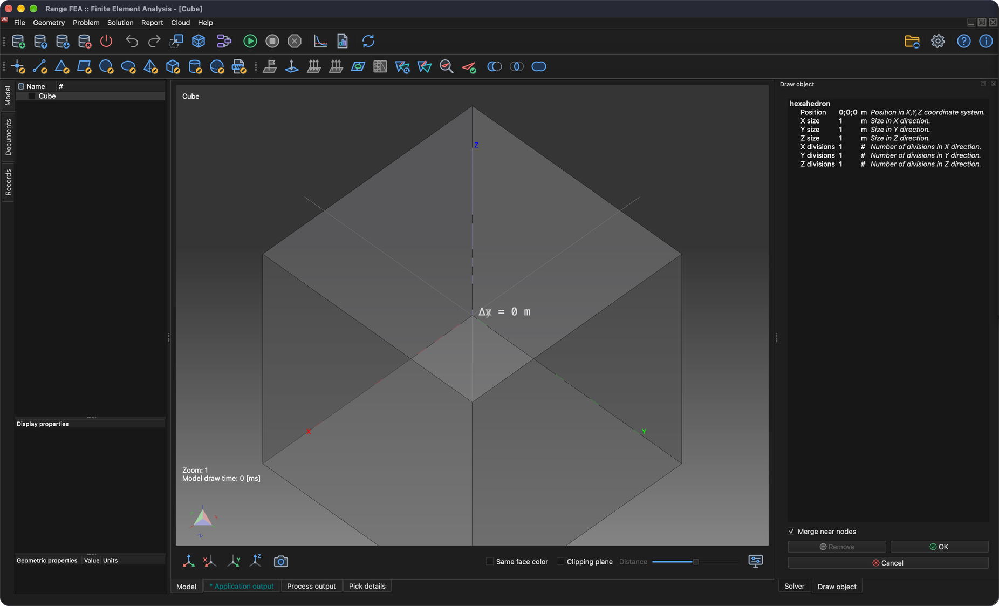

# Dessiner un cube

Ce tutoriel montre comment dessiner/générer une géométrie simple telle qu'un cube.

## 1. Créer un nouveau modèle

**Menu :** _Fichier -> Nouveau modèle_

Saisissez **Cube** comme nom du modèle et cliquez sur **OK**. Un nouveau modèle vide nommé **Cube** est créé. Comme aucun problème n'est affecté au modèle nouvellement créé, la fenêtre **Enchaînement des tâches du problème** s'ouvre.

### 1.1 Affecter le type de problème

Pour affecter un type de problème, cliquez sur le bouton **Ajouter un type de problème** et, dans la fenêtre **Sélecteur de type de problème**, choisissez **Heat transfer** (transfert de chaleur).

Cliquez sur **OK** pour fermer la fenêtre **Sélecteur de type de problème**, puis de nouveau sur **OK** pour fermer la fenêtre **Enchaînement des tâches du problème**.

## 2. Dessiner un cube

**Menu :** _Géométrie -> Dessiner -> Dessiner un hexaèdre_

Une fois l'élément de menu activé, le panneau **Dessiner un objet** s'affiche sur le côté droit de la fenêtre principale ; il permet de modifier la position, la taille et les divisions axiales de l'objet.

L'objet affiché change en même temps que les valeurs modifiées dans le panneau **Dessiner un objet**. Cliquez sur **OK** pour ajouter l'objet au modèle. Une fenêtre de confirmation s'ouvre avec la liste des modèles sélectionnés auxquels l'objet sera ajouté.

Confirmez avec **OK** et le cube est ajouté au modèle **Cube**.

## 3. Enregistrer le modèle

Pour enregistrer le modèle, il suffit d'exécuter l'action suivante.

**Menu :** _Fichier -> Enregistrer le modèle_

Si le modèle n'a jamais été enregistré, le programme affiche la fenêtre **Enregistrer le modèle** avec un nom de fichier et un emplacement proposés. Cliquez sur **Enregistrer** pour confirmer.
