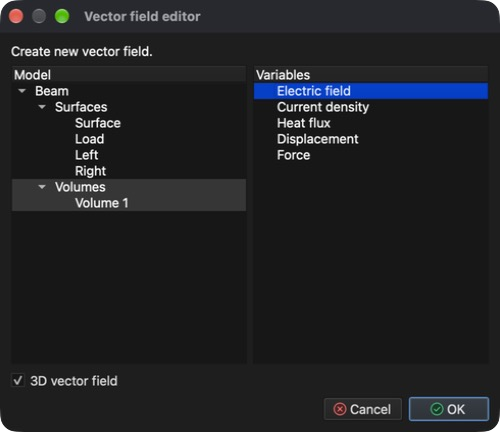

# Multiphysique

Ce tutoriel montre comment résoudre plusieurs problèmes couplés sur un même modèle. Le modèle **Beam** (poutre) du tutoriel **Analyse des contraintes et des déformations** est réutilisé. Cette fois, un courant électrique traverse la poutre, le courant échauffe la poutre (effet Joule) et la chaleur fait dilater et déformer la poutre.

Trois types de problème sont nécessaires ; ils sont résolus dans cet ordre :

1. **Electro-statics** (électrostatique) – calcule le potentiel électrique, le champ électrique, la densité de courant et la chaleur de Joule produite par le courant.
2. **Heat transfer** (transfert de chaleur) – calcule la répartition de la température due à la chaleur de Joule.
3. **Stress analysis** (analyse des contraintes) – calcule la dilatation thermique (déplacements) et les contraintes qui en résultent.

Chaque problème utilise les résultats du précédent, l'ordre des problèmes est donc important.

## 1. Charger le modèle

**Menu :** _Fichier -> Ouvrir un modèle_

Dans la boîte de dialogue **Ouvrir un modèle**, sélectionnez **Beam.rbm** et cliquez sur **Open** (Ouvrir).

Comme aucun type de problème n'est encore affecté au modèle, la boîte de dialogue **Sélectionner le problème** s'ouvre automatiquement à la fin du chargement.

## 2. Sélectionner les problèmes

Dans la boîte de dialogue **Sélectionner le problème**, cliquez sur les tuiles **Electro-statics**, **Heat transfer** et **Stress analysis**. Sous les tuiles, la boîte de dialogue affiche l'**Ordre de résolution** : Electro-statics → Heat transfer → Stress analysis. **Modal analysis** est marqué **Incompatible**, car il ne peut pas être combiné avec d'autres types de problème. Validez avec **OK**.

La boîte de dialogue peut être rouverte à tout moment avec le bouton **Sélectionner le problème** de la barre d'outils.

## 3. Générer le maillage 3D

Les trois problèmes sont résolus sur un maillage volumique.

**Menu :** _Géométrie -> Volume -> Générer un maillage tétraédrique_

Les valeurs préremplies de la boîte de dialogue **Générer un maillage 3D** suffisent. Cliquez sur **OK**. Une fois le maillage terminé, une nouvelle entité **Volume 1** apparaît sous **Volumes** dans l'**arbre du modèle**.

## 4. Affecter le matériau

Un matériau doit être affecté à toutes les entités du modèle. Le matériau doit fournir les propriétés nécessaires aux trois problèmes ; c'est le cas de **Iron** (fer).

1. Dans l'**arbre du modèle**, développez **Volumes**, cliquez sur **Surface**, puis cliquez sur **Volume 1** en maintenant _Maj_ pour sélectionner toutes les entités.
2. Ouvrez l'onglet **Matériau** à droite de la fenêtre principale.
3. Cochez **Iron**.

## 5. Affecter les conditions aux limites

Comme plusieurs types de problème sont sélectionnés, l'onglet **Conditions aux limites** propose désormais les conditions de chacun d'eux, et une entité peut recevoir plusieurs conditions – une par problème. Affectez les conditions suivantes aux entités **surfaciques** :

1. **Surface** (la surface extérieure de la poutre)
    - _Simple convection_ (convection simple)
        - Convection coefficient = 100 `[W/(m^2*K)]`
        - Fluid temperature = 293,15 `[K]`
2. **Load** (la face au milieu de la poutre)
    - _Electric potential_ (potentiel électrique)
        - Electric potential = 0,04 `[V]`
    - _Simple convection_ (valeurs identiques à **Surface**)
3. **Left** et **Right** (les faces aux deux extrémités de la poutre)
    - _Displacement_ (déplacement)
        - Displacement in X, Y and Z direction = 0 `[m]`
    - _Electric potential_
        - Electric potential = -0,04 `[V]`
    - _Simple convection_ (valeurs identiques à **Surface**)

Le courant circule donc du milieu de la poutre vers ses deux extrémités, et toutes les faces cèdent de la chaleur à l'air ambiant par convection.

Pour chaque entité : sélectionnez-la dans l'**arbre du modèle** (maintenez _Ctrl_ / _⌘ Cmd_ pour sélectionner **Left** et **Right**), cochez la condition dans l'onglet **Conditions aux limites**, sélectionnez la condition pour afficher ses propriétés sous la liste, puis double-cliquez sur la valeur, saisissez la nouvelle et appuyez sur _Entrée_. Les valeurs par défaut de **Simple convection** (100 `[W/(m^2*K)]` et 293,15 `[K]`) et de **Displacement** (0 `[m]`) conviennent déjà ; seul **Electric potential** doit être modifié.

## 6. Vérifier les conditions d'environnement

Les conditions d'environnement s'appliquent à tout le modèle et ne se cochent pas comme les conditions aux limites. Ouvrez l'onglet **Conditions d'environnement** et sélectionnez chaque condition pour vérifier ses valeurs :

- _Gravitational acceleration_ (accélération de la pesanteur)
    - 0, 0 et -9,80665 `[m/s^2]` dans les directions X, Y et Z
- _Temperature_ (température)
    - Temperature = 293,15 `[K]`

## 7. Résoudre le problème

**Menu :** _Solution -> Démarrer le solveur_

Le modèle doit être enregistré avant que le solveur puisse démarrer. Le modèle **Beam** a été ouvert depuis un fichier, il y est donc enregistré automatiquement ; un modèle jamais enregistré affiche d'abord la boîte de dialogue **Enregistrer le modèle**. La boîte de dialogue **Démarrer le solveur** s'affiche ensuite.

La boîte de dialogue liste trois avertissements : **Electro-statics: No implicit boundary condition assigned.**, **Heat transfer: No explicit boundary condition assigned.** et **Stress analysis: No implicit boundary condition assigned.** Ils sont attendus pour cette configuration et peuvent être ignorés. Cliquez sur **OK** pour démarrer le solveur.

Le solveur s'exécute en arrière-plan et sa sortie est affichée dans l'onglet **Sortie du processus**. Les problèmes sont résolus l'un après l'autre dans l'ordre du flux de tâches ; le calcul est terminé lorsque la sortie se termine par **SOLVER - END**.

## 8. Créer un champ vectoriel

Un **champ vectoriel** est une entité d'affichage qui représente une variable vectorielle sous forme de flèches. Il sert ici à montrer le champ électrique à l'intérieur de la poutre.

**Menu :** _Géométrie -> Champ vectoriel -> Créer un champ vectoriel_

Dans la boîte de dialogue **Éditeur de champ vectoriel**, sélectionnez **Volume 1** dans la liste **Modèle** et **Electric field** dans la liste **Variables**, et laissez **Champ vectoriel 3D** coché. La liste **Variables** affiche les variables vectorielles calculées pour l'entité sélectionnée (**Electric field**, **Current density**, **Heat flux**, **Displacement** et **Force**).

Cliquez sur **OK** pour créer le champ vectoriel. Il est ajouté à l'**arbre du modèle** sous **Champs vectoriels** avec le nom **Electric field**, et les résultats calculés peuvent lui être appliqués comme à toute autre entité du modèle.

## 9. Afficher les résultats

Les résultats sont affichés dans l'onglet **Résultats** sur l'entité sélectionnée dans l'**arbre du modèle**, comme dans le tutoriel **Analyse des contraintes et des déformations**.

### 9.1. Température et déformation du volume

1. Dans l'**arbre du modèle**, cochez **Volumes** (en laissant les surfaces décochées), puis sélectionnez **Volume 1**.
2. Dans l'onglet **Résultats**, choisissez **Temperature - Scalar** dans le menu déroulant, cochez **Carte de couleurs** et **Afficher la légende**. Si la plage affichée ne correspond pas aux résultats, cliquez sur **Réinitialiser selon les données**.
3. Choisissez **Displacement - Vector [3]** dans le menu déroulant, cochez **Forme déformée** et réglez **Échelle de déformation et des flèches** sur **20** pour rendre la déformation visible (les déplacements calculés ne sont que d'environ 1,2 mm).
4. Choisissez à nouveau **Temperature - Scalar** pour que la légende affiche la température.

La température varie d'environ 468 K à 558 K ; la poutre est la plus chaude au milieu de ses deux parties extérieures et elle se cintre vers le haut, car les extrémités fixées l'empêchent de se dilater librement.

### 9.2. Température sur le champ vectoriel

1. Dans l'**arbre du modèle**, décochez **Volumes**, cochez **Champs vectoriels** et sélectionnez **Electric field**.
2. Dans l'onglet **Résultats**, choisissez **Temperature - Scalar**, cochez **Carte de couleurs** et **Afficher la légende** (s'ils ne le sont pas déjà). Les flèches sont maintenant colorées selon la température à leur position.
3. Dans les **Propriétés d'affichage** sous l'arbre, cochez **Pointes des flèches** pour montrer la direction du champ électrique. Le champ électrique est orienté du milieu de la poutre (potentiel le plus élevé) vers les deux extrémités.

